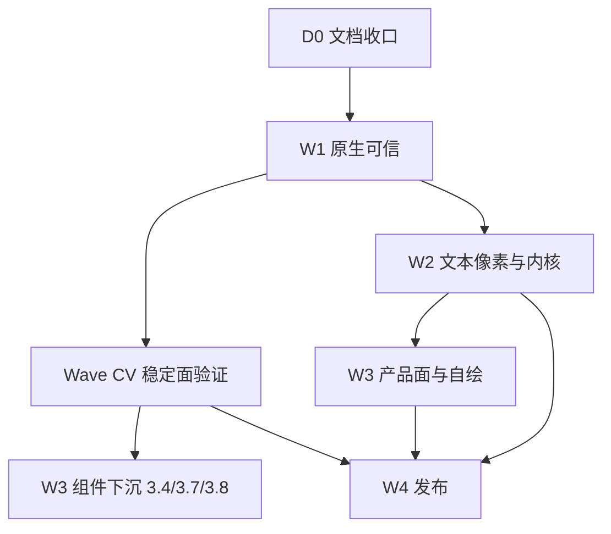

# RUI 权威入口与统一计划（巩固期）

> **文档地位**：巩固期**唯一入口**与**唯一执行源**（勾选、排期、DoD、禁区摘要）。  
> **日期**：2026-08-12；**W2 退出 / 进入 W3**：2026-08-13  
> **前提**：阶段一～十二 MVP 已落地；底座锁定（ADR-1～9）。本文**不**新开架构分叉。

读本文即可知道：现在做到哪、下一步做什么、争议找哪份规范。  
三份领域规范仍写「是什么」；三份旧计划降为**冻结展开**，不再各自勾选。

---

## 0. 为何改造

巩固期曾并列三套「权威 + 计划」：

| 域 | 规范（是什么） | 计划（做什么） |
|----|----------------|----------------|
| 工程化 | `ENGINEERING_GRADE_FRAMEWORK.md` | `ENGINEERING_IMPLEMENTATION_PLAN.md` |
| 组件 | `COMPONENT_LIBRARY.md` | `COMPONENT_LIBRARY_PLAN.md` |
| 响应式 | `REACTIVITY.md` | `REACTIVITY_PLAN.md` |

另有跨层契约 `element_identity.md`、分桶表 `component_inventory.md`。每份都自带「文档拓扑」和勾选表，结果是：

1. **六个入口**：README / PROJECT / 各文 §拓扑 互相指向，不知从哪读起。  
2. **三套 WP 编号**（`WP-*` / `C-WP-*` / `R-WP-*`）描述同一件事（焦点、a11y、Owner、golden、Gallery、SemVer），双清单互掐。  
3. **门禁分散**：工程说 W2.4 才算「可预测」；组件说未过 CV 不准 C1；响应式说硬化不挡发布——没有一张表说清**谁挡 Beta、谁可并行**。  
4. **身份债横切三域**（`id` / `focus_id` / `template_id` / 信号键），却拆在三份计划里分期，顺序靠「对齐」段落维持。

**改造原则**：规范可分域；**计划必须合一**。领域争议回规范，执行争议只改本文。

---

## 1. 文档治理（谁说了算）

### 1.1 层级

```text
AUTHORITY.md                         ★ 唯一入口 + 唯一勾选源（本文）
│
├─ 领域规范（只写「是什么 / 禁区」，不写排期）
│   ENGINEERING_GRADE_FRAMEWORK.md   工程门槛 · ADR · 锁定栈
│   COMPONENT_LIBRARY.md             组件产品面 · 双书写 · API 契约
│   REACTIVITY.md                    细粒度模型 · 三档更新 · 缺口事实
│   element_identity.md              身份四轴（跨组件 / 宏 / 运行时）
│   drawing.md                       Svg / Canvas / 2D·3D 公开自绘面
│
├─ 数据表（随代码改，不另开计划）
│   component_inventory.md           分桶 + id 策略 + planned
│
├─ 操作手册（验收步骤，不是第二套 WP）
│   desktop_smoke · a11y_smoke · ime · keyboard_nav
│   reactivity_and_hot_reload · headless · custom_components
│   color · font* · damage · layout_subtree · text_align · box_model
│   drawing（自绘面规范，亦作手册入口）
│   glyphon_audit · PUBLISH · size_and_memory · multi_window · tray
│
└─ 非执行源
    三份 *_PLAN.md                   冻结展开（历史 WP 细则；勾选作废）
    gap_analysis · STAGE7_ROADMAP · PROJECT · REFERENCE_COMPARISON
    archive/ · rui.md · bugs.md · site/README
```

### 1.2 争议路由

| 问题类型 | 权威 | 禁止 |
|----------|------|------|
| 要不要换 VDOM / 弃 wgpu / 废 Builder | 纲领 ADR + 本文 §3 | 在组件 PR 里静默改哲学 |
| 默认交付面 = shadcn？双书写？ | `COMPONENT_LIBRARY.md` | 另起纯无头产品包 |
| 这次 `set` 触发什么？Store/Resource 语义；何为完整细粒度；是否超过 Floem / 逼近 Solid | `REACTIVITY.md`（§0.1 / §5.7 / **§5.9 记分牌**） | 以「追平 Solid API 面 / SSR」或 Dioxus 组件级 diff 替代机制目标 |
| `<svg>` / `<canvas>` / 2D·3D 怎么画 | [`drawing.md`](drawing.md) | HTML-in-canvas、换 Skia 主线、完整 SVG/Canvas2D 规范 |
| `id` 是不是 focus / template / 信号键 | `element_identity.md` | 三轴混用；空串当身份 |
| 自定义 / 复合控件心智负担是产品还是框架？ | `COMPONENT_LIBRARY.md` **§2.3**；手册 [`custom_components.md`](custom_components.md) | 在每个选器里发明第二套 Owner / `untrack` / 浮层配方 |
| 这周做什么、是否升 Beta | **本文** | 在三份旧计划里改勾选充进度 |
| 某组件 verified / broken | `component_inventory.md`（回写规范 §5.2.1） | 只改 Gallery 文案 |

### 1.3 旧计划处置

| 文件 | 即日起 | 后续（可选） |
|------|--------|----------------|
| `ENGINEERING_IMPLEMENTATION_PLAN.md` | 文首标明「展开附录；勾选以本文为准」 | 正文吸收完毕后迁 `archive/` |
| `COMPONENT_LIBRARY_PLAN.md` | 同上；**CV 门禁并入本文 Wave CV** | 同上 |
| `REACTIVITY_PLAN.md` | 同上；R-WP 映射为本文 WP 别名 | 同上 |

旧编号（`C-WP-*` / `R-WP-*`）仅作别名，见 §5.0。手册里已写的 `WP-1.1` 等**保持不变**。

---

## 2. 一句话结论

RUI 底座已验证：**Solid 式细粒度 + 保留 Element/taffy 树 + `winit/wgpu/taffy/glyphon` + shadcn 产品面 / `ui!`↔Builder 双轨**。  
巩固期不是再选哲学，而是把**原生可信、文本/像素、反应性卫生、组件信任度、发布契约**收成可承诺的 SemVer 面。

| 维度 | 现状（2026-08-12） | 工程级 |
|------|---------------------|--------|
| 代码 | `crates/` ≈ 5.3 万行；`components/` ≈ 45 模块 | 稳定面文档化；破坏性可追踪 |
| 原生 | Win 冒烟 #1–#9 已签；macOS/Linux 未签 | 三平台签署 |
| 文本/像素 | **W2 已退出（2026-08-13）**：测宽 ☑；damage ☑；golden×5 ☑；盒模型 WP-2.9 ☑ | 细粒度 damage 默认；glyph 级 golden 可加深 |
| 反应性 | API 主路径齐；WP-2.4 / 2.7 ☑；**战略：超过 Floem、逼近 Solid 机制**（§5.9）；主缺口 I-7 For 项级 → I-11 Index → I-8 Store 路径 → I-12 effect 分相 | 纯度超 Floem 可宣称（I-7 绿）；逼近 Solid 须 I-8/11/12 + G8；**不挡** Win-first 0.1 |
| 组件 | Gallery 八分区 ☑；**WP-CV.0–.4 ☑ · CV 已退出（2026-08-13）**；golden → WP-2.6 | 分桶 + 测/冒烟；未过 CV 不做 C1 大重构 |
| 发布 | `PUBLISH.md` 齐；无 CHANGELOG；未 crates.io | `cargo add rui` + 文档站 |

---

## 3. 锁定决策与禁区（摘要）

展开见纲领 §2 / §8。此处只列**不可再分叉**项。

| ID | 决策 |
|----|------|
| ADR-1 | 细粒度 Signal，不采用 VDOM |
| ADR-2 | 保留 Element + taffy `NodeId` |
| ADR-3 | 图形主线 wgpu；Windows 默认优先 GL 以降内存；**公开自绘面 = Svg/Canvas/Scene 叶，不另开渲染器**（[`drawing.md`](drawing.md)） |
| ADR-4 | 布局固定 taffy；文本 measure 对齐 Pretext 思想 |
| ADR-5 | utility + 变体，单一 `rui_style_tokens` |
| ADR-6 | 组件 = shadcn 产品面 + headless 骨架 |
| ADR-7 | 热重载基于 `template_id`；`template_id` ≠ 焦点/a11y 主键 |
| ADR-8 | 工程级以原生+发布为准，不以 Solid API 百分百对齐为准 |
| ADR-9 | `ui!` 与 Builder **双书写面**一等公民，禁止只留其一 |

**巩固期明确不做**：换 VDOM / EUI DSL / 弃 wgpu；Solid DOM/SSR/hydration；移动/鸿蒙一等公民；完整 CSSOM；平行「纯 Radix 组件包」；未过 CV 对全量组件做行为大重构；无验收大重构；DevTools（Backlog）。

**细粒度战略**（展开 `REACTIVITY.md` §0.1 / §5.9）：**超过 Floem 纯度、逼近 SolidJS 机制**（非 DOM/SSR/API 名）。I-1…I-6 已齐；**超 Floem 决胜 = WP-R.5b（I-7）**；逼近 Solid = 5c Index + WP-R.3B Store 路径 + WP-R.9 effect 分相 + G8。ADR-8 仍禁止用 Solid 百分百 API 替代发布门槛。

**三档更新**（开发者红线，展开 `REACTIVITY.md` §3）：

| 档 | API | 禁止 |
|----|-----|------|
| 属性 | `bind_*` | 根 `app_builder` 裸 `get()` 订整树 |
| 结构 | Show / For / `switch_reactive` / `reactive!` | 用结构岛表达纯文本闪烁 |
| 高频 chrome | `ReactiveSync` / peek | effect 风暴驱动 paint |

---

## 4. 三域边界（不互相吞并）

| 域 | 规范管 | 计划（本文）管 | 不管 |
|----|--------|----------------|------|
| **工程** | 六门槛、栈、发布叙事、质量门命令；自绘面纪律 [`drawing.md`](drawing.md) | W1 冒烟、**W2 已退出**、W3 产品+Svg/Canvas、W4 crates.io | 单个组件 variant 名 |
| **组件** | 分层、双书写、受控 API、清单、质量门模板 | CV 走查（仅 `components/` 控件）、行为下沉、Gallery 覆盖 | 重写 Signal 内核；Theme/utility SemVer |
| **响应式** | §0.1 战略、§5.9 记分牌、§5.7 不变量、缺口 G1–G10 | WP-R.5a/b/c、R.3B、R.9、R.7 | 浮层 placement、chrome 色值；换 `reactive_graph` / VDOM / 抄 Solid DOM |
| **身份**（横切） | 四轴不变量 I-1… | 审计 + 空串收敛 + scoped API（并入 WP-2.4 / CV） | 当「第四套计划」 |

组件受控 Signal 的**语义**以反应性规范为准；**暴露面**（`*_signal` / 非受控键）以组件规范为准；**键的生命周期**以身份契约 + WP-2.4 为准。

---

## 5. 统一执行计划

### 5.0 编号规则

- **勾选只在本节。** 旧 `C-WP-*` / `R-WP-*` 是别名，便于对照冻结计划。  
- 已有手册引用的 `WP-1.1`…`WP-4.7` **不改号**。  
- 新增包接在所属 Wave 末尾（`WP-2.7`、`WP-CV.*`、`WP-3.8`…）。



| 波次 | 主题 | 挡 Beta？ | 建议工期* |
|------|------|-----------|-----------|
| **D0** | 文档治理（本文） | 否（但挡「再开第七套权威」） | 本次 |
| **W1** | 原生：IME / 焦点 / a11y / 三平台冒烟 | Win 已退出；**三平台列挡 Beta** | 补签 1 周级 |
| **CV** | 稳定面走查 + 身份审计 + 最小测网 | **挡组件大重构**；不单独挡 0.1 Win-first | 1–2 周 |
| **W2** | 文本已签；Owner/Store；golden；**盒模型收口** | **已退出（2026-08-13）** 2.1–2.9 ☑；2.9 不挡 Beta | 2–3 周 |
| **W3** | Gallery / Chart / 选器 / 外壳；**Svg/Canvas 自绘**；CV 后才下沉行为 | 分区已有；3.11/3.12 MVP 建议；3D/B16/B17 不挡 | 2–3 周 |
| **W4** | CHANGELOG / crates.io / 文档站 / CI | **挡 Beta** | 1–2 周 |

\*单人全职量级。每波结束：代码合入 + 测试绿 + **只改本文勾选** + 必要时改对应规范事实表。

### 5.1 D0 — 文档收口

| ID | 任务 | 状态 |
|----|------|------|
| **D0.1** | 本文落地；根 README / `docs/` 入口改指本文 | ☑ 2026-08-12 |
| **D0.2** | 三份 `*_PLAN.md` 文首冻结声明；三规范「执行源」改指本文 | ☑ 2026-08-12 |
| **D0.3** | 手册与历史文（gap / STAGE7 / PROJECT / REFERENCE / identity）改链 | ☑ 2026-08-12 |
| **D0.4** | （可选）吸收旧计划正文后迁 `archive/` | ☐ |

### 5.2 Wave 1 — 原生可信

**目标**：桌面主路径像系统控件。细则仍见冻结总计划 §3 与各手册。

| ID | 主题 | 别名 | 状态 |
|----|------|------|------|
| **WP-1.1** | IME 光标区与滚动 | — | ☑ Win #3/#4（中文）；☐ 日/韩可选 |
| **WP-1.2** | 焦点环 / Tab / roving / Esc 顶层 | C-WP-1.3 | ☑ Win #5–#7；库测绿 |
| **WP-1.3** | AccessKit 主路径（桥 + 读屏） | C-WP-1.4 桥侧 | ☑ Win Narrator #9；组件身份仍 → CV / WP-2.4 |
| **WP-1.4** | 三平台真窗口冒烟 | — | ☑ Win #1–#9；☐ **macOS / Linux** |

**W1 开发机（Win）已退出**（2026-08-10）。升 Beta 前补齐 macOS/Linux 列。

### 5.3 Wave CV — 稳定面验证（原组件门禁）

**目标**：把「Gallery 能演示」变成「敢承诺」的最小**控件**集合。  
**CV 范围**：仅 `components/` 产品控件（Gallery 分区 + inventory §1.1–1.7）。**不含** Theme / utility（样式承诺面，见 inventory §1.8）、Form helpers（Context，已降 `experimental`）。  
**硬规则：未过 CV 不得开 WP-3.4 / 3.7 / 3.8 行为与 API 大重构。**  
broken 修不好 → 降出稳定面，禁止假装 `verified`。

| ID | 主题 | 别名 | 状态 |
|----|------|------|------|
| **WP-CV.0** | 分桶清单 + prelude 双书写 | C-WP-0.2 / 0.3 | ☑ inventory + `rui::prelude` |
| **WP-CV.1** | 稳定候选 Gallery / 手工走查 | C-WP-V.1 | ☑ 2026-08-12；§5.2.1 行为控件走查完成；Form 降出稳定面 |
| **WP-CV.2** | 最小自动化网（Button/Input/Dialog/Tabs/Checkbox\|Switch 布局或行为） | C-WP-V.2 | ☑ 2026-08-12；`crate_tests/components/cv_stable_layout.rs` 矩阵 8 测 |
| **WP-CV.3** | P0 修障或降级 | C-WP-V.3 | ☑ 2026-08-12；inventory 稳定面文档手工复核修错；`broken` = 无；无未分类 P0 |
| **WP-CV.4** | `id` 过度使用审计（分类表） | C-WP-V.5 | ☑ 2026-08-12；inventory §2.1；稳定面空串 I-1 已修（`resolve_instance_id`） |
| **WP-CV.5** | 核心 golden 骨架 | C-WP-V.4 | ⏭ **并入 WP-2.6**（2026-08-13；不单独阻塞 CV） |

**CV 已退出**（2026-08-13）。退出条件 = 下表四项 + CV.0–CV.4；**CV.5 不挡退出**，视觉 golden 交给 WP-2.6（挡 Beta / 「宣称视觉稳定」）。

**CV 退出（进入组件下沉前）**

- [x] §5.2.1 **行为控件**已标 `verified`（Gallery 走查 ☑ 2026-08-12）；Form → `experimental`（非控件）  
- [x] 行为控件无未分类 P0（CV.3 ☑ 2026-08-12；inventory §2 `broken` = 无）  
- [x] Button · Input · Dialog · Tabs · Checkbox|Switch 有 layout/行为测 **或** 冒烟勾选（CV.2 ☑ 2026-08-12）  
- [x] 行为控件 id 策略已按身份契约分类；空串不写入 `focus_id`/`template_id`（CV.4 ☑ 2026-08-12）  

分桶真源：[`component_inventory.md`](component_inventory.md) §2（控件）。  
**当前 `verified`（控件）**：Button、Label、Separator、Card、Input、Textarea、Checkbox、Switch、RadioGroup、Slider、Select、Combobox、Dialog、Toast、Tooltip、Tabs、ScrollArea、Scrollbar。  
**Form**：降出 §5.2.1（Context helpers → `experimental`）；加深见 WP-3.9。  
**CV.2 核心矩阵**（2026-08-12）：Button/Input/Dialog/Tabs/Checkbox/Switch — `cv_*` layout + Checkbox/Switch 行为测；见 `crate_tests/components/cv_stable_layout.rs`。  
**CV.3**（2026-08-12）：稳定面 inventory 文档手工验证修错后签署；无未分类 P0，不降级。  
**CV.4**（2026-08-12）：稳定面 id 分类表 → inventory §2.1；空串 I-1 修 → `utils/instance_id::resolve_instance_id`；API 去必填 / Gallery 减噪 → **WP-2.8 ☑**。  
**CV.5**：不单独开工；golden 五场景 → **WP-2.6**。  
**样式承诺面**（Theme / utility）：非控件、不进 CV；SemVer 与验收见 inventory §1.8、规范 §5.2.2、WP-2.9 / [`color.md`](color.md)。

### 5.4 Wave 2 — 文本、像素与内核硬化

**目标**：测宽≡绘制可测；damage 默认策略；Owner/ID 不泄漏；golden 可扩展。

| ID | 主题 | 别名 | 状态 |
|----|------|------|------|
| **WP-2.1** | 测宽与 glyphon 分行对齐 | — | ☑ |
| **WP-2.2** | 细粒度 damage 策略可测 | — | ☑（GPU PartialLoad = B8，不挡） |
| **WP-2.3** | 子树布局上溢升父 | — | ☑ |
| **WP-2.4** | Anchors/Bindings 挂 Owner + scoped ID | R-WP-1；消费方 C-WP-2.6 | ☑ 2026-08-13；`registry_owner` 测 + `scoped_template_id`/`scoped_focus_id`；Gallery「布局 → WP-2.4」 |
| **WP-2.5** | Store produce + Resource→EB 契约 | R-WP-4 测 | ☑ 2026-08-13；`produce` 切片测 + `throw_resource_error` e2e + `docs/CHANGELOG.md`；Gallery「布局 → WP-2.5」 |
| **WP-2.6** | 组件 golden 五场景 | C-WP-3.3 | ☑ 2026-08-13；Button/Input/Dialog/Tabs/ScrollArea；`golden_component_*` + `tests/golden/golden_*.rgba` |
| **WP-2.7** | 双路径 / 根裸 `get()` 可观测 | R-WP-2 | ☑ 2026-08-13；建议进 Beta；0.1 Win-first 可注明已知限制 |
| **WP-2.8** | 身份 API 收敛（展示型去必填；空串；试点 scoped） | C-WP-2.6 | ☑ 2026-08-13；前置 CV.4 ☑；框架能力来自 2.4 |
| **WP-2.9** | 类 CSS 盒模型完善（文档 / utility / 测宽叶纪律 / 命中测） | — | ☑ 2026-08-13；**不挡 Beta**；细则 [`box_model.md`](box_model.md) |

WP-2.4 任务要点（已签）：注册表随 Owner dispose（Anchors + Bindings + COMPONENT_*）；`scoped_template_id` / `scoped_focus_id`；长会话无膨胀测 `crate_tests/reactive/registry_owner.rs`；Gallery「布局 → WP-2.4」。文档：`reactivity_and_hot_reload.md` + `element_identity.md` §7。细则见冻结 [`REACTIVITY_PLAN.md`](REACTIVITY_PLAN.md) R-WP-1。

WP-2.5 任务要点（已签）：`Store::produce` ≡ `update` + 切片 `PartialEq` 契约测；Resource Err→EB 经**显式** `throw_resource_error`（巩固期不自动桥）；`docs/CHANGELOG.md` 实验面草案；Gallery「布局 → WP-2.5」。细则见 R-WP-4。

#### WP-2.4 验收（可判定）

| 层级 | 命令 / 操作 | 通过标准 | 失败标准 |
|------|-------------|----------|----------|
| **A 库测（权威，必须）** | `cargo test -p rui --lib registry_owner` | `2 passed`：`owner_dispose_clears_anchor_binding_and_component_props` + `registry_does_not_grow_across_repeated_owner_cycles` | 任一 `FAILED` |
| **A′ scoped id 测** | `cargo test -p rui --lib scoped_template_and_focus` | `1 passed`；两 root 下同名 local 生成不同字符串，且含 `::tpl:` / `::focus:` | 断言失败 |
| **B Gallery（建议）** | `cargo run -p gallery` → 侧栏「布局」→ 卡片「WP-2.4)」 | 见下「B 逐步」 | 卸载后 a/b/p **高于**基线；或 scoped 行缺少 `::tpl:`/`::focus:` |

**B 逐步（Gallery）**

1. 若结构岛已显示 → 点 **「卸载岛」**。  
2. 点 **「刷新当前」**，再点 **「记当前为卸载基线」**（仅卸载态有效；挂载态点了不会写入基线）。  
3. **「挂载岛」** → **「刷新当前」** → `当前 a` 应 **≥ 基线 a + 1**。  
4. **「卸载岛」** → **「刷新当前」** → `当前 a/b/p` 均 **≤** 对应基线（等于通过；任一更高 = 泄漏失败）。卡片状态行会显示「通过 / 失败」。  
5. 重复挂载/卸载至 **cycles ≥ 10**，最后停在卸载态并刷新 → 仍须 **≤ 基线**，且状态为「手工判定: 通过」。  
6. 挂载态下两行须含 `::tpl:gal_wp24_isle` 与 `::focus:gal_wp24_btn`（前缀为 owner path）。

**签署规则**：A（+A′）绿即可勾 WP-2.4；B 用于人工抽查与回归演示，不替代库测。

#### WP-2.5 验收（可判定）

| 层级 | 命令 / 操作 | 通过标准 | 失败标准 |
|------|-------------|----------|----------|
| **A produce（权威）** | `cargo test -p rui --lib produce_notifies` | `produce_notifies_select_only_when_slice_changes` passed | `FAILED` |
| **A′ Err→EB（权威）** | `cargo test -p rui --lib resource_err_to_error_boundary` | `resource_err_to_error_boundary_via_throw_resource_error` passed | `FAILED` |
| **A″ create_resource（权威）** | `cargo test -p rui --lib create_resource_err_sets` | `create_resource_err_sets_state_and_bridges_to_eb` passed | `FAILED` |
| **A‴ 实验面草稿** | 打开 `docs/CHANGELOG.md` | 含 Store / Resource / `throw_resource_error` 实验表 | 缺条目 |
| **B Gallery（建议）** | `cargo run -p gallery` →「布局」→「WP-2.5)」 | 见下「B 逐步」 | ticks 误增；或注入 Err 无 fallback |

**B 逐步（Gallery）**

1. **B1 produce**：记下 `name_ticks` / `age_ticks` →「age+1」仅 age +1 →「改名」仅 name +1 →「同值再 set」两 ticks 不变，且 note 为「未通知（符合契约）」。  
2. **B2 Err→EB**：框内初始 `children ok`；旁路行 `resource=` 同步。→「注入 Err」框内 `fallback: gallery boom` 且旁路为 `Err(...)` →「复位 Ready」回到 `children ok` / `Ready(1)`。

**签署规则**：A+A′+A″ 绿且 CHANGELOG 草案在即可勾 WP-2.5；B 不替代库测。巩固期 Err→EB **显式**桥，不承诺自动桥。

WP-2.6 任务要点（已签）：稳定面五场景像素 golden（**Button / Input / Dialog / Tabs / ScrollArea**）；离屏 harness（LayoutTree→`RuiPipeline`→readback，chrome-only）；`RUI_UPDATE_GOLDEN=1` 重录。VirtualList / Markdown **不**进本门禁（非 verified）。

#### WP-2.6 验收（可判定）

| 层级 | 命令 / 操作 | 通过标准 | 失败标准 |
|------|-------------|----------|----------|
| **A 组件 golden（权威）** | `RUI_FORCE_SOFTWARE=1 cargo test -p rui --lib golden_component -- --test-threads=1`（Win 加 `--features backend-dx12`） | 五测 passed：`button` / `input` / `dialog` / `tabs` / `scroll_area` | 任一 `FAILED` / mismatch |
| **A′ 既有 offscreen** | `cargo test -p rui --lib offscreen` | clear + stage8 等既有测绿 | `FAILED` |
| **A″ fixtures** | `crates/rui/tests/golden/golden_*.rgba` | ≥5 场景 fixture：`golden_button_default` 等 | 缺文件 |
| **重录** | `RUI_UPDATE_GOLDEN=1` + 同上 A 命令 | 写入/更新 `.rgba`；PR 勿混无关重录 | — |

**签署规则**：A+A′+A″ 绿即可勾 WP-2.6；名单以稳定面为准，禁止把 experimental 写回 Beta 门禁。

WP-2.7 任务要点（已签）：lifecycle `mark_next_effect_as_ui_root`；诊断钩子 `ui_root_effect_dep_count` / `root_bare_get_count`；debug 构建根订阅非空时 warn 一次；库测 `crate_tests/reactive/root_bare_get.rs`；Gallery「布局 → WP-2.7」。细则见冻结 [`REACTIVITY_PLAN.md`](REACTIVITY_PLAN.md) R-WP-2。

#### WP-2.7 验收（可判定）

| 层级 | 命令 / 操作 | 通过标准 | 失败标准 |
|------|-------------|----------|----------|
| **A 库测（权威）** | `cargo test -p rui --lib root_bare_get` | `3 passed`：裸 get 可观测 + bind + Show 根 dep=0 | 任一 `FAILED` |
| **A′ 诊断 API** | 文档 / rustdoc：`mark_next_effect_as_ui_root` · `ui_root_effect_dep_count` | 公开可调用 | 缺 API |
| **B Gallery（建议）** | `cargo run -p gallery` →「布局」→「WP-2.7)」 | 见下「B 逐步」 | 对照基线失败（root_deps 抬高） |

**B 逐步（Gallery）**

1. 「刷新根 dep」→「记为基线」（记下 `ui_root_effect_dep_count`；卫生 Gallery 多为 0）。  
2. **B1 bind**：点「文案 +1」数次 → 文案应变。  
3. **B2 Show**：点「卸载/挂载面板」切换结构岛。  
4. 「对照基线」→ `root_deps` **不得高于**基线（本卡操作不新增根订阅）。  

**签署规则**：A 绿即可勾 WP-2.7；B 用于人工抽查与回归演示，不替代库测。不消除双路径（bind vs 结构岛仍为设计）。

WP-2.8 任务要点（已签）：展示型 `navbar()` / `bar_chart()` / `line_chart()` / `progress()` 去必填 id；空串不写 `Some("")`（Progress/Toggle → `resolve_instance_id`）；Toggle 非受控 `use_scoped_signal` 试点；Gallery 减噪 +「布局 → WP-2.8」。细则见冻结 [`COMPONENT_LIBRARY_PLAN.md`](COMPONENT_LIBRARY_PLAN.md) C-WP-2.6。

#### WP-2.8 验收（可判定）

| 层级 | 命令 / 操作 | 通过标准 | 失败标准 |
|------|-------------|----------|----------|
| **A 展示型（权威）** | `cargo test -p rui --lib navbar_without_id`；`bar_chart_without_id` | 无 `template_id` / 非 `Some("")` | `FAILED` |
| **A′ Toggle 试点** | `cargo test -p rui --lib toggle_empty_id`；`toggle_uncontrolled_uses_scoped` | 空 id 非空 focus/template；跨 Owner 独立 | `FAILED` |
| **B Gallery（建议）** | `cargo run -p gallery` →「布局」→「WP-2.8)」 | Navbar/Chart/Progress/Toggle 无手写 `gal-*`；Toggle 可点 | 仍强制堆展示型 id |

**签署规则**：A+A′ 绿即可勾 WP-2.8；B 不替代库测。

#### WP-2.9 盒模型完善（展开）

**目标**：把「Taffy + BorderBox 默认 + 百分比 content-box」收成可承诺、可测、可写 utility 的契约；**不**追求完整 CSSOM。

| 子项 | 任务 | 映射 [`box_model.md`](box_model.md) | 状态 |
|------|------|--------------------------------------|------|
| **2.9.1** | 手册落地；纲领/文档站/README 互链；Gallery「布局」区链到契约摘要 | BM1 | ☑ 手册 2026-08-12；入口链 + Gallery「WP-2.9)」2026-08-13 |
| **2.9.2** | Builder `.border_box()` + utility `box-border` / `box-content`（`rui_style_tokens` + 宏映射） | BM2 | ☑ |
| **2.9.3** | 稳定面「单节点文案 + padding」审计：该 ContentBox 的改 ContentBox 或拆叶；表进 inventory 或本手册附录 | BM3 | ☑ [`box_model.md`](box_model.md) 附录 A |
| **2.9.4** | 库测：outline 不扩大 hit；overflow+padding 裁剪边；（回归）percent_content_box 保持绿 | BM7 | ☑ `box_model_contract` + `percent_content_box` |
| **2.9.5** | `em` 语义：文档标明「现相对根 16px」；可选试点「相对本节点 font-size」并加测 | BM4 | ☑ 局部 em（`CssDim` + `text_style.size`）；`IntoDimension`/`IntoF32` 仍根 16px |
| **2.9.6** | （P2）分边 border API + 绘制 | BM6 | ☑ 2026-08-13 **B15** |
| **2.9.7** | （P2）视口单位：文档诚实写清「布局根 Percent」；真 `vw`/`vh` 另议 | BM5 | ☑ 真视口（`LayoutTree.viewport` + `to_taffy_style_with`） |

**退出**：2.9.1–2.9.7 ☑（含分边 border）。  
**禁区**：换 Taffy；outline/shadow 进布局；块级 margin collapse。

WP-2.9 任务要点（已签）：`.border_box()` + `box-border`/`box-content`；测宽叶审计表（Tabs=ContentBox，Button/Input 等拆叶）；命中/裁剪库测；局部 `em` + 真视口 `vw`/`vh`/`dvh` + `calc`；分边 `border-left` 等（B15）。Gallery「布局 → WP-2.9 / B15」。细则 [`box_model.md`](box_model.md)。

#### WP-2.9 验收（可判定）

| 层级 | 命令 / 操作 | 通过标准 | 失败标准 |
|------|-------------|----------|----------|
| **A 盒模型测（权威）** | `cargo test -p rui --lib box_model_contract` | BorderBox/ContentBox 外缘；outline 不扩 hit；border 可点；overflow+padding clip=父 border-box | 任一 `FAILED` |
| **A′ 百分比回归** | `cargo test -p rui --lib percent_content_box` | 全绿（含 `percent_width_is_parent_content_box_not_border_box`） | `FAILED` |
| **A″ em / 视口** | `cargo test -p rui --lib em_resolves_against_root`；`box_model_contract` 中 vw/em/calc | `IntoDimension` 的 `1em` ≡ 根 16px；布局期局部 em + 真 vw/vh/dvh + calc | `FAILED` |
| **A‴ utility** | `cargo test -p rui_style_tokens`；`cargo test -p rui --lib apply_box_sizing_utilities` | `box-border`/`box-content` 已知并写入 `box_sizing` | 未知类 / 未改 sizing |
| **B Gallery（建议）** | `cargo run -p gallery` →「布局」→「WP-2.9 / B15)」 | `box-content` 明显宽于 `box-border`；洋葱图四边异色；点描边内侧 +1、点 outline 外扩不加 | 两盒同宽；分边同色同宽；点红描边也 +1 |

**签署规则**：A+A′+A″+A‴ 绿即可勾 WP-2.9；B 不替代库测。2.9.6 / B15 分边 border 已签。

**W2 已签署**：2.1–2.9。（2.9 不挡升 Beta。）

**W2 退出（2026-08-13）**：2.1–2.9 全部 ☑；进入 **Wave 3**。反应性加深（WP-R.*）仍与 W3 **并行**，不挡 W3 开工。

### 5.5 Wave 3 — 产品面、外壳与公开自绘

**目标**：Gallery 可作名片；关键键盘完整；外壳可演示；**引入 `<svg>` / `<canvas>` 与 2D·3D 能力**（规范 [`drawing.md`](drawing.md)）。  
**3.4 / 3.7 / 3.8 仅 CV 通过后开工（CV 已 ☑）。**  
**当前焦点（3.2 / 3.3 / 3.4 / 3.5 / 3.14 已签）**：**3.11 · 3.12**；3.13 可交错；3.7 / 3.8 可消费默认 Owner；B16 / B17 不挡本波。

| ID | 主题 | 别名 | 状态 |
|----|------|------|------|
| **WP-3.1** | Gallery 八分区 | C-WP-3.1 | ☑ 侧栏；「每稳定面一入口」随 CV 复核 |
| **WP-3.2** | Path → Chart 加深（含 Pie）；与 3.11 **共用 path 核** | — | ☑ 2026-08-13 path 光栅 + 预设；grammar：`define_chart` + cartesian/polar + log/time + tooltip/crosshair |
| **WP-3.3** | Date/Time/Color + Command 键盘 | C-WP-3.2 | ☑ 2026-08-17；Calendar 抽出；Date/Time/Color 键盘+ISO；Command ↑↓/Enter；作者面 → **3.14 ☑** |
| **WP-3.4** | 浮层单一路径（popup / Dialog 壳 / Esc） | C-WP-1.1；总计划 3.4 | ☑ 2026-08-17；`mount_anchored_overlay` / `mount_viewport_portal_stage`；禁第二套 portal |
| **WP-3.5** | Router + 次窗 Gallery 演示 | — | ☑ 2026-08-17；导航区外壳卡；次窗键不进主窗 |
| **WP-3.6** | 系统托盘原生接线（feature） | — | ☐ 挡发布则可标 stub |
| **WP-3.7** | Toggle/Checkbox/Switch 共享状态原语 | C-WP-1.2 | ☐ **前置 CV ☑**；建议 3.14 默认 Owner 已落地 |
| **WP-3.8** | variant/size/token/受控 API 归一 + 双书写审计 | C-WP-2.1–2.3、2.5 | ☐ **前置 CV ☑**；仅 `verified`；指南正文在 **3.14.3** |
| **WP-3.9** | Form 校验路径 | C-WP-3.4 | ☐ 前置 3.14 ☑；浮层路径 3.4 ☑ |
| **WP-3.10** | VirtualMasonry | 总计划 3.7 | ☐ **P2**；依赖 2.1（已满足）但不挡 Beta |
| **WP-3.11** | **`<svg>` 标签 + 矢量绘制**（场景图；描边/填充） | — | ☐ 规范 [`drawing.md`](drawing.md) §3；emoji-svg ≠ 公开 Svg |
| **WP-3.12** | **`<canvas>` 标签 + 画布自定义绘制**（paint / 2D context MVP） | — | ☐ [`drawing.md`](drawing.md) §4 |
| **WP-3.13** | **2D / 3D 能力层**（2D 合成纪律；`<scene3d>` 实验 feature；原 B6 矩阵并入） | — | ☐ [`drawing.md`](drawing.md) §5；**3D 不挡 W3 退出** |
| **WP-3.14** | **复合控件作者面**（默认实例 Owner；`untrack`/`isolate_reads` 纪律；cookbook） | C-WP-2.4 部分 | ☑ 2026-08-17；`#[component]`→`component_root`；测 `component_authoring`；诊断 [`COMPONENT_LIBRARY.md`](COMPONENT_LIBRARY.md) §2.3 |

#### WP-3.11 / 3.12 / 3.13 验收（可判定 · 进入 W3 前已写清）

| ID | A 库测 / API | B Gallery（建议） | 失败 |
|----|----------------|-------------------|------|
| **3.11 Svg MVP** | `ui!`+Builder 各建一叶；`viewBox`+至少 `circle`/`path`；叶 `layout_bounds` 正确 | 「数据」或新「绘制」区：圆+path 可见描边/填充 | 仅 attr stub 无像素；与 Chart 第二套 path 格式 |
| **3.12 Canvas MVP** | `paint` 回调可 `fill_rect`/`stroke`；resize → LayoutChanged；回调内 `peek` 不抬根 dep | 拖线或时钟自绘 | 每帧重建整棵 UI；订根 effect |
| **3.13 2D** | 变换/clip 有测或与 3.12 同页 | 可见 rotate/clip | 换 Skia 主线 |
| **3.13 3D MVP** | feature 关闭时默认构建绿；开启时一 mesh/立方 | 可选演示页 | 默认 feature 塞 glTF 全家桶 |

**签署**：3.11/3.12 A 绿即可勾；3.13 2D 建议随 3.12；3D 可标 experimental。细则 [`drawing.md`](drawing.md)。

WP-3.3 任务要点（已签）：独立 `Calendar`（`caption_layout`、ISO、方向键）；Date/TimePicker 复用 + Enter/Esc；ColorPicker HSV + hex/rgb/hsl；Command ↑↓/Enter；浮层 `floating_portal_anchor` + 嵌套 Popover/Select；TimePicker 三 Combobox。作者面 **WP-3.14 ☑**；浮层单一路径 **WP-3.4 ☑**。键盘表 [`keyboard_nav.md`](keyboard_nav.md)。

#### WP-3.14 复合控件作者面（进入 3.4 / 再扩复合控件前）

**诊断（W3 实证）**：WP-3.2 / 3.3 的心智负担**主要不是**日历算术或 HSV，而是框架**未把「组件实例」做成默认值**，复合控件作者必须同时做对 Owner、跟踪、浮层、身份四件事。展开 [`COMPONENT_LIBRARY.md`](COMPONENT_LIBRARY.md) §2.3。

| 子项 | 任务 | 状态 |
|------|------|------|
| **3.14.1** | `#[component]` **默认**实例 `component_root`（Solid 式执行域）；纯 Builder 根同一 helper | ☑ |
| **3.14.2** | 跟踪纪律可测：`isolate_reads` 注册 anchor，`untrack` 不注册；测升格 `crate_tests/reactive/component_authoring.rs` | ☑ |
| **3.14.3** | 手册 [`custom_components.md`](custom_components.md) 复合控件配方（Owner / 跟踪 / 浮层 / 实例信号） | ☑ |
| **3.14.4** | 与 **WP-3.4** 分界：本包未改 Dialog / placement 产品化 | ☑ |

**禁区**：换 VDOM；让 `#[component]` 默认整树 `get()` 重跑；把 Owner 默认做成 opt-in 而文档继续假装「组件即实例」。

#### WP-3.14 验收（可判定）

| 层级 | 命令 / 操作 | 通过标准 | 失败标准 |
|------|-------------|----------|----------|
| **A 宏默认 Owner** | 库测：`#[component]` 内两次 `provide_context` 的兄弟实例互不覆盖（对位 TimePicker 三 Combobox） | passed；**无需**在组件体手写 `with_child_owner` | 仍须手写才隔离；或破坏既有 Select/Combobox 测 |
| **A′ Builder helper** | 库测：非宏根调用同一 helper 亦隔离 | passed；rustdoc 有一句 | 只宏有、Builder 无 |
| **A″ 跟踪契约** | `cargo test -p rui --lib` 含 isolate vs untrack 注册 anchor | `untrack` 不注册、`isolate_reads` 注册 | 测只活在 `date_picker.rs` 且无公共说明 |
| **B 手册** | 打开 `custom_components.md` | 含四条红线 + 反例（`untrack` 空浮层、省略 Owner 串菜单） | 仍只有 Hello Button |

**签署规则**：A+A′+A″ 绿且手册 3.14.3 即可勾 WP-3.14（**已签 2026-08-17**）。**不挡** 3.11/3.12。

WP-3.14 任务要点（已签）：`#[component]` 包 [`component_root`](../crates/rui/src/core/reactivity.rs)；Builder 同 helper（`with_child_owner` 为别名）；库测 `crate_tests/reactive/component_authoring.rs`（宏兄弟 Context、Builder 根、untrack vs isolate_reads）；手册配方 [`custom_components.md`](custom_components.md)。未改 Dialog。

#### WP-3.4 浮层单一路径

**目标**：关闭「每控件自研 portal / 第二套坐标 sync」。几何仍只在 `utils/popup`；Esc 仍只在 `portal_overlay`。

| 子项 | 任务 | 状态 |
|------|------|------|
| **3.4.1** | 锚定浮层入口 [`mount_anchored_overlay`](../crates/rui/src/utils/popup.rs)（`mark_floating` + `panel_block_clicks` + 0×0 锚） | ☑ |
| **3.4.2** | 视口模态入口 [`mount_viewport_portal_stage`](../crates/rui/src/utils/popup.rs) + [`mount_modal_layer`](../crates/rui/src/utils/popup.rs)；舞台内只 `swallow_clicks` | ☑ |
| **3.4.3** | 存量迁入：Select / Combobox / Date / Color / Tooltip / 有锚 Popover / Dropdown / ContextMenu / Menubar；Dialog / Sheet / CommandOverlay 走视口舞台 | ☑ |
| **3.4.4** | Esc 顶层单测保持；Dropdown 关闭不占布局；Sheet 不嵌套 `rui_portal` | ☑ |

**标注例外（不是第二套 placement）**：无锚点 Popover（仅 portal 面板）；NavigationMenu `viewport` 槽（仍 `mark_floating`）；Toast pinned host；CommandOverlay chrome 为 top-1/3（舞台 helper 与 Dialog 相同）。焦点陷阱产品化仍归 **C-WP-1.3**（Tab 已约束在顶层 Stacked，见 [`keyboard_nav.md`](keyboard_nav.md)）。

#### WP-3.4 验收（可判定）

| 层级 | 命令 / 操作 | 通过标准 | 失败标准 |
|------|-------------|----------|----------|
| **A helper** | `cargo test -p rui --lib mount_anchored_overlay_is_zero_anchor`；`mount_viewport_stage_does_not_nest_portal` | passed | 调用点继续 `portal_panel` 当 flex 兄弟 |
| **A′ 存量** | `nested_portal_panel_is_the_old_sheet_bug`；`mount_viewport_stage_does_not_nest_portal`；Command overlay hoist 测仍绿 | passed | 视口舞台内再 `panel_block_clicks` |
| **B Esc** | `push_two_esc_closes_top_only`；`three_layers_esc_closes_top_only_each_time` | passed | Esc 关错层 |
| **C smoke** | [`desktop_smoke.md`](desktop_smoke.md) #6 Combobox、#7 Escape 顶层 | Win 已 ☑ 2026-08-09 | 新组件再发明 0×0 配方 |

**签署规则**：A+A′+B 绿即可勾 WP-3.4（**已签 2026-08-17**）。禁区：第二套 `left/top` sync；`panel_block_clicks` 再包 `portal_panel`；用 `untrack` 包浮层体（仍归 3.14 纪律）。

#### WP-3.5 Router + 次窗 Gallery 演示

| 子项 | 任务 | 状态 |
|------|------|------|
| **3.5.1** | Gallery **导航**区外壳卡：Inbox / Settings + Back / Forward（[`Router`](../crates/rui/src/app/router.rs)） | ☑ |
| **3.5.2** | 次窗独立树（不共用主窗 Router / Navigator id）；打开/关闭不拆主窗 | ☑ |
| **3.5.3** | 次窗 Keyboard / IME 不写入主窗焦点与 Esc 栈 | ☑ |
| **3.5.4** | [`multi_window.md`](multi_window.md) 主↔次协作图 | ☑ |

#### WP-3.5 验收（可判定）

| 层级 | 命令 / 操作 | 通过标准 | 失败标准 |
|------|-------------|----------|----------|
| **A 历史** | `cargo test -p rui --lib router_two_hops_back_reaches_start` | passed | 只能 navigate 不能 back |
| **A′ Gallery** | `cargo test -p gallery navigation_section_mounts_shell_router_view` | 导航区有 `gal_shell_router__router_view` | 仍只有 Navigator 卡 |
| **B 手工** | Gallery → 导航 → Inbox→Settings→Back；Open secondary 后主窗 Dialog/输入仍在 | 两页可回退；关次窗主窗存活（smoke #8） | 次窗按键关掉主窗浮层或打字进主窗 |

**签署规则**：A+A′ 绿即可勾 WP-3.5（**已签 2026-08-17**）。次窗完整 pointer / per-window overlay / `shared_slot` 见 [`multi_window.md`](multi_window.md)（2026-08-17 已接）。

**W3 退出（产品+外壳，不要求 3.13 3D / B16 / B17）**：Gallery 分区完整；Chart≥2 种真实绘制（3.2 ☑）；Date/Time/Color+Command 键盘（3.3 ☑）；作者面默认 Owner（3.14 ☑）；浮层单一路径（3.4 ☑）；Router 历史可演示（3.5 ☑）；托盘接线或 README 标 stub；**3.11 或 3.12 至少一项 MVP**。Toggle/API 归一仍是 **3.7 / 3.8**，故不可宣称「复合控件 API 已全部好写」。

### 5.6 Wave 4 — 发布与质量矩阵

| ID | 主题 | 别名 | 状态 |
|----|------|------|------|
| **WP-4.1** | SemVer 承诺面 + CHANGELOG | C-WP-4.1 | ☐ |
| **WP-4.2** | path 依赖 → crates.io 版本 | — | ☐ |
| **WP-4.3** | 首次 `cargo publish` | — | ☐ |
| **WP-4.4** | 文档站 Getting Started + 组件索引（双写法） | C-WP-4.2 | ☐ |
| **WP-4.5** | CI：golden≥5 + 既有门禁 | — | ☐ |
| **WP-4.6** | 体积/内存发布核对 | — | ☐ |
| **WP-4.7** | 对外叙事升 Beta | — | ☐ 依赖 §6 全勾 |

### 5.7 反应性加深（战略：超过 Floem、逼近 Solid；不挡 Win-first 0.1）

并入 W2 之后或与 W3 交错；勾选仍只在本表。顺序：**5 → 3 → 9 → 7**（见 `REACTIVITY.md` §0.1）。

| ID | 主题 | 别名 | 挡 Beta？ | 状态 |
|----|------|------|-----------|------|
| （见 2.4 / 2.5 / 2.7） | 门禁三项 | R-WP-1 / 4 / 2 | 2.6 是；2.7 建议 | 2.4 ☑；2.5 ☑；**2.7 ☑** |
| **WP-R.5** | 列表：**5a** keyed 插删换位测；**5b** 项级 For Owner（I-7，**超 Floem 决胜**）；**5c** 真 Index Accessor（I-11） | R-WP-5 | 否（0.1）；**挡「宣称超过 Floem」= 5b**；**挡「逼近 Solid」= 5b+5c** | ☐ |
| **WP-R.3** | Store **路径触发器**（选 B；兄变不重跑弟） | R-WP-3 | 否 · **P1**（逼近 Solid；不再默认冻结 A） | ☐ |
| **WP-R.9** | Effect 分相：Computed → `bind_*` → 用户 effect（I-12） | R-WP-9 | 否 · P1（逼近 Solid） | ☐ |
| **WP-R.7** | 宏降级漏绑 | R-WP-7 | 否 · **P1**（否则 5b 只写在纸上） | ☐ |
| **WP-R.6** | 热重载 × 反应槽不变量 | R-WP-6 | 否 | ☐ |
| **WP-R.8** | 信号图可观测（非 DevTools UI） | R-WP-8 | 否 · P2 | ☐ |

---

## 6. 升 Beta · Definition of Done

全部为真才可将对外叙事从 **Alpha / 工程级 MVP** 改为 **Beta / 工程可用**：

- [ ] `cargo publish` 三 crate 成功；干净环境最小窗口可跑（WP-4.3）  
- [ ] 文档站：Getting Started（含双写法）+ 更新契约 + 组件索引（WP-4.4）  
- [ ] 三平台真窗口冒烟 #1–#8（WP-1.4；**Win 已签**，macOS/Linux ☐）  
- [x] AccessKit 主路径可演示并有文档（WP-1.3）  
- [x] damage 策略可测（WP-2.2；GPU PartialLoad = B8）  
- [x] 测宽对齐测 + ≥5 组件 golden CI（WP-2.1 ☑，**WP-2.6 ☑ 2026-08-13**；WP-4.5 CI 矩阵仍可加深）  
- [x] WP-2.4：Owner 注册表无泄漏测（2026-08-13；`registry_owner`）  
- [ ] 开放 P0 = 0（冒烟列、crates、文档站、CHANGELOG）  
- [ ] README：SemVer 承诺面 / 实验面 + 状态 **Beta**（WP-4.1 / 4.7）  

组件库专项不另设第二套升 Beta 条件；稳定面表随 WP-4.1 冻结。未过 CV 的组件**不得**写入承诺面。

---

## 7. Backlog（Beta 后 / 明确延后）

| ID | 项 | 来源 |
|----|-----|------|
| B1 | DevTools（Signal 依赖图） | 工程 |
| B2 | `mergeProps` / `splitProps` / `children()` | 反应性 |
| B3 | backdrop-blur 离屏缓存 | 工程 |
| B4 | 移动 / 鸿蒙 `PlatformWindow` 实装 | 工程 |
| B5 | VirtualMasonry 产品化 | 工程 WP-3.10 / 组件 CB2 |
| B6 | 完整 3D/矩阵变换 | **并入 WP-3.13**（2026-08-13）；不再单列挡 W3 |
| B16 | **canvas-ui 式创意组件库**（Liquid/Glass/粒子/VHS… 包住子树） | 对照 [canvas-ui](https://github.com/DavidHDev/canvas-ui)；依赖 3.11–3.13；**不搬** HTML-in-canvas；不挡 W3/Beta；见 [`drawing.md`](drawing.md) §6.1 |
| B17 | **react-bits 式动效目录**（文字动效 / 背景 / 动画 UI） | 对照 [react-bits](https://github.com/DavidHDev/react-bits)；动画原语 + glyphon；背景/3D 跟 3.12/3.13；**不搬** CSS-in-JS / Framer / 每字 DOM span；不挡 W3/Beta；见 [`drawing.md`](drawing.md) §6.2 |
| B7 | 真窗口 CI | 工程 |
| B8 | GPU PartialLoad / retain 默认开 | 工程；见 `damage.md` |
| B9 | 完整 headless 公开模块 `rui::headless::*` | 组件 CB1 |
| B10 | 块级 markdown 编辑控件 | 组件 CB3 |
| B11 | 组件视觉回归（多 DPI / dark） | 组件 CB4 |
| B12 | 非默认 brand 主题包 | 组件 CB5 |
| B13 | 实验面批量升 verified | 组件 CB6；须走 CV 流程 |
| B14 | ShadCN planned P1（Badge/Avatar/Skeleton/…） | inventory §1.9；落地先 `experimental` |
| B15 | 盒模型加深：分边 border（`border-left` 等） | [`box_model.md`](box_model.md) BM6；☑ 2026-08-13 `border_width_sides` / `border_color_sides` + Taffy `Rect` + 非均匀四边条；`box_model_contract`；Gallery「WP-2.9 / B15」 |

---

## 8. 执行节奏（建议）

| 周 | 焦点 |
|----|------|
| 0 | D0（本文）；并行起草 WP-4.1 CHANGELOG 骨架 |
| 1–2 | **CV**（走查 + 最小测网 + 身份审计）∥ 启动 WP-2.4；macOS/Linux 冒烟可并行 |
| 3–4 | WP-2.4 / 2.5 / 2.6 / 2.7 / **2.9**（盒模型）；CV 收尾 |
| 5–6 | **W3**：**3.4 / 3.5 ☑**；**3.11 Svg / 3.12 Canvas**；3.7/3.8；3.13 2D 可跟 3.12；3.2/3.3/3.14 已签 |
| 7 | WP-4.2–4.6；冻结承诺面 |
| 8 | publish + 升 Beta |

原则：**一 WP 一 PR**（或与别名旧号同 PR，描述只点本文 ID）。  
**未过 CV 不开 3.4/3.7/3.8。** 修不好的稳定候选**降级**，不阻塞 Beta。

测试基线：

```text
cargo fmt --all -- --check
cargo clippy --workspace --all-targets --no-deps -- -D warnings
cargo test -p rui --lib
cargo test -p rui --lib offscreen
cargo check -p gallery
```

---

## 9. 旧编号对照（只读）

| 旧 ID | 并入 |
|-------|------|
| C-WP-0.1～0.3 | D0 + WP-CV.0 |
| C-WP-V.1～V.5 | WP-CV.1～.5（V.5 = CV.4） |
| C-WP-1.1 | WP-3.4 |
| C-WP-1.2 | WP-3.7 |
| C-WP-1.3 | WP-1.2 |
| C-WP-1.4 | WP-1.3（桥）+ CV / 2.8（组件身份） |
| C-WP-2.1～2.3 / 2.5 | WP-3.8 |
| C-WP-2.4 | WP-3.14.3（自定义组件指南） |
| C-WP-2.6 | WP-2.8 |
| C-WP-3.1 | WP-3.1 |
| C-WP-3.2 | WP-3.3 ☑ |
| C-WP-3.3 / V.4 | WP-2.6 |
| C-WP-3.4 | WP-3.9 |
| C-WP-4.1 / 4.2 / 4.3 | WP-4.1 / 4.4 / 4.2–4.3 |
| R-WP-1 | WP-2.4 |
| R-WP-2 | WP-2.7 |
| R-WP-3 | WP-R.3 |
| R-WP-4 | WP-2.5 |
| R-WP-5～8 | WP-R.5～.8 |
| R-WP-9 | WP-R.9（effect 分相） |

---

## 10. 工作约定

1. **新工作包**必须映射到纲领六门槛之一或规范缺口表，否则进 §7 Backlog。  
2. **改勾选只改本文**；改「何为正确」改对应规范。  
3. 稳定面变更必须有测或 smoke 条目；新 props 默认双入口（标签 + Builder）。  
4. 新浮层不接受长期第二套 placement。  
5. 身份：新 API 默认不把用户 `id` 设为必填；空串不得写入 `focus_id`/`template_id`。  
6. 对照代码只读 `Reference/`，禁止无 ADR 把 Leptos/Floem/EUI 内核粘进 `crates/rui`。  
7. **复合控件**：新开合/Context/浮层必须走已有 Owner helper + `mount_anchored_overlay` / `mount_viewport_portal_stage`；禁止在产品 PR 里再发明 `untrack` 包整棵面板、全局信号键或第二套 0×0 portal。Owner 纪律归 **WP-3.14 ☑**；浮层路径归 **WP-3.4 ☑**。

---

*本文随 WP 关闭而改勾选。架构否决项变更须显式 ADR，不得默默回潮。*
