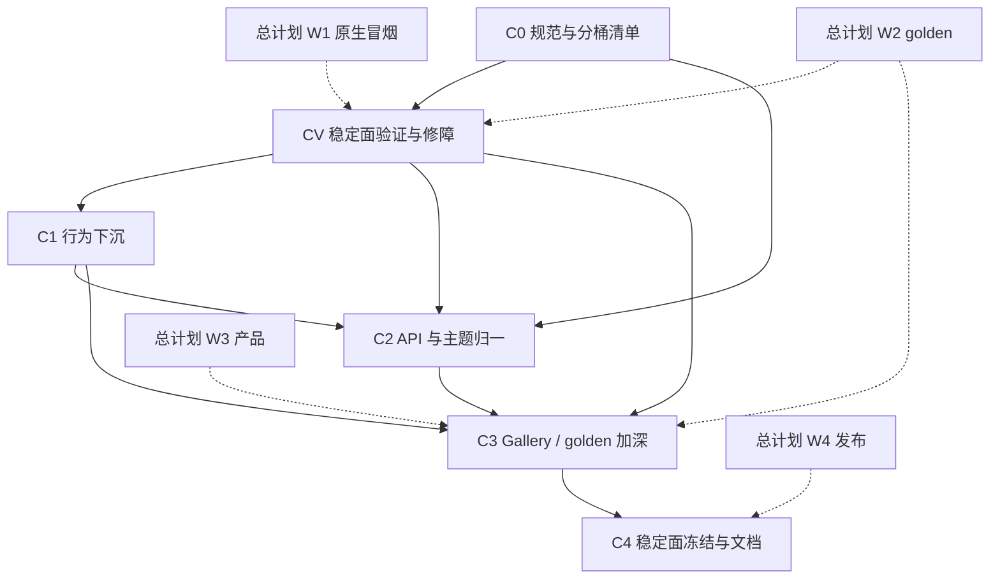

# RUI 基础组件库实施计划

> **文档地位**：把 [`COMPONENT_LIBRARY.md`](COMPONENT_LIBRARY.md) 落成**可执行工作包（C-WP）**。  
> **与总计划关系**：不替代 [`ENGINEERING_IMPLEMENTATION_PLAN.md`](ENGINEERING_IMPLEMENTATION_PLAN.md)；组件专项与巩固期 **W1–W4 交错**。重叠项（焦点环、a11y、golden、Gallery）以总计划验收为准，本计划补**分层下沉、API 归一、清单工程化**。受控 Signal / Owner 注册表与 [`REACTIVITY_PLAN.md`](REACTIVITY_PLAN.md) **R-WP-1**、总计划 **WP-2.4** 对齐，不在此重复实现反应性内核。  
> **前提**：阶段一～十二组件 MVP 已落地；选型已定为 **shadcn 产品面 + headless 骨架**，书写为 **`ui!` ↔ Builder 双轨兼容**（ADR-6 / ADR-9，不可再分叉）。  
> **执行原则**：**先验证稳定面、再行为下沉与 API 归一**。大量组件仍属「Gallery 可演示、库测/冒烟未盖住」——**禁止**在未过 CV 门禁前大面积做 C1/C2 重构。  
> **日期**：2026-08-09（基线与勾选相对 2026-08-07 刷新）  

---

## 0. 目标与退出条件

**总目标**：基础组件库从「Gallery 可演示 MVP」升到「可写入 SemVer 稳定面、可测、可换肤、行为可下沉」。

| 目标 | 映射 |
|------|------|
| 默认 API = shadcn 样式组件 | 规范 §0 / ADR-6 |
| 行为可复用、可单测 | 规范 §2；抽出 popup/toggle/roving 契约 |
| 稳定面清单冻结 | 规范 §5.2 + 总计划 WP-4.1 |
| Gallery / golden / a11y 达标 | 规范 §6；总计划 W1/W2/W4 |

### 0.1 要不要「按原计划 C0→C4」还是「先测再修」？

| 选项 | 结论 |
|------|------|
| **原顺序立刻开 C1/C2**（浮层下沉、variant 归一） | **否**。在未验证树上重构 = 把未知 bug 焊进新抽象，回归成本更高。 |
| **停下计划、49 个组件逐个修到完美** | **否**。范围过大，拖死 Beta；多数应标实验面，不进稳定承诺。 |
| **正确路径** | **薄 C0（清单分桶）→ CV（稳定面验证+修障）→ 再 C1/C2；C3 golden 与 CV 重叠提前**。与总计划 **W1 冒烟 / W2.6 golden** 合并执行，不另起「测完全部再写代码」的无限队列。 |

**CV 门禁（进入 C1 前必须满足）**：

- [x] 稳定面草案已标：`verified` / `broken` / `experimental`（见 C-WP-0.2 / [`component_inventory.md`](component_inventory.md)）  
- [ ] 稳定面候选的 **P0 阻断**（崩溃、无法开合、无法输入、布局塌缩）已修或降出稳定面  
- [ ] 至少 **Button · Input · Dialog · Tabs · Checkbox|Switch** 有：headless 可构建布局测 **或** Gallery 手工清单勾选 **或** 已有库测  
- [ ] 已知 diagnose 类问题（如 showcase 塌缩）有结论：已修 / 有测锁定 / 降级  
- [ ] **`id` 身份卫生**：稳定候选已按 [`element_identity.md`](element_identity.md) / 规范 §4.2 分类（必填实例键 / 可选 / 展示型不要求）；空串不写入 `focus_id`/`template_id`；审计见 C-WP-V.5  

**硬退出（组件库专项 DoD）**：

- [ ] 文档：规范 + 本计划 + 文档站组件索引（或等价 README 表）齐套  
- [ ] 稳定面组件均有 Gallery 示例；变体命名与 Button 对齐文档化；**双书写面**（标签 ↔ Builder）在规范 / Getting Started 有对照  
- [ ] `utils/popup` + Esc 栈成为浮层唯一推荐路径（无第二套 placement）  
- [ ] 至少 Button / Input / Dialog / Tabs / Checkbox|Switch 满足规范 §1 工程口径（或列入实验面并标明）  
- [ ] 核心 ≥5 组件 golden 进 CI（与总计划 WP-2.6 / WP-4.5 合并验收）  
- [ ] CHANGELOG / README 稳定面表与规范 §5.2 一致；**ADR-9 双书写面**无回潮  

---

## 1. 基线事实（2026-08-09）

| 项 | 事实 |
|----|------|
| 组件模块 | `components/` **45** 个公开模块；私有壳在 `components/internal/`（`dialog_shell` / `text_edit`）不计入产品面 |
| 自动化覆盖 | `crate_tests/`：reactive / layout / components（Button·Input·Textarea）/ interaction；**多数组件仍无行为/像素验收** |
| Golden | 仅 2 个 offscreen fixtures；**缺** Button/Input/Dialog/… 组件场景矩阵 |
| 冒烟 | `desktop_smoke.md` 偏 IME/焦点，**非组件矩阵全覆盖**；三平台未签署 |
| 原语 | `primitives/`：box / interactive / overlay / text / path / portal；**无**独立 toggle 模块 |
| 浮层 | `utils/popup.rs` 统一 placement；`components/internal/dialog_shell` 共享 Dialog/AlertDialog 模态壳；开合状态仍多在各组件 |
| 主题 | `style/theme.rs` + `color_space.rs` 对齐 shadcn v4 OKLCH；light/dark（见 [`color.md`](color.md)） |
| Gallery | 八分区**已落地**（与总计划 WP-3.1 同步 ☑）；示例侧常堆 `gal-*` **id**（示范习惯 ≠ API 必填） |
| **身份债** | 多数 Builder 首位强制 `id`；空串/`template_id` 曾致 AccessKit 重复 NodeId；全局 `use_signal("{id}__…")` 揉焦点/锚点 → [`element_identity.md`](element_identity.md) / C-WP-V.5 / C-WP-2.6 / 总计划 WP-2.4 |
| 总计划重叠 | W1 焦点/a11y；W2 golden；W3 Gallery/选器/浮层打磨；W4 发布与索引 |
| CV 门禁 | **未通过**（C-WP-0.2 / V.* 仍 ☐）→ **禁止**开 C1 大重构 |

**推论**：当前是「密度高、信任低」，且 **`id` 使用面过宽**。计划价值在**分桶 + 门禁 + 身份卫生 + 与 W1/W2 对齐的验证**，不在尽快抽 headless。

---

## 2. 波次总览与依赖



| 波次 | 主题 | 建议工期* | 与总计划 |
|------|------|-----------|----------|
| **C0** | 规范 / **分桶清单** / 稳定面草案 | 2–3 天 | 并行 WP-4.1 起草 |
| **CV** | **稳定面验证 + P0 修障**（门禁） | 1–2 周 | 紧耦合 W1 冒烟 + 提前 WP-2.6 骨架 |
| **C1** | 行为下沉与浮层单一路径 | 1–2 周 | **仅 CV 通过后**；W1.2 / W1.3 / W3.4 |
| **C2** | variant·size·token·受控 API 归一 | 1–2 周 | 优先已 verified 组件 |
| **C3** | Gallery 补全 / 选器键盘 / golden 矩阵加深 | 2–3 周 | W3 + W2.6 收尾 |
| **C4** | SemVer 面 / 文档站索引 / 升稳定 | 1 周 | = W4.1 / W4.4 |

\*单人全职量级。每波结束：代码合入 + 测试绿 + 更新本计划勾选 + 同步规范 §5。

**明确不做（整计划期）**：平行发布「纯 Radix 组件包」；VirtualMasonry 产品化（总计划 P2）；块级 markdown 编辑器；npm 式复制组件工作流；**未分桶就对全量 49 组件做行为大重构**。

---

## 3. Wave C0 — 规范冻结与分桶清单

**目标**：选型无歧义；每个公开 API 有桶，后续验证有范围。

### C-WP-0.1 权威文档落地

| | |
|--|--|
| **路径** | `docs/COMPONENT_LIBRARY.md`、本文件、纲领/总计划交叉链接 |
| **任务** | ① 确认 ADR-6；② 文档拓扑写入纲领 §6.4 与总计划 §11；③ `headless.md` 标明从属规范 |
| **验收** | 三处互链可点；无「纯无头 vs shadcn」未决表述 |
| **状态** | ☑ |

### C-WP-0.2 组件清单表与稳定面草案（含验证桶）

| | |
|--|--|
| **路径** | 规范 §5；[`component_inventory.md`](component_inventory.md) |
| **任务** | ① 按 Gallery 分区列出全部公开 API；② 每项标 **`experimental` / `stable-candidate` / `verified` / `broken`**；③ 每项附 **id 策略**（必填实例键 / 可选 / 展示型不要求 / 仅内部自动）；④ 稳定候选默认 ≤ 规范 §5.2 草案；⑤ 与 gap §6 EUI 对照只保留密度标尺 |
| **验收** | 表与 `components/mod.rs` pub use 一致；**broken 不得进 C1**；id 策略列可对接 C-WP-V.5 |
| **状态** | ☑ 2026-08-10：inventory 分桶 + id 策略 + EUI 密度标尺；规范 §5 已互链；broken=无 |

### C-WP-0.3 Prelude / 导出与双书写面策略

| | |
|--|--|
| **路径** | `crates/rui/src/prelude.rs`（`rui::prelude`）；规范 §3 |
| **任务** | ① 默认 prelude re-export 样式组件标签入口 **与** 对应 Builder/`fn`；② 低层 popup 可不进 prelude；③ **ADR-9** 禁止废除无标签写法 |
| **验收** | 标签与纯 Builder 均可编译；规范 §3 有互嵌示例 |
| **状态** | ☑ 2026-08-10：`rui::prelude` 落地；`tests/prelude_dual_surface.rs` 覆盖双面+互嵌；规范 §3.0 策略结论 |

**C0 退出**：互链完成；分桶表可评审；prelude + 双书写面策略有结论。

---

## 3.5 Wave CV — 稳定面验证与修障（门禁波次）

**目标**：把「能演示」变成「敢承诺」的最小集合；**未过本波不得开 C1 大重构**。

### C-WP-V.1 稳定候选手工 / Gallery 走查

| | |
|--|--|
| **路径** | `examples/gallery`；清单表 |
| **任务** | ① 稳定候选逐项：渲染可见、主交互一次成功、无立即崩溃；② 记录 broken + 复现；③ 与 `desktop_smoke` 重叠项直接复用签署 |
| **验收** | 每项有 ☑/broken 笔记；P0 列表公开（issue 或清单列） |
| **状态** | ☐ |
| **对齐** | 总计划 W1 冒烟（原生项优先） |

### C-WP-V.2 最小自动化网（先窄后宽）

| | |
|--|--|
| **路径** | `crates/rui/src/crate_tests/`；可选 offscreen |
| **任务** | ① Button / Input / Dialog / Tabs / Checkbox\|Switch：`build_and_layout` 宽高 > 0；② 已有 reactive sync 保持绿；③ 场景回归按 reactive/layout/components/interaction 维护（原 `diagnose_*` 已升为正式测） |
| **验收** | `cargo test -p rui --lib` 含上述布局/行为测 |
| **状态** | ☐ 已有 Button/Input/Textarea/`headless_smoke`/showcase_collapse 等；**未**按稳定候选矩阵关门 |

### C-WP-V.3 P0 修障冲刺

| | |
|--|--|
| **路径** | 走查与 diagnose 指出的组件 |
| **任务** | 只修 **阻断稳定候选** 的缺陷；修不好则 **降出稳定面**（标 experimental/broken），禁止假装 verified |
| **验收** | 稳定候选无未分类 P0；CV 门禁勾选完成 |
| **状态** | ☐ |

### C-WP-V.4 核心 golden 提前骨架（可选但推荐）

| | |
|--|--|
| **路径** | 总计划 WP-2.6 |
| **任务** | 能录则先录 Button + Input（或 Dialog）1～2 场景，避免验证全靠手工 |
| **验收** | 与 WP-2.6 合并；未完成不阻塞 CV 退出，但阻塞「宣称视觉稳定」 |
| **状态** | ☐ |

### C-WP-V.5 `id` 过度使用审计（身份卫生）

| | |
|--|--|
| **路径** | [`element_identity.md`](element_identity.md)；规范 §4.2；`components/*` Builder 签名；Gallery |
| **任务** | ① 表列：各组件 `id` 是必填 / 可选 / 仅内部；实际用于信号键 / focus / template / 锚点 / 无；② 标出「展示型却强制 id」「空 id → `Some("")` 写入 focus/template」「空 id 自动生成但不稳定」清单；③ Gallery 走查时记录「仅因示范而写的 id」——不把示范习惯写成 API 要求；④ 对照身份契约 I-1～I-3 标 P0 |
| **验收** | 审计表进 `docs/component_inventory.md` 或规范附录；CV 门禁增加：稳定候选的 id 策略已分类；P0 空串写入项有修或降级 |
| **状态** | ☐ |
| **对齐** | [`element_identity.md`](element_identity.md) §8；规范 §4.2 |

**CV 退出**：§0.1 门禁全勾（含身份审计分类）；方可进入 C1。C2 仅处理 `verified` / 无 P0 的候选。

---

## 4. Wave C1 — 行为下沉（Radix 骨架）

**目标**：浮层与开关类行为可复用、可测；样式层变薄。  
**前置**：**CV 门禁已通过**；重构范围限于 verified 浮层/开关，禁止顺手「清理」broken 实验件。

### C-WP-1.1 浮层行为契约固化

| | |
|--|--|
| **路径** | `utils/popup.rs`、`app/portal_overlay`、`components/internal/dialog_shell`、Dialog / Popover / Select / Dropdown / Tooltip / ContextMenu / Sheet |
| **任务** | ① 文档化必用 API：`mark_floating`、underlay、Esc 栈、`internal/dialog_shell`；② 禁止新组件自写第二套坐标 sync；③ 存量审计：列出未走统一引擎的调用点并改或开 issue |
| **验收** | 审计表关闭或仅剩标注实验；Escape 顶层单测或 smoke 条目 |
| **状态** | ☐（**前置：CV 通过**）placement/`internal/dialog_shell` 已存在；契约审计与冒烟未关门 |
| **对齐** | 总计划 WP-1.2、WP-3.4 |

### C-WP-1.2 Toggle / 布尔控件 headless 抽取

| | |
|--|--|
| **路径** | 新建 `primitives/toggle.rs` 或 `utils/toggle_state.rs`；Checkbox / Switch / Toggle |
| **任务** | ① 受控/非受控单一写入；② disabled；③ 样式组件只消费状态 + token |
| **验收** | 三控件共享测例；规范 §2.1「禁止扩散」满足 |
| **状态** | ☐ |

### C-WP-1.3 Roving + focus_trap 产品化

| | |
|--|--|
| **路径** | `utils/roving.rs`、`utils/focus_trap.rs`、Tabs / Menubar / Command / Combobox |
| **任务** | ① roving 单测进 `cargo test -p rui --lib`；② `sync_focus_trap` 与 Dialog/Sheet 接线文档化；③ focus_id 前缀表写入 `keyboard_nav.md` |
| **验收** | 总计划 WP-1.2 验收合并勾选 |
| **状态** | ☐ |
| **对齐** | WP-1.2 |

### C-WP-1.4 AccessKit 主路径组件

| | |
|--|--|
| **路径** | `a11y/bridge.rs`、Button、Input、Tabs、（Menu 或 Combobox 择一）；[`element_identity.md`](element_identity.md) |
| **任务** | Role / 名称 / 值；可聚焦控件非空唯一 `focus_id`（契约 I-3）；读屏复现步骤文档 |
| **验收** | 与总计划 WP-1.3 同一验收；空串/复用 template 库测仍绿 |
| **状态** | ☐（桥+主路径 Role 多随 WP-1.3；组件身份卫生仍挂 V.5/2.6） |

**C1 退出**：浮层单一路径；布尔控件共享状态原语；roving/trap/a11y 主路径可演示。

---

## 5. Wave C2 — API 与主题归一（ShadCN 产品面）

**目标**：变体/尺寸/token/受控 API 像同一套设计系统。  
**范围**：仅 `verified`（及无 P0 的 stable-candidate）；broken/experimental 不强制归一。

### C-WP-2.1 Variant / Size 词汇表

| | |
|--|--|
| **路径** | Button（标杆）、Toggle、ToggleGroup、Alert 类、Badge 若有 |
| **任务** | ① 冻结公共 variant 名；② size 阶梯与 Button 对齐或显式差异表；③ 未知 variant 回退 default 并可测 |
| **验收** | 规范或 `docs/component_variants.md` 一页表；Gallery 基础区展示矩阵 |
| **状态** | ☐ |

### C-WP-2.2 Token 唯一真源

| | |
|--|--|
| **路径** | `style/theme.rs`、`tokens/colors.rs`、各组件 chrome 函数 |
| **任务** | ① 组件内禁止魔法色；② dark 切换后 Gallery 抽查 Button/Input/Dialog；③ focus ring 用 theme.ring |
| **验收** | 换肤冒烟条目；代码审无大量裸 OKLCH（theme 外） |
| **状态** | ☐ |

### C-WP-2.3 受控 API 一致性

| | |
|--|--|
| **路径** | Input、Checkbox、Switch、Select、Tabs、Dialog(open) |
| **任务** | ① 文档：`*_signal` / `open_signal` 命名；② 禁止双源；③ 绑定更新走 `apply_bound_*` 或等价 paint sync |
| **验收** | 库测覆盖「外部 set → chrome 更新」至少 Button variant + Input 一类 |
| **状态** | ☐ |

### C-WP-2.4 自定义组件指南校准

| | |
|--|--|
| **路径** | `docs/custom_components.md` |
| **任务** | 与规范 §2–§3 对齐：优先组合 primitives + tokens；**同时示范** `ui!` 与 Builder；示例 Alert/Card |
| **验收** | 指南无「只能写标签」暗示；链到规范 §3 |
| **状态** | ☐ |

### C-WP-2.5 双书写面 API 等价审计

| | |
|--|--|
| **路径** | 稳定面组件；规范 §3；`ui!` 宏展开 vs `*Builder` |
| **任务** | ① 审计稳定面：RSX props 与 Builder 方法一一对应表；② 缺口补 Builder 或文档「仅糖」例外；③ 库测或 doctest：互嵌 |
| **验收** | 审计表关闭；Button/Input 双写法示例进文档站或 README |
| **状态** | ☐ |
| **对齐** | ADR-9 |

### C-WP-2.6 身份 API 收敛（减少强制 `id`）

| | |
|--|--|
| **路径** | [`element_identity.md`](element_identity.md)；规范 §4.2；C-WP-V.5 审计表；优先 Progress / Navbar / Chart / 纯展示 Label 路径 |
| **任务** | ① 展示型：`id` 改为可选或移除首位必参；② 有状态：文档区分「实例键」与 `focus_id`；能受控则不强迫 id；③ **空串**：一律自动非空键或不写 focus/template（契约 I-1 / I-6）；④ 推动内部信号迁 `use_scoped_signal`（或等价 Owner 键）的试点（Button hover 键或 Toggle 择一）；⑤ Gallery 删掉无必要的 `gal-*` id |
| **验收** | 至少 2 个原「无故必填 id」的稳定面组件改为可选；稳定候选无 `Some("")` focus/template；规范示例不再教「每个控件都写 id」；试点有测 |
| **状态** | ☐ |
| **前置** | C-WP-V.5 |
| **对齐** | 总计划 WP-2.4（scoped）；WP-1.3 桥防御测不得回退 |

**C2 退出**：词汇表发布；token/受控无结构性例外；双书写面审计闭环；身份收敛至少完成审计表中的 P0 展示型项。

---

## 6. Wave C3 — 工程化打磨（与 W2/W3 合并执行）

**目标**：可感质量 + 可回归（在 CV 最小网之上加深）。

### C-WP-3.1 Gallery 覆盖率

| | |
|--|--|
| **路径** | `examples/gallery` |
| **任务** | ① 稳定面组件均有入口；② 浮层区含 Dialog/Tooltip/Toast/Command；③ 关于页链到规范与冒烟文档 |
| **验收** | 总计划 WP-3.1；清单表打勾 |
| **状态** | ☑ 八分区侧栏已落地（与 WP-3.1 同步）；稳定面「每组件一入口」随 C-WP-0.2 分桶后复核 |
| **对齐** | WP-3.1 |

### C-WP-3.2 选器与 Command 键盘

| | |
|--|--|
| **路径** | date/color/time picker、Command、Combobox |
| **任务** | 方向键 / Enter / Escape；Gallery 可纯键盘走通 |
| **验收** | 总计划 WP-3.3 / WP-3.4 |
| **状态** | ☐ |

### C-WP-3.3 组件 golden 五场景

| | |
|--|--|
| **路径** | offscreen tests + golden fixtures |
| **任务** | Button、Input、Dialog、VirtualList、Markdown（或 Label 选区）；接续 C-WP-V.4 |
| **验收** | 总计划 WP-2.6 + WP-4.5；`RUI_UPDATE_GOLDEN` 可重录 |
| **状态** | ☐ |

### C-WP-3.4 表单与校验路径

| | |
|--|--|
| **路径** | `components/form.rs`、Input invalid 绑定 |
| **任务** | FormProvider 错误展示与视觉 invalid 一致；Gallery 表单页 |
| **验收** | 库测 clear/set field error；文档一句 |
| **状态** | ☐ |

**C3 退出**：Gallery 覆盖稳定面；五 golden 绿；选器键盘可演示。

---

## 7. Wave C4 — 稳定面冻结与文档发布

**目标**：组件库可随 `rui` 0.1 对外承诺（仅 `verified` 进稳定面）。

### C-WP-4.1 SemVer 稳定面定稿

| | |
|--|--|
| **路径** | CHANGELOG、README、规范 §5.2 |
| **任务** | 冻结稳定面；实验面打标；破坏性变更模板 |
| **验收** | 总计划 WP-4.1 |
| **状态** | ☐ |

### C-WP-4.2 文档站组件索引

| | |
|--|--|
| **路径** | `docs/site/` |
| **任务** | 每稳定面组件：一句话 + **标签与 Builder 各一则**最小片段（或互链）+ Gallery 分区；Getting Started 用 Button+Input 双写法 |
| **验收** | 总计划 WP-4.4 |
| **状态** | ☐ |

### C-WP-4.3 发布核对

| | |
|--|--|
| **路径** | PUBLISH.md、prelude、feature 门 |
| **任务** | 默认 feature 不含实验重依赖；组件索引与 crate 文档 `//!` 模块级一致 |
| **验收** | `cargo package` 无缺文档致命项；干净环境最小窗口用稳定面组件 |
| **状态** | ☐ |
| **对齐** | WP-4.2 / 4.3 |

**C4 退出**：组件库专项 DoD（§0）全勾；总计划升 Beta 时可引用本计划。

---

## 8. Backlog（Beta 后）

| ID | 项 | 备注 |
|----|-----|------|
| CB1 | 完整 headless 公开模块（`rui::headless::*`） | 仅当社区有强需求 |
| CB2 | VirtualMasonry | 总计划 B5；依赖行高 |
| CB3 | 块级 markdown 编辑控件 | 非只读渲染 |
| CB4 | 组件级视觉回归（多 DPI / dark） | golden 矩阵扩展 |
| CB5 | 主题包（非默认 brand） | token 预设，不改架构 |
| CB6 | 实验面组件批量升 verified | 按 CV 流程逐个升，禁止一次「全绿」 |

---

## 9. 执行节奏（建议）

| 周 | 焦点 |
|----|------|
| 0–0.5 | C0 分桶清单、prelude |
| 0.5–2 | **CV**：Gallery 走查 + 核心布局/行为测 + P0 修障（并行 W1 冒烟） |
| 2–3 | CV 收尾；可选 Button/Input golden 骨架 |
| 3–5 | C1（仅 verified）与 W1.2/1.3 |
| 5–6 | C2 API/token 归一（verified） |
| 6–7 | C3 Gallery/选器/五 golden 收尾 |
| 7–8 | C4 与 W4 发布 |

原则：**一 C-WP 一 PR**（或与对应总计划 WP 合并）；**未过 CV 不开 C1 大重构**。

---

## 10. 工作约定

1. 争议先改 [`COMPONENT_LIBRARY.md`](COMPONENT_LIBRARY.md) / ADR，再写代码。**ADR-9（双书写面）** 与 ADR-6 同级。  
2. **验证优先于抽象**：没有复现笔记或测的「重构顺手修」默认拒绝合入稳定路径。  
3. **身份卫生**：新 API 默认不把用户 `id` 设为必填；空串不得写入 `focus_id`/`template_id`；全局 `use_signal("{id}__…")` 须在 `//!` 写明多实例契约（[`element_identity.md`](element_identity.md)、规范 §4.2）。  
4. 新浮层控件不接受「先打补丁坐标、后接 popup」的长期状态。  
5. 稳定面变更必须有测或 smoke 条目；新 props 默认双入口（标签 + Builder）。  
6. 修不好的候选 **降级**，不阻塞 Beta。  
7. 每波结束更新：本计划勾选、规范 §5、必要时 gap §6。  
8. 测试命令同总计划 §10。

---

## 11. 文档拓扑

```text
ENGINEERING_GRADE_FRAMEWORK.md
ENGINEERING_IMPLEMENTATION_PLAN.md   ← 巩固期总 WP（★执行源）
REACTIVITY.md / REACTIVITY_PLAN.md   ← 细粒度口径 + R-WP（WP-2.4/2.5 · C-WP-V.5/2.6）
COMPONENT_LIBRARY.md                 ← 组件权威规范
COMPONENT_LIBRARY_PLAN.md            ← 本文件（含 CV 门禁）
element_identity.md                  ← 跨层身份契约（与 C-WP-V.5 / 2.6、WP-2.4 同步）
headless.md / custom_components.md / keyboard_nav.md / color.md / a11y_smoke.md / reactivity_and_hot_reload.md
archive/                             ← 选型与早期随笔（已冻结）
```

---

*计划随 C-WP 关闭而改勾选；新增 C-WP 须映射到规范 §1 某条门槛，否则进 §8 Backlog。*
