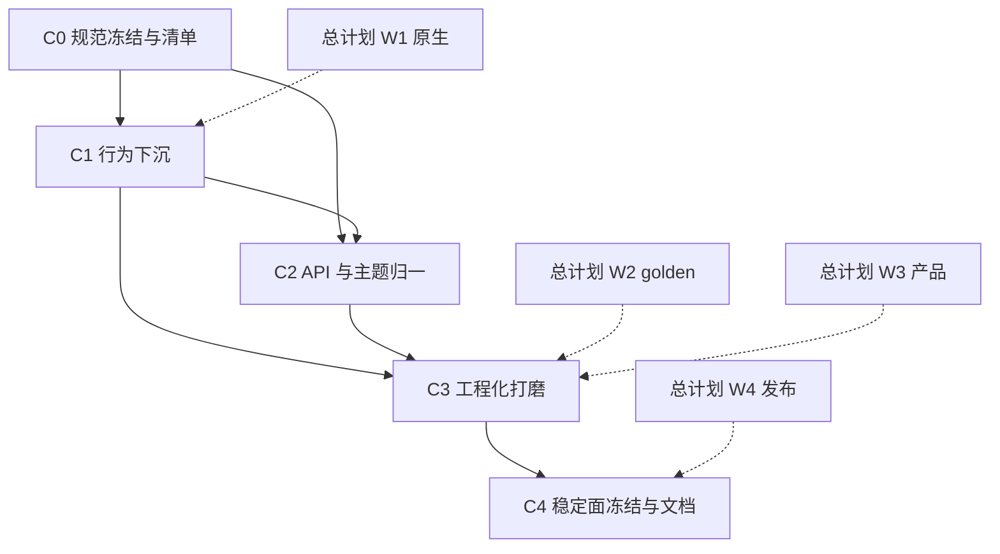

# RUI 基础组件库实施计划

> **文档地位**：把 [`COMPONENT_LIBRARY.md`](COMPONENT_LIBRARY.md) 落成**可执行工作包（C-WP）**。  
> **与总计划关系**：不替代 [`ENGINEERING_IMPLEMENTATION_PLAN.md`](ENGINEERING_IMPLEMENTATION_PLAN.md)；组件专项与巩固期 **W1–W4 交错**。重叠项（焦点环、a11y、golden、Gallery）以总计划验收为准，本计划补**分层下沉、API 归一、清单工程化**。  
> **前提**：阶段一～十二组件 MVP 已落地；选型已定为 **shadcn 产品面 + headless 骨架**，书写为 **`ui!` ↔ Builder 双轨兼容**（ADR-6 / ADR-9，不可再分叉）。
> **日期**：2026-08-07  

---

## 0. 目标与退出条件

**总目标**：基础组件库从「Gallery 可演示 MVP」升到「可写入 SemVer 稳定面、可测、可换肤、行为可下沉」。

| 目标 | 映射 |
|------|------|
| 默认 API = shadcn 样式组件 | 规范 §0 / ADR-6 |
| 行为可复用、可单测 | 规范 §2；抽出 popup/toggle/roving 契约 |
| 稳定面清单冻结 | 规范 §4.2 + 总计划 WP-4.1 |
| Gallery / golden / a11y 达标 | 规范 §5；总计划 W1/W2/W4 |

**硬退出（组件库专项 DoD）**：

- [ ] 文档：规范 + 本计划 + 文档站组件索引（或等价 README 表）齐套  
- [ ] 稳定面组件均有 Gallery 示例；变体命名与 Button 对齐文档化；**双书写面**（标签 ↔ Builder）在规范 / Getting Started 有对照  
- [ ] `utils/popup` + Esc 栈成为浮层唯一推荐路径（无第二套 placement）  
- [ ] 至少 Button / Input / Dialog / Tabs / Checkbox|Switch 满足规范 §1 工程口径（或列入实验面并标明）  
- [ ] 核心 ≥5 组件 golden 进 CI（与总计划 WP-2.6 / WP-4.5 合并验收）  
- [ ] CHANGELOG / README 稳定面表与规范 §5.2 一致；**ADR-9 双书写面**无回潮

---

## 1. 基线事实（计划起点）

| 项 | 事实 |
|----|------|
| 组件源文件 | `components/` ≈ 49 模块（含 stub / 辅助） |
| 原语 | `primitives/`：box / interactive / text / path；**无**独立 popup/toggle 模块 |
| 浮层 | `utils/popup.rs` 统一 placement；各组件自行组合 open 状态 |
| 主题 | `style/theme.rs` 对齐 shadcn v4 OKLCH；light/dark |
| Gallery | 侧栏：基础 / 表单 / 浮层·反馈 / 数据 / 导航 / 布局 / 文本 / 关于 |
| 规范缺口 | headless 契约有文；缺权威产品规范与专项 WP（本文补齐） |
| 总计划重叠 | W1 焦点/a11y；W2 golden；W3 Gallery/选器/浮层打磨；W4 发布与索引 |

---

## 2. 波次总览与依赖



| 波次 | 主题 | 建议工期* | 与总计划 |
|------|------|-----------|----------|
| **C0** | 规范 / 清单 / 稳定面草案 | 2–3 天 | 并行 WP-4.1 起草 |
| **C1** | 行为下沉与浮层单一路径 | 1–2 周 | 紧耦合 W1.2 / W1.3 / W3.4 |
| **C2** | variant·size·token·受控 API 归一 | 1–2 周 | 可与 C1 后半交错 |
| **C3** | Gallery 补全 / 选器键盘 / golden | 2–3 周 | = W3 主线 + W2.6 |
| **C4** | SemVer 面 / 文档站索引 / 升稳定 | 1 周 | = W4.1 / W4.4 |

\*单人全职量级。每波结束：代码合入 + 测试绿 + 更新本计划勾选 + 同步规范 §4。

**明确不做（整计划期）**：平行发布「纯 Radix 组件包」；VirtualMasonry 产品化（总计划 P2）；块级 markdown 编辑器；npm 式复制组件工作流。

---

## 3. Wave C0 — 规范冻结与清单

**目标**：选型与清单无歧义；后续 PR 有归类依据。

### C-WP-0.1 权威文档落地

| | |
|--|--|
| **路径** | `docs/COMPONENT_LIBRARY.md`、本文件、纲领/总计划交叉链接 |
| **任务** | ① 确认 ADR-6；② 文档拓扑写入纲领 §6.4 与总计划 §11；③ `headless.md` 标明从属规范 |
| **验收** | 三处互链可点；无「纯无头 vs shadcn」未决表述 |
| **状态** | ☑ |

### C-WP-0.2 组件清单表与稳定面草案

| | |
|--|--|
| **路径** | 规范 §4；可选 `docs/component_inventory.md` 或 site 索引 stub |
| **任务** | ① 按 Gallery 分区列出全部公开 API；② 标 MVP / 工程目标 / 实验；③ 与 gap §6 EUI 对照只保留「密度标尺」不改架构 |
| **验收** | 表与 `components/mod.rs` pub use 一致；实验面 ≤ 清晰列表 |
| **状态** | ☐ |

### C-WP-0.3 Prelude / 导出与双书写面策略

| | |
|--|--|
| **路径** | `crates/rui/src/lib.rs` 或 `prelude`；规范 §3 |
| **任务** | ① 默认 prelude re-export 样式组件标签入口 **与** 对应 Builder/`fn`（如 `Button` + `button`）；② `primitives` / 低层 popup 可不进 prelude，但文档须说明纯 Rust 拼装路径；③ 明确 **ADR-9**：禁止文档或 API 演进废除无标签写法 |
| **验收** | Gallery / 最小示例：标签写法与纯 Builder 写法均可只依赖公开导出编译；规范 §3 有互嵌示例 |
| **状态** | ☐ |

**C0 退出**：规范互链完成；稳定面草案可评审；prelude + 双书写面策略有结论（改或 ADR 记录维持现状）。

---

## 4. Wave C1 — 行为下沉（Radix 骨架）

**目标**：浮层与开关类行为可复用、可测；样式层变薄。

### C-WP-1.1 浮层行为契约固化

| | |
|--|--|
| **路径** | `utils/popup.rs`、`app/portal_overlay`、Dialog / Popover / Select / Dropdown / Tooltip / ContextMenu / Sheet |
| **任务** | ① 文档化必用 API：`mark_floating`、underlay、Esc 栈；② 禁止新组件自写第二套坐标 sync；③ 存量审计：列出未走统一引擎的调用点并改或开 issue |
| **验收** | 审计表关闭或仅剩标注实验；Escape 顶层单测或 smoke 条目 |
| **状态** | ☐ |
| **对齐** | 总计划 WP-1.2、WP-3.4 |

### C-WP-1.2 Toggle / 布尔控件 headless 抽取

| | |
|--|--|
| **路径** | 新建 `primitives/toggle.rs` 或 `utils/toggle_state.rs`；Checkbox / Switch / Toggle |
| **任务** | ① 受控/非受控单一写入；② disabled；③ 样式组件只消费状态 + token |
| **验收** | 三控件共享测例；规范 §2.1「禁止扩散」满足 |
| **状态** | ☐ |

### C-WP-1.3 Roving + FocusTrap 产品化

| | |
|--|--|
| **路径** | `utils/roving.rs`、`components/focus_trap.rs`、Tabs / Menubar / Command / Combobox |
| **任务** | ① roving 单测进 `cargo test -p rui --lib`；② FocusTrap 与 Dialog/Sheet 接线文档化；③ focus_id 前缀表写入 `keyboard_nav.md` |
| **验收** | 总计划 WP-1.2 验收合并勾选 |
| **状态** | ☐ |
| **对齐** | WP-1.2 |

### C-WP-1.4 AccessKit 主路径组件

| | |
|--|--|
| **路径** | `accesskit_bridge.rs`、Button、Input、Tabs、（Menu 或 Combobox 择一） |
| **任务** | Role / 名称 / 值；读屏复现步骤文档 |
| **验收** | 与总计划 WP-1.3 同一验收 |
| **状态** | ☐ |

**C1 退出**：浮层单一路径；布尔控件共享状态原语；roving/trap/a11y 主路径可演示。

---

## 5. Wave C2 — API 与主题归一（ShadCN 产品面）

**目标**：变体/尺寸/token/受控 API 像同一套设计系统。

### C-WP-2.1 Variant / Size 词汇表

| | |
|--|--|
| **路径** | Button（标杆）、Toggle、ToggleGroup、Alert 类、Badge 若有 |
| **任务** | ① 冻结公共 variant 名；② size 阶梯与 Button 对齐或显式差异表；③ 未知 variant 回退 default 并可测 |
| **验收** | 规范或 `docs/component_variants.md` 一页表；Gallery 基础区展示矩阵 |
| **状态** | ☐ |

### C-WP-2.2 Token 唯一真源

| | |
|--|--|
| **路径** | `style/theme.rs`、`tokens/colors.rs`、各组件 chrome 函数 |
| **任务** | ① 组件内禁止魔法色；② dark 切换后 Gallery 抽查 Button/Input/Dialog；③ focus ring 用 theme.ring |
| **验收** | 换肤冒烟条目；clippy/代码审无大量裸 OKLCH（theme 外） |
| **状态** | ☐ |

### C-WP-2.3 受控 API 一致性

| | |
|--|--|
| **路径** | Input、Checkbox、Switch、Select、Tabs、Dialog(open) |
| **任务** | ① 文档：`*_signal` / `open_signal` 命名；② 禁止双源；③ 绑定更新走 `apply_bound_*` 或等价 paint sync |
| **验收** | 库测覆盖「外部 set → chrome 更新」至少 Button variant + Input 一类 |
| **状态** | ☐ |

### C-WP-2.4 自定义组件指南校准

| | |
|--|--|
| **路径** | `docs/custom_components.md` |
| **任务** | 与规范 §2–§3 对齐：优先组合 primitives + tokens；**同时示范** `ui!` 与 Builder；示例 Alert/Card |
| **验收** | 指南无「只能写标签」暗示；链到规范 §3 |
| **状态** | ☐ |

### C-WP-2.5 双书写面 API 等价审计

| | |
|--|--|
| **路径** | 稳定面组件；规范 §3；`ui!` 宏展开 vs `*Builder` |
| **任务** | ① 审计稳定面：RSX props 与 Builder 方法一一对应表；② 缺口补 Builder 或文档「仅糖」例外；③ 库测或 doctest：互嵌（`ui!` 内嵌 Builder、`child(ui!{…})`） |
| **验收** | 审计表关闭；Button/Input 双写法示例进文档站或 README |
| **状态** | ☐ |
| **对齐** | ADR-9 |

**C2 退出**：词汇表发布；token/受控无结构性例外（例外须进实验面表）；双书写面审计（C-WP-2.5）闭环或仅剩已文档化例外。

---

## 6. Wave C3 — 工程化打磨（与 W2/W3 合并执行）

**目标**：可感质量 + 可回归。

### C-WP-3.1 Gallery 覆盖率

| | |
|--|--|
| **路径** | `examples/gallery` |
| **任务** | ① 稳定面组件均有入口；② 浮层区含 Dialog/Tooltip/Toast/Command；③ 关于页链到规范与冒烟文档 |
| **验收** | 总计划 WP-3.1；清单表打勾 |
| **状态** | ☐ |
| **对齐** | WP-3.1 |

### C-WP-3.2 选器与 Command 键盘

| | |
|--|--|
| **路径** | date/color/time picker、Command、Combobox |
| **任务** | 方向键 / Enter / Escape；Gallery 可纯键盘走通 |
| **验收** | 总计划 WP-3.3 / WP-3.4 |
| **状态** | ☐ |

### C-WP-3.3 组件 golden 五场景

| | |
|--|--|
| **路径** | offscreen tests + golden fixtures |
| **任务** | Button、Input、Dialog、VirtualList、Markdown（或 Label 选区） |
| **验收** | 总计划 WP-2.6 + WP-4.5；`RUI_UPDATE_GOLDEN` 可重录 |
| **状态** | ☐ |

### C-WP-3.4 表单与校验路径

| | |
|--|--|
| **路径** | `components/form.rs`、Input invalid 绑定 |
| **任务** | FormProvider 错误展示与 `aria`/视觉 invalid 一致；Gallery 表单页 |
| **验收** | 库测 clear/set field error；文档一句 |
| **状态** | ☐ |

**C3 退出**：Gallery 覆盖稳定面；五 golden 绿；选器键盘可演示。

---

## 7. Wave C4 — 稳定面冻结与文档发布

**目标**：组件库可随 `rui` 0.1 对外承诺。

### C-WP-4.1 SemVer 稳定面定稿

| | |
|--|--|
| **路径** | CHANGELOG、README、规范 §4.2 |
| **任务** | 冻结稳定面；实验面打标；破坏性变更模板 |
| **验收** | 总计划 WP-4.1 |
| **状态** | ☐ |

### C-WP-4.2 文档站组件索引

| | |
|--|--|
| **路径** | `docs/site/` |
| **任务** | 每稳定面组件：一句话 + **标签与 Builder 各一则**最小片段（或互链）+ Gallery 分区；Getting Started 用 Button+Input 双写法 |
| **验收** | 总计划 WP-4.4 |
| **状态** | ☐ |

### C-WP-4.3 发布核对

| | |
|--|--|
| **路径** | PUBLISH.md、prelude、feature 门 |
| **任务** | 默认 feature 不含实验重依赖；组件索引与 crate 文档 `//!` 模块级一致 |
| **验收** | `cargo package` 无缺文档致命项；干净环境最小窗口用稳定面组件 |
| **状态** | ☐ |
| **对齐** | WP-4.2 / 4.3 |

**C4 退出**：组件库专项 DoD（§0）全勾；总计划升 Beta 时可引用本计划。

---

## 8. Backlog（Beta 后）

| ID | 项 | 备注 |
|----|-----|------|
| CB1 | 完整 headless 公开模块（`rui::headless::*`） | 仅当社区有强需求 |
| CB2 | VirtualMasonry | 总计划 B5；依赖行高 |
| CB3 | 块级 markdown 编辑控件 | 非只读渲染 |
| CB4 | 组件级视觉回归（多 DPI / dark） | golden 矩阵扩展 |
| CB5 | 主题包（非默认 brand） | token 预设，不改架构 |

---

## 9. 执行节奏（建议）

| 周 | 焦点 |
|----|------|
| 0–0.5 | C0 文档互链、清单、prelude 结论 |
| 1–2 | C1 与总计划 W1 同步（焦点 / 浮层 / a11y） |
| 3–4 | C2 API/token 归一；启动 C3 Gallery |
| 5–6 | C3 golden + 选器键盘（搭 W2/W3） |
| 7–8 | C4 与 W4 发布、文档站索引 |

原则：**一 C-WP 一 PR**（或与对应总计划 WP 合并为一个 PR，描述贴双清单验收）。

---

## 10. 工作约定

1. 争议先改 [`COMPONENT_LIBRARY.md`](COMPONENT_LIBRARY.md) / ADR，再写代码。**ADR-9（双书写面）** 与 ADR-6 同级，不可默默废除 Builder 或 `ui!`。  
2. 新浮层控件不接受「先打补丁坐标、后接 popup」的长期状态。  
3. 稳定面变更必须有测或 smoke 条目；新 props 默认双入口（标签 + Builder）。  
4. 每波结束更新：本计划勾选、规范 §5、必要时 gap §6。  
5. 测试命令同总计划 §10。

---

## 11. 文档拓扑

```text
ENGINEERING_GRADE_FRAMEWORK.md
ENGINEERING_IMPLEMENTATION_PLAN.md   ← 巩固期总 WP
COMPONENT_LIBRARY.md                 ← 组件权威规范
COMPONENT_LIBRARY_PLAN.md            ← 本文件
headless.md / custom_components.md / keyboard_nav.md
```

---

*计划随 C-WP 关闭而改勾选；新增 C-WP 须映射到规范 §1 某条门槛，否则进 §8 Backlog。*
