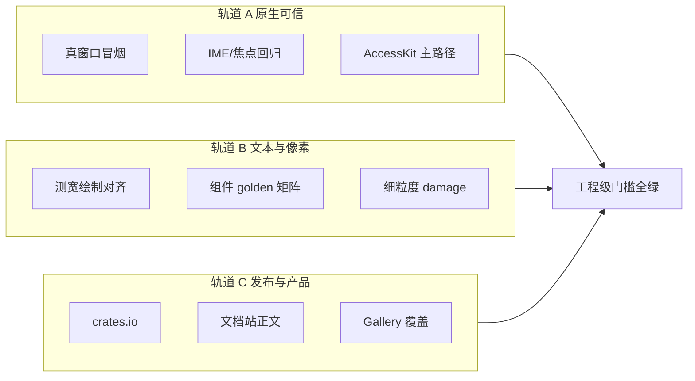

# 迈向工程级：Rust 原生跨平台 UI 框架（权威纲领）

> **文档地位**：工程门槛、ADR、锁定栈与禁区的**领域规范**（「是什么」）。  
> **执行源**：巩固期勾选 / 排期 / DoD 以 [`AUTHORITY.md`](AUTHORITY.md) 为准。本文**不**再充当入口或第二套计划。  
> **事实来源**：`crates/rui` 实现、[`gap_analysis.md`](comparison/gap_analysis.md)（历史审计）、[`STAGE7_ROADMAP.md`](archive/STAGE7_ROADMAP.md)、[`PROJECT.md`](archive/PROJECT.md)、[`PUBLISH.md`](ops/PUBLISH.md)，以及对标参考库（见 §3）。  
> **审计日期**：2026-08-09（基线）；治理收口 2026-08-12；**2026-08-13** 公开自绘叶（Svg/Canvas/2D·3D）挂 ADR-3  
> **版本口径**：阶段一～十二 **MVP 已落地**。本文区分 **MVP（可演示、可测）** 与 **工程级（可依赖、可发布、可维护）**。

---

## 0. 一句话结论

RUI 的架构赌注已经验证：**Solid 式细粒度响应式 + 保留 Element/taffy 树 + `winit/wgpu/taffy/glyphon` 自绘栈** 是正确底座。  
工程级差距**不再是「换哲学」**，而是把原生输入、文本可信度、组件深度、发布工程与质量门从 **MVP 打磨到可承诺的 SemVer 面**。

| 维度 | 现状（代码事实 · 2026-08-09） | 工程级门槛 |
|------|-------------------------------|------------|
| 代码体量 | `crates/` ≈ **5.3 万行** / **182** 个 `.rs`；`components/` **45** 个模块（含 `mod.rs` 共 46 文件） | API 稳定面文档化；破坏性变更可追踪 |
| 响应式 | Owner / Signal / Memo / Context / Store / Resource / Suspense / **ErrorBoundary** / **`switch_reactive`** / `on_mount` | 热路径无全局表泄漏；`REGISTERED_*` 挂 Owner；Store produce 契约完整 |
| 渲染布局 | wgpu SDF 矩形 + glyphon；**逻辑 damage 正式默认**；子树 `mark_dirty`；GPU PartialLoad / 树级 DL = B8；**公开 Svg/Canvas 叶仍 ☐**（[`drawing.md`](drawing.md)） | 测宽≡绘制；W3 自绘面起步；B8 少画 |
| 桌面可用 | IME 光标区代码路径；焦点环 / roving / focus_trap；AccessKit 桥；**多窗 wired MVP**；**Router wired MVP**；托盘 **可选 feature 已接线**（默认 stub） | 三平台真窗口冒烟签署；读屏主路径可演示 |
| 质量门 | CI 三平台 + `clippy -D warnings` + 离屏 golden（clear + stage8 + **5 组件场景**） | 真窗冒烟或等价；glyph 级 golden 可加深 |
| 发布 | `PUBLISH.md`；文档站 stub；**无 CHANGELOG / 未 crates.io** | `cargo add rui` 可用；文档站有 Getting Started |

---

## 1. 「工程级」的操作定义

对本项目，「工程级」**不是**「Solid 一比一复刻」，也**不是**「体积压到 egui / EUI 量级」。它是下列六条同时成立：

1. **可预测的更新模型**  
   组件挂载跑一次；属性走 `bind_*`；结构走 `<Show>` / `<For>` / `reactive!`；脏标记区分 Layout / Paint；开发者能说清「这次 set 会触发什么」。

2. **可信的原生桌面行为**  
   IME（中日韩）、焦点环、Tab / roving、Escape 关浮层、系统剪贴板与文件拖放，在 Win / macOS / Linux 上行为一致到可写冒烟清单。

3. **测宽与绘制同源**  
   布局 leaf measure 与 glyphon 分行消费同一套 `prepare` / `layout`（及字体策略）；虚拟列表行高可信。

4. **无障碍可接系统**  
   AccessKit 树有层级、Role、Action、live region；主路径控件可被读屏读到名称与值变化。

5. **质量门可阻断回归**  
   `fmt` + `clippy -D warnings` + 三平台 `test` + 离屏 / 组件 golden；可选真窗口冒烟；bench 有基线。

6. **可发布的契约**  
   crates.io 版本、feature 门、SemVer 承诺面、Getting Started、组件 API 索引；默认 feature 保持精简。

未满足以上任一条时，项目可以很强，但只能称为 **工程级 MVP / Alpha+**，不能对外承诺「生产依赖」。

---

## 2. 架构纲领（不可再分叉）

### 2.1 执行模型：声明式 API × 保留模式内核

```text
  用户代码 (ui! 标签  ↔  *Builder 纯 Rust  ·  #[component] / Signal)
            │  两种写法 → 同一 Element；挂载一次 + 细粒度订阅
            ▼
  Element 树  ←── reconcile / bind_* / template_paths
            │
     ┌──────┼──────────┐
     ▼      ▼          ▼
   taffy  AccessKit   wgpu 实例批 + glyphon
  (布局)   (a11y)     (像素)
```

| 主张 | 代码锚点 | 工程含义 |
|------|----------|----------|
| 持久保留树 | `layout_tree::build_and_layout` 复用 `NodeId`；`reconcile_elements` | 禁止每帧清树重建 |
| 细粒度直达 | `bind_text` / `bind_prop` / `bind_class` / `template_paths` | 计数器类更新不应整树 diff |
| Layout ≠ Paint | `LayoutStatus`；同宽文本 → `StyleChanged` | 滚动与换色廉价 |
| 子树布局 | `mark_dirty` + `resolve_layout_compute_root`（上溢升父）；live 从 app root compute | 见 [layout_subtree.md](engine/layout_subtree.md)；非换引擎 |

**明确不做的替代路线**（已否决，见 gap §1）：

| 路线 | 为何否决 |
|------|----------|
| Dioxus / React 式 VDOM | 自绘无 DOM；多一层 diff，与细粒度更新目标冲突 |
| EUI 式命令式 / DSL | 丢掉已投入的 Solid 内核与 `ui!` DX |
| 纯 egui 即时模式 | 难撑无头组件库、Portal、无障碍树与复杂产品面 |
| 弃 wgpu 追体积 | 与「跨平台像素级自绘」冲突；内存差主要来自 GPU 驱动（见 [`size_and_memory.md`](ops/size_and_memory.md)） |

### 2.2 分层栈（实现 = 选型）

| 层 | 实现 | 职责 | 边界 |
|----|------|------|------|
| OS / 窗口 | `winit` + `accesskit_winit` | 窗口、IME、剪贴板、事件、a11y 适配 | 不写平台 GUI 控件 |
| 图形 | `wgpu` + 自研 SDF / 阴影 / 渐变 WGSL | 像素、批处理、HiDPI；**公开叶：Svg / Canvas / 2D·3D**（见 [`drawing.md`](drawing.md)） | 不引入 Skia 主线；不搬 HTML-in-canvas |
| 文本 | `glyphon` / `cosmic-text` + `text/measure` | shaping、测宽、soft-wrap、markdown | 不自研完整 shaping |
| 布局 | `taffy` | Flex / Grid | 不换布局算法 |
| 响应式 | 自研 Solid 式（`core/reactivity`、`store`、`resource`） | Signal / Owner / Effect | 不对齐 DOM/SSR |
| 样式 | `rui_style_tokens` + utility 变体引擎 | Tailwind/Uno 心智、theme、dark | 不实现完整 CSSOM |
| 组件 | primitives → tokens → components；行为工具在 `utils/` | ShadCN 式无头骨架 + 样式产品面 | 交互状态机不永久粘在样式层；浮层几何走 `utils/popup` |
| 颜色 | `style/color_space` + `theme`（OKLCH 令牌 → display sRGB） | 与 shadcn v4 语义色同源；CPU 混色用 linear / Oklab | 不接完整 ICC / HDR（设计见 [`color_advanced.md`](engine/color_advanced.md)）；主题运行时见 [`theme.md`](engine/theme.md) |
| DX | `rui_macros` + `rui_hot_reload_cli` + 公开 `*Builder` | `ui!` 与纯 Rust Builder **双书写面**；热补丁 `template_id` | 热重载不替代正确性测试；**不废弃无标签写法** |

**锁定栈（不可再开选型分叉）**：`winit` + `accesskit_winit` · `wgpu` · `taffy` · `glyphon`/`cosmic-text` · `palette`（OKLCH）。否决：Skia 主线、弃 wgpu 追体积、stretch、完整 CSSOM。选型过程见 [`archive/Tech-Select.md`](archive/Tech-Select.md)。

工作区 crate：

```text
crates/
  rui/                 # 运行时 · 组件 · 渲染 · 文本
  rui_macros/          # ui! / #[component]
  rui_style_tokens/    # 宏与运行时共享 utility 真源
  rui_hot_reload_cli/  # 开发期 watcher → TCP template_patch
```

---

## 3. 参考基线：各司其职，禁止错位搬运

对照目录：`Reference/SolidJS`、`ShadCN-UI`、`TailwindCSS`、`UnoCSS`、`EUI-NEO-main`、`pretext-main`、`dioxus`、`leptos-main`、`floem-main`，以及同仓 `xilem` / `freya` / `shadcn-rs`（架构对照，非默认依赖）。

| 层 | 参考 | 学什么 | 不学 / 不搬 |
|----|------|--------|-------------|
| 编程模型 | **SolidJS** | 组件跑一次；Signal 驱动局部更新；Owner / cleanup / Context；`Show` / `For` / memo；**`mapArray` 项级 root** | DOM、SSR、hydration、Web 并发调度 |
| 图协议 | **Leptos `reactive_graph`** | Owner 树；Clean/Check/Dirty 思想；RenderEffect vs Effect 分层 | 换核依赖；SSR；tachys HTML |
| 原生绑定 | **Floem `floem_reactive`** | `UpdaterEffect`（订阅/应用拆开）；Scope dispose；`dyn_stack` diff 纪律 | 整套 API 改名；Web 式 Resource |
| 样式与组件体验 | **ShadCN-UI** + **Tailwind** + **UnoCSS** | a11y 契约、无头拆分、变体命名、原子类心智、shortcuts 思想 | Web 专有 CSS、DOM 选择器、完整 Attributify 运行时 |
| 产品完整度 | **EUI-NEO** | 组件密度标尺（chart / markdown / datepicker / virtualmasonry 等）；gallery 驱动；batch 纪律；**视觉契约**（2.5D / Shadertoy 叶 / workshop，见 [`EUI_NEO_VISUAL.md`](comparison/EUI_NEO_VISUAL.md)） | 命令式 DSL；为缩体积弃 wgpu；用 mesh 3D 模拟 UI 翻牌 |
| 文本算法 | **pretext** | `prepare` 一次 / `layout` 纯算术；变宽绕排；稳定行高 | 不当布局总方案；不原样移植 JS |
| DX 热重载 | **Dioxus** | 监视源码、免全量重编的补丁心智；RSX 体验 | **VDOM / 组件级 diff 当细粒度**；WebView 桌面壳 |
| 性能上限对照 | **Xilem** / **Freya** | 保留树、增量更新讨论 | 不强制对齐其公开 API |

**推论**：工业级缺口在 **原生层**（IME、焦点、a11y、多窗）与 **工程层**（Store 深度、golden、发布），Solid 本身解决不了——必须自研补齐。因此**下一阶段不开「是否放弃 Solid」的架构分叉**。

---

## 4. 能力现状快照（相对工程级）

### 4.1 已闭环（阶段一～六 + 七～十二 MVP）

摘要（细节与勾选清单见 [`gap_analysis.md`](comparison/gap_analysis.md) §7、[`STAGE7_ROADMAP.md`](archive/STAGE7_ROADMAP.md)）：

| 域 | 已落地要点 |
|----|------------|
| 内核 | Owner / `on_cleanup` / `on_mount` / Context；惰性 memo；`with`/`update`；scoped signal；`on` / selector / deferred |
| 异步 | `create_resource` + `Suspense`；`ErrorBoundary`；`run_on_ui_thread` / `spawn_blocking` |
| 样式 | 单一 utility 真源；hover/focus/dark/data-*；断点；`group-hover`/`peer-*`；theme 切换；spring `transition-*` |
| 事件 | 冒泡/捕获/pointer capture；右键双击；文件拖放；触摸惯性/长按/pinch |
| 渲染 | damage+scissor MVP；opacity/translate/rotate/scale；多层阴影；渐变条带；离屏 golden |
| 文本 | prepare/layout + 缓存；inline + **块级** markdown MVP；变宽绕排 MVP；RTL/letter-spacing；FontSystem 共享 |
| 原生 | IME 光标区（库测 + 诊断钩子）；焦点环 token；roving；focus_trap；AccessKit Role/Action/live（lifecycle 接线） |
| 组件 | 浮层引擎、Dialog 模态壳（`components/dialog.rs`）、表单、表格、树、虚拟列表、Command/Menubar、Date/Color、Chart Bar/Line MVP、Carousel、Gallery 八分区 |
| 外壳 | **Router**（历史 back/forward 有测）/ **次窗 wired MVP** / 托盘 `system-tray` 可选接线 / 剪贴板助手 |
| 工程 | 三平台 CI；`RUI_FORCE_SOFTWARE` offscreen（2 golden）；tracing feature；layout bench；`PUBLISH.md`；库测分布在 `crate_tests/` + 模块内测 |

### 4.2 Solid 对齐口径（编程模型，非整仓）

衡量的是**细粒度响应式编程模型**覆盖度，不是 solid-main 仓库对齐度。DOM/SSR 相关 API **不在范围内**。

**权威展开**：战略 **超过 Floem、逼近 Solid 机制**（§0.1 / §5.9 记分牌）；**终极目标：Solid 细粒度 × 原生 GUI**（§0.2 / §5.10 源码对照）；四框架对照、不变量 → [`REACTIVITY.md`](REACTIVITY.md)；执行 → [`AUTHORITY.md`](AUTHORITY.md) WP-R.5 / R.3 / R.9 / R.7。发布门槛仍是原生+crates.io（ADR-8），**不是** Solid API 百分百。

| 状态 | 代表 API |
|------|----------|
| 已有 | Signal / Effect / Memo / `create_computed` / batch / untrack / Root / cleanup / Context / Store(`field` 路径 + select/produce 过渡) / Resource / Suspense / **ErrorBoundary** / Show / For / **`switch_reactive`** / Dynamic / Portal / selector / deferred / `bind_*` / **`on_mount`**；**REGISTERED_* → Owner**（WP-2.4）；**`for_keyed_reactive` / `index_reactive`**（WP-R.5）；**effect 分相**（WP-R.9）；**宏降级**（WP-R.7 / G8） |
| 部分 | `for_each` ≠ `<Index>`（用 `index_reactive`）；`store_select` 仍订根（用 `Store::field`）；热重载 × 反应槽回归（G7 / WP-R.6 ☑ 2026-08-18） |
| 可长期空缺 | DevTools；Read/Write 半边拆分；`RenderEffect` 类型 |

### 4.3 组件面（相对 EUI 密度标尺）

`components/` 约 **45** 个公开模块；私有壳在 `components/internal/`（`text_edit`）不计入产品面；Dialog 壳在 `dialog.rs`。相对 EUI 的产品空洞主要在：

- 图表深度（WP-3.2 已：grammar + cartesian/polar 族 + log/time scale + Chart tooltip/crosshair + path 光栅；仍可加深 pow scale / 动画轴，见 `drawing.md` §8）
- VirtualMasonry（依赖可信行高）
- 块级 markdown 产品打磨；选器键盘与本地化
- 各控件键盘 / a11y 的「系统控件级」一致性；稳定面分桶与 CV 验证（见组件计划）

**原则**：用 EUI 量密度，不用 EUI 换架构。清单权威：[`COMPONENT_LIBRARY.md`](COMPONENT_LIBRARY.md) §5。

### 4.4 MVP ≠ 工程级：仍开放的深化面

| 优先级 | 主题 | 说明 |
|--------|------|------|
| P0 发布 | crates.io 实发 + 文档站正文 + CHANGELOG | stub / checklist 已有；缺真实 `cargo publish` |
| P0 原生 | 三平台真窗口冒烟签署 | 见 [`desktop_smoke.md`](ops/desktop_smoke.md)；IME 代码路径已合入、手工签署未完成 |
| P1 文本 | glyphon 分行与 `layout_lines` 完全对齐；绕排边界 | 虚拟列表 / masonry 前置；审计见 [`glyphon_audit.md`](engine/glyphon_audit.md) |
| P1 渲染 | 逻辑细粒度 damage 正式默认；GPU retain / 树级 DL → B8 | 见 [`damage.md`](engine/damage.md) ADR；勿用「只重绘组件」替代脏区 |
| P1 DX | 列表项级 Owner（完整 FG I-7）；宏漏绑；热重载×反应槽 | `REGISTERED_*`→Owner 已 ☑ WP-2.4；余见 [`REACTIVITY.md`](REACTIVITY.md) §5.7 / AUTHORITY WP-R.5·6·7 |
| P1 布局 | 盒模型契约收口（utility / 测宽叶 ContentBox / 命中测） | ☑ WP-2.9（2026-08-13）；2026-09-05 手册追上实现 + padding/margin `%` 对齐 CSS；Gallery 展示色 + CI；见 [`box_model.md`](engine/box_model.md) **已冻结** |
| P1 内核 | Windows 默认 ~1 MiB 栈下可构建/布局；`Element` 子节点指针化（对标 GPUI/Iced） | ☑ 冻结：句柄 + TLS slab + 堆 DFS；64 KiB 红区热点；不 fork taffy → [`stack_and_element_model.md`](engine/stack_and_element_model.md) |
| P1 组件 | 稳定面 CV 验证；Chart/Path；Date/Time 键盘；组件 golden ≥5 | Gallery 分区已有；信任度不足 |
| P2 | backdrop-blur 缓存、移动/鸿蒙一等公民 | Inspector P0–P2 已落地（`devtools` feature）；选择器级联 / 样式表仍不做 |

---

## 5. 三档更新契约（开发者必须遵守）

权威口径：[`REACTIVITY.md`](REACTIVITY.md) §3；用法细则：[`reactivity_and_hot_reload.md`](ops/reactivity_and_hot_reload.md)。纲领级摘要：

| 档位 | API | 允许做什么 | 禁止 |
|------|-----|------------|------|
| 属性 | `bind_text` / `bind_prop` / `bind_class` / `bind_style` | 就地改文本/样式/chrome | 在根 `app_builder` 裸 `get()` 订整树 |
| 结构 | `show_reactive` / `for_*` / `switch_reactive` / `reactive!` | 挂载卸载子树 | 用结构岛表达纯文本闪烁 |
| 高频 chrome | `ReactiveSync` / peek 写回 | 每帧同步视觉 | 用 effect 风暴驱动 paint |

热重载：`template_id`（文件 + 宏行）命中后局部注入；结构岛需显式稳定 id。热补丁**不替代**单元测试与 golden。

无头分层：[`COMPONENT_LIBRARY.md`](COMPONENT_LIBRARY.md) + [`headless.md`](components/headless.md) — primitives（状态） / tokens（语义值） / components（外观）；默认交付面为 ShadCN 样式组件；书写面为 `ui!` 与 Builder **双轨兼容**（ADR-9）。

---

## 6. 工程级质量体系

### 6.1 门禁（已有）

| 门禁 | 实现 |
|------|------|
| 格式 | `cargo fmt --all -- --check` |
| 静态分析 | `clippy --workspace -D warnings` |
| 功能 | 三平台 `cargo test --workspace` |
| 像素烟雾 | `RUI_FORCE_SOFTWARE=1` + `cargo test -p rui --lib offscreen` |
| 许可与元数据 | MIT；`rui` Cargo.toml keywords/categories |

### 6.2 发布契约（待实发）

权威清单：[`PUBLISH.md`](ops/PUBLISH.md)。

- 发布顺序：`rui_style_tokens` → `rui_macros` → `rui`
- 默认 feature **空集**（无大字体嵌入、无 resvg）；`tracing` / `system-tray` / `remote-asset` / `backend-dx12` / `bundled-*` / `emoji-svg` 按需开启
- SemVer：0.x 允许 breaking，但必须在 CHANGELOG 写明「承诺面」与「实验面」

### 6.3 体积与内存的正确叙事

[`size_and_memory.md`](ops/size_and_memory.md) 已证伪「Rust UI 必然比 EUI 肥」：

- 计算器 release ≈ **4.4 MB** 量级可执行文件
- 空白 `wgpu` 窗口的 Private Bytes 大头在 **GPU 用户态驱动**（DX12 ≫ GL）
- Windows 默认后端优先 **GL** 以降内存；需要 WARP/D3D12 时开 `backend-dx12`

工程级对外表述必须区分：**框架开销** vs **图形栈开销**。

### 6.4 文档拓扑

```text
AUTHORITY.md                        ← ★唯一入口 + 唯一执行源（勾选 / 排期 / DoD）
ENGINEERING_GRADE_FRAMEWORK.md      ← 本纲领（门槛 + ADR + 禁区）
REACTIVITY.md                       ← 细粒度领域规范
COMPONENT_LIBRARY.md                ← 组件领域规范
element_identity.md                 ← 跨层身份契约
component_inventory.md              ← 分桶数据表
│
├─ 冻结展开：ENGINEERING_IMPLEMENTATION_PLAN · COMPONENT_LIBRARY_PLAN · REACTIVITY_PLAN
├─ 从属手册：reactivity_and_hot_reload · headless · custom_components
│            keyboard_nav · ime · desktop_smoke · a11y_smoke · color · font_strategy · font
│            multi_window · tray · glyphon_audit · size_and_memory · stack_and_element_model
│            platform · PUBLISH · emoji_gpu_compat_matrix · site/README
├─ 历史审计（非执行源）：gap_analysis · STAGE7_ROADMAP · PROJECT · REFERENCE_COMPARISON
└─ archive/                         ← 选型过程 / 早期随笔（已冻结，仅供追溯）
```

争议处理：架构与禁区以本纲领 + ADR 为准；**反应性口径**以 [`REACTIVITY.md`](REACTIVITY.md) 为准；组件选型以 [`COMPONENT_LIBRARY.md`](COMPONENT_LIBRARY.md) 为准；**身份轴**以 [`element_identity.md`](element_identity.md) 为准；**排期勾选**以 [`AUTHORITY.md`](AUTHORITY.md) 为准。

---

## 7. 迈向工程级的执行路线（巩固期）

阶段七～十二的 **MVP 勾选已完成**。巩固期不再新开「阶段十三」编号洪流，而按 **三条并行轨道** 推进，直到 §1 六条门槛全绿。



工作包拆解、依赖、工期与勾选清单见 **[AUTHORITY.md](AUTHORITY.md)**（统一 Wave / WP）。细则可对照冻结的 [ENGINEERING_IMPLEMENTATION_PLAN.md](archive/ENGINEERING_IMPLEMENTATION_PLAN.md)。

### 轨道 A — 原生可信（桌面「像系统控件」）→ Wave 1

1. 按 [`desktop_smoke.md`](ops/desktop_smoke.md) 在 Win / macOS / Linux 签署：打开示例 → 中文 IME → Tab 移焦 → Escape 关浮层。  
2. Combobox / Menu / Tabs 的 roving 与 AccessKit Role 回归用例入库。  
3. 输入框滚动/缩放下 `set_ime_cursor_area` 不漂移。

**退出标准**：冒烟表全绿；至少一条读屏路径文档化并可复现。

### 轨道 B — 文本与像素可信 → Wave 2

1. `layout_lines` / soft-wrap / chip 与 glyphon 绘制分行对齐测试。  
2. 组件级 golden 矩阵进 CI（不少于核心 5 场景：Button、Input、Dialog、Tabs、ScrollArea）。  
3. 结构未变时默认走元素 damage union；全帧 Clear 仅保留给结构变更。

**退出标准**：虚拟列表行高在固定字号下可断言；CI golden 稳定（含 `RUI_UPDATE_GOLDEN` 流程文档）。

### 轨道 C — 发布与产品面 → Wave 3–4

1. 按 [`PUBLISH.md`](ops/PUBLISH.md) 完成首次 crates.io（或 0.1 预发布）。  
2. 文档站从 stub 升级为可浏览 Getting Started + 组件索引（mdBook / VitePress 任选）。  
3. Gallery：每公开组件至少一页可运行示例；Chart/Path、Date/Time 补齐键盘与格式；**Svg/Canvas 公开自绘面起步**（WP-3.11 / 3.12）。

**退出标准**：外部用户仅凭文档 `cargo add rui` 跑出最小窗口；README 状态从「Alpha」升为「Beta」需同时满足轨道 A/B 退出标准。

### 明确不做（巩固期禁区）

- 换 VDOM / EUI DSL / 弃 wgpu  
- 完整 Solid DOM/SSR/hydration  
- 移动端 / 鸿蒙作为一等公民（仅保留 `PlatformWindow` 扩展点）  
- 为对标 egui 体积而砍文本栈或 SDF 管线  
- 无验收标准的「大重构」  
- 用默认 PE `/STACK`、无条件 `stacker::grow`、或 **fork taffy** 替代 `Element` 指针化与走树迭代（见 ADR-10、[`stack_and_element_model.md`](engine/stack_and_element_model.md)）  
- HTML-in-canvas / Chrome flag / 换 Skia 主线做公开自绘（见 [`drawing.md`](drawing.md)）

---

## 8. 决策记录（ADR 摘要）

| ID | 决策 | 状态 |
|----|------|------|
| ADR-1 | 细粒度 Signal，不采用 VDOM | 接受 |
| ADR-2 | 保留 Element + taffy NodeId | 接受 |
| ADR-3 | 图形主线 wgpu；Windows 默认优先 GL 以降内存；公开自绘面挂 wgpu 叶（Svg/Canvas/Scene） | 接受 |
| ADR-4 | 布局固定 taffy；文本 measure 分层对齐 Pretext 思想 | 接受 |
| ADR-5 | 样式走 utility + 变体，单一 `rui_style_tokens` 真源 | 接受 |
| ADR-6 | 组件 ShadCN 无头分层（primitives / tokens / components） | 接受 |
| ADR-7 | 热重载基于 `template_id`，不承诺逻辑热替换；`template_id` ≠ 全局 a11y/焦点主键（见 [`element_identity.md`](element_identity.md)） | 接受 |
| ADR-8 | 工程级以原生+发布为准，不以 Solid API 百分百对齐为准 | 接受 |
| ADR-9 | **双书写面**：`ui!` 标签与 Builder 纯 Rust 一等公民、互嵌兼容；禁止只保留其一 | 接受 |
| ADR-10 | **栈预算**：框架不 emit PE `/STACK`；Windows ~1 MiB 为测基线；`Element` 堆句柄 + TLS `ElementInner` slab + RUI 走树堆 DFS；`with_ui_build_stack` = GPUI `stacksafe` 同构（64 KiB 红区）；**不 fork taffy**（内部递归 + 128 帽为接受差距）；应用 opt-in 见 `platform/os/windows/stack.rs` | 接受；[`stack_and_element_model.md`](engine/stack_and_element_model.md) **已冻结** |

---

## 9. 成功画像（Definition of Done）

当且仅当下列全部为真，可将对外叙事从 **Alpha / 工程级 MVP** 调整为 **Beta / 工程可用**：

- [ ] `cargo publish` 三 crate 成功，且最小示例在干净环境可编译运行  
- [ ] 文档站有中英 Getting Started、更新契约、组件索引  
- [ ] 三平台真窗口冒烟清单签署或 CI 等价物  
- [ ] AccessKit 主路径（Input 名称/值、Button、至少一种弹出菜单）可演示  
- [ ] 测宽与绘制对齐测试 + ≥5 组件 golden 在 CI 绿  
- [ ] `gap_analysis.md` 开放 P0 为 0；本纲领 §4.4 的 P0 项关闭  
- [ ] README 明确 SemVer 承诺面与实验 API 列表  

在此之前：保持诚实——**骨架与方向已工程化，产品承诺面仍在加固**。

---

## 10. 相关文档索引

| 文档 | 用途 |
|------|------|
| [AUTHORITY.md](AUTHORITY.md) | **巩固期唯一入口与执行源**（统一 WP / DoD） |
| [ENGINEERING_IMPLEMENTATION_PLAN.md](archive/ENGINEERING_IMPLEMENTATION_PLAN.md) | 工程 WP 冻结展开（勾选作废） |
| [COMPONENT_LIBRARY.md](COMPONENT_LIBRARY.md) | **组件库权威规范**（默认 shadcn 面 + headless 骨架） |
| [COMPONENT_LIBRARY_PLAN.md](archive/COMPONENT_LIBRARY_PLAN.md) | 组件 WP 冻结展开（勾选作废） |
| [REACTIVITY.md](REACTIVITY.md) | **细粒度响应式领域规范** |
| [element_identity.md](element_identity.md) | **跨层身份契约**（`id` / `focus_id` / `template_id` / AccessKit） |
| [box_model.md](engine/box_model.md) | 类 CSS 盒模型契约（WP-2.9 ☑；**已冻结** 2026-09-05） |
| [gap_analysis.md](comparison/gap_analysis.md) | 历史差距审计底稿（非巩固期执行源） |
| [STAGE7_ROADMAP.md](archive/STAGE7_ROADMAP.md) | 阶段七～十二历史排期（执行已移交巩固期计划） |
| [PROJECT.md](archive/PROJECT.md) | 愿景与分层初衷 |
| [reactivity_and_hot_reload.md](ops/reactivity_and_hot_reload.md) | 三档更新与热重载契约 |
| [headless.md](components/headless.md) | 无头三层契约（从属组件规范） |
| [custom_components.md](components/custom_components.md) | 用户自定义组件指南 |
| [color.md](engine/color.md) | OKLCH 色空间 / 线性混色 / semantic_tone / outline≠CSS outline |
| [color_advanced.md](engine/color_advanced.md) | Display P3 / 色彩管理 / HDR·PQ 设计方案（未实现） |
| [media.md](engine/media.md) | 动态纹理槽 / 音视频分层（未实现；不挡 0.1）· 计划 [plans/media-av.md](plans/media-av.md) |
| [theme.md](engine/theme.md) | DesignTokens / 明暗 / `theme.toml` 覆盖 / 多预设架构 |
| [keyboard_nav.md](ops/keyboard_nav.md) | Tab / Escape / focus_trap / roving |
| [desktop_smoke.md](ops/desktop_smoke.md) | 真窗口冒烟 |
| [ime.md](ops/ime.md) | WP-1.1 IME 验收与诊断 |
| [glyphon_audit.md](engine/glyphon_audit.md) | 文本管线核对（坚持 glyphon 中期） |
| [PUBLISH.md](ops/PUBLISH.md) | crates.io 清单 |
| [size_and_memory.md](ops/size_and_memory.md) | 体积与内存事实 |
| [stack_and_element_model.md](engine/stack_and_element_model.md) | **Windows 默认栈、`Element` 堆句柄与对标框架**（ADR-10） |
| [platform.md](engine/platform.md) | **`crate::platform` OS 层现状、cfg 边界与目标结构** |
| [font_strategy.md](engine/font_strategy.md) | 字体策略契约（**已冻结** 2026-09-06）· [font.md](engine/font.md) 诊断手册 |
| [animation_and_motion.md](engine/animation_and_motion.md) | CSS 动画 / Motion 分层 + 冻结子集（**已冻结** 2026-09-06） |
| [site/README.md](site/README.md) | 文档站大纲 stub |
| [archive/](archive/README.md) | 已冻结历史文档（选型 / 早期随笔） |

---

*本纲领随巩固期轨道关闭而修订；架构否决项（§2.1 / §7 禁区）变更须显式 ADR，不得默默回潮。*
