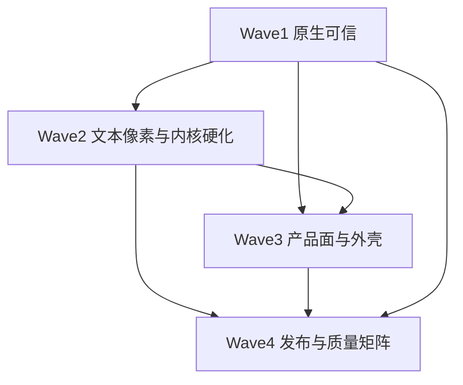

# RUI 工程级实现计划（巩固期）

> **文档地位**：把 [ENGINEERING_GRADE_FRAMEWORK.md](ENGINEERING_GRADE_FRAMEWORK.md) 的六条门槛与三轨，落成**可执行工作包（WP）**。  
> **前提**：阶段一～十二 **MVP 已完成**；本计划只做「MVP → 工程可承诺」。  
> **底座不变**：Solid 式响应式 + `winit/wgpu/taffy/glyphon`（禁区见纲领 §7）。  
> **日期**：2026-08-07  

交叉文档：[gap_analysis.md](gap_analysis.md) · [STAGE7_ROADMAP.md](STAGE7_ROADMAP.md) · [PUBLISH.md](PUBLISH.md) · [desktop_smoke.md](desktop_smoke.md)

---

## 0. 目标与退出条件

**总目标**：关闭纲领 §9 的 Beta DoD，对外叙事从 Alpha / 工程级 MVP → **Beta / 工程可用**。

| 门槛（纲领 §1） | 本计划对应波次 |
|-----------------|----------------|
| 1 可预测更新模型 | W2（Owner / ID / Store） |
| 2 可信原生桌面 | W1 |
| 3 测宽 ≡ 绘制 | W2 |
| 4 无障碍可接系统 | W1 |
| 5 质量门阻断回归 | W2 + W4 |
| 6 可发布契约 | W3 + W4 |

**硬退出（全部勾选才升 Beta）**：见文末 §8。

---

## 1. 基线事实（计划起点）

| 项 | 事实 |
|----|------|
| 代码 | `crates/` ≈ 4.2 万行 / 153 `.rs`；组件 ~49 源文件 |
| CI | 三平台 test + `clippy -D warnings` + `RUI_FORCE_SOFTWARE` offscreen |
| Golden | 仅 `offscreen_clear_blue_8x8` + `stage8_pattern`（**缺组件场景矩阵**） |
| Gallery | 侧栏分区：基础 / 表单 / 浮层 / 数据 / 导航 / 布局 / 文本 |
| 托盘 | `system-tray` feature 门闸；**原生未接线**（`tray.md`） |
| 发布 | `PUBLISH.md` 齐；**未实发 crates.io**；文档站为 stub |
| 冒烟 | `desktop_smoke.md` 清单存在；**三平台未签署** |
| 开放 P0 | 真窗口冒烟签署、crates.io、文档站正文 |

---

## 2. 波次总览与依赖



| 波次 | 主题 | 并行策略 | 建议工期* |
|------|------|----------|-----------|
| **W1** | 原生：IME / 焦点 / a11y / 冒烟签署 | 独占主线前半 | 1–2 周 |
| **W2** | 文本对齐 / damage / Owner·ID / golden 骨架 | 与 W3 前半可交错 | 2–3 周 |
| **W3** | Gallery / Chart·Path / Router·托盘 / 选器打磨 | 依赖 W2 行高后再做 Masonry | 2–3 周 |
| **W4** | crates.io / 文档站 / CI 矩阵 / SemVer / README Beta | 文档可提前起草 | 1–2 周 |

\*单人全职量级；可按人力并行压缩。每波结束必须：**代码合入 + 测试绿 + 更新本计划勾选 + 同步 gap §4.4**。

**明确不做**（整计划期）：换 VDOM/EUI DSL；弃 wgpu；Solid DOM/SSR；移动/鸿蒙一等公民；无验收大重构；DevTools（列入 Backlog §7）。

---

## 3. Wave 1 — 原生可信（轨道 A）

**目标**：桌面主路径「像系统控件」；冒烟表可签署。

### WP-1.1 IME 光标区与滚动同步

| | |
|--|--|
| **路径** | `app/input_controller.rs`、`app/ime_support.rs`、`app/window_events.rs`、`components/input.rs`、`components/textarea.rs` |
| **任务** | ① preedit 稳定上屏不丢字；② `set_ime_cursor_area` 随 ScrollArea / 缩放更新；③ 中日韩至少一种 IME 回归测（可手工 + 日志断言接口） |
| **验收** | `desktop_smoke` #3–#4 在开发机 Win 通过；滚动后候选窗不漂移。细则：[ime.md](ime.md) |
| **状态** | ☑ 代码+库测已合入；☐ 手工 #3–#4 待签署 |

### WP-1.2 焦点环与 Tab / roving

| | |
|--|--|
| **路径** | `style/focus_ring.rs`、`style/theme.rs`、`utils/roving.rs`、`components/focus_trap.rs`、Combobox / ContextMenu / Menubar / Tabs |
| **任务** | ① 可聚焦控件默认 `focus-visible` 环（ring token）；② 应用级 Tab 序文档化；③ 列表/菜单 roving 单测；④ Escape 仅关顶层浮层契约测 |
| **验收** | smoke #5–#7；roving 单测进 `cargo test -p rui --lib` |
| **状态** | ☐ |

### WP-1.3 AccessKit 主路径

| | |
|--|--|
| **路径** | `accesskit_bridge.rs`、Input / Button / Combobox（或 Menu） |
| **任务** | ① TextField / Button / ListBox 或 Menu Role 正确；② 焦点与 Action 同步；③ 文档：一条读屏复现步骤（Narrator / VoiceOver / Orca 任选） |
| **验收** | smoke #9 至少一平台签署；`docs/desktop_smoke.md` 或新 `docs/a11y_smoke.md` 写清步骤 |
| **状态** | ☐ |

### WP-1.4 三平台真窗口冒烟签署

| | |
|--|--|
| **路径** | [desktop_smoke.md](desktop_smoke.md)；示例 `gallery` |
| **任务** | ① Win / macOS / Linux 各填表；② 失败项开 issue 标签 `smoke`；③ 可选：半自动脚本记录窗口创建（不强制 CI 真窗） |
| **验收** | 表中 #1–#8 三列均有签署（#9 至少一平台） |
| **状态** | ☐ |
| **依赖** | WP-1.1～1.3 修完阻塞项后再签 |

**Wave 1 退出**：冒烟 #1–#8 全绿；AccessKit 主路径可演示。

---

## 4. Wave 2 — 文本、像素与内核硬化（轨道 B + 门槛 1）

**目标**：测宽≡绘制可测；damage 默认路径；Owner/ID 不泄漏；golden 可扩展。

### WP-2.1 测宽与 glyphon 分行对齐

| | |
|--|--|
| **路径** | `text/measure.rs`、`text/wrap_variable.rs`、`renderer/prepare_text.rs`、`layout/layout_tree.rs` |
| **任务** | ① 固定用例：ASCII / CJK / soft-wrap / chip·mention 断行；② 断言 `layout_lines*` 行数·行宽与 prepare 消费一致（容差文档化）；③ 无字体环境启发式不 panic |
| **验收** | 库测 `text_align_*`（命名自定）CI 绿；VirtualList 固定字号行高可断言 |
| **状态** | ☐ |

### WP-2.2 细粒度 damage 默认路径

| | |
|--|--|
| **路径** | `app/damage.rs`、`app/state.rs`、render 提交路径 |
| **任务** | ① 结构未变：`rects_union` → scissor / Load；② 结构变更才全帧 Clear；③ 计数器 `bind_text` 同宽场景不触发全屏 Clear（可测或 tracing 断言） |
| **验收** | 单测或 debug 计数；文档一句说明默认策略 |
| **状态** | ☐ |

### WP-2.3 子树布局上溢升父

| | |
|--|--|
| **路径** | `layout/layout_tree.rs`（`pick_subtree_compute_root`、`mark_dirty`） |
| **任务** | 尺寸上溢时升父/根的规则固化 + 单测（嵌套 flex 改子宽） |
| **验收** | `layout_mark_dirty` / 新测覆盖升父；无错误裁剪 |
| **状态** | ☐ |

### WP-2.4 Anchors / Bindings 挂 Owner + scoped ID

| | |
|--|--|
| **路径** | `app/reactive.rs`（`REGISTERED_ANCHORS` / `REGISTERED_BINDINGS`）、`core/reactivity.rs` |
| **任务** | ① 注册表条目随 owner dispose 移除（已有部分 `on_cleanup`，审计全覆盖）；② 辅助 API：scoped `template_id` / `focus_id`（owner path 前缀）；③ 长会话反复挂载/卸载无表膨胀测 |
| **验收** | dispose 后 registry 不含键；文档更新 [reactivity_and_hot_reload.md](reactivity_and_hot_reload.md) |
| **状态** | ☐ |

### WP-2.5 Store / Resource 契约加固

| | |
|--|--|
| **路径** | `core/store.rs`、`app/resource.rs`、`app/error_boundary.rs` |
| **任务** | ① `produce` 语义与文档示例；② Resource Err → ErrorBoundary 端到端测；③ 标明实验 API（若尚不承诺） |
| **验收** | 库测覆盖 produce + EB；SemVer 面草稿记入 CHANGELOG 草案 |
| **状态** | ☐ |

### WP-2.6 组件 golden 骨架（5 场景）

| | |
|--|--|
| **路径** | `renderer/offscreen.rs`、`crates/rui/tests/golden/`、CI `offscreen` job |
| **任务** | 落地场景：**Button**、**Input**、**Dialog**、**VirtualList**（或列表行）、**Markdown 块**；稳定哈希 / RGBA 比对；`RUI_UPDATE_GOLDEN=1` 流程写入 docs |
| **验收** | CI 跑通 ≥5 golden；更新失败时有明确重录说明 |
| **状态** | ☐ |
| **注意** | 软件渲染确定性：固定尺寸、禁动画、固定字体策略（见 [font_strategy.md](font_strategy.md)） |

**Wave 2 退出**：对齐测 + ≥5 golden CI；damage 策略可陈述；Owner 注册表无泄漏测。

---

## 5. Wave 3 — 产品面与桌面外壳（轨道 C 产品侧）

**目标**：Gallery 可作产品名片；关键控件键盘完整；外壳可演示应用骨架。

### WP-3.1 Gallery 覆盖矩阵

| | |
|--|--|
| **路径** | `examples/gallery` |
| **任务** | 公开组件每类至少一页或一节：基础、表单、浮层、数据（Table/Tree/VirtualList）、导航（Tabs/Menubar/Command）、反馈（Toast/Progress）、日期颜色、Chart |
| **验收** | `cargo run -p gallery` 可浏览上述分区；侧栏或 Tabs 导航 |
| **状态** | ☑ 侧栏分区已落地（2026-08-07） |

### WP-3.2 Path 原语 → Chart 加深

| | |
|--|--|
| **路径** | `primitives/path.rs`、`components/chart.rs`、renderer path 提交 |
| **任务** | ① path 可描边/填充进批处理；② Line 真实折线；③ Pie MVP（扇区或近似）；④ Gallery 页 |
| **验收** | 三种图至少两种可交互演示；非整矩形 stub |
| **状态** | ☐ |

### WP-3.3 Date / Time / Color 键盘与格式

| | |
|--|--|
| **路径** | `components/date_picker.rs`、`color_picker.rs`、Time 相关 |
| **任务** | 方向键改值；Enter 确认；Escape 关闭；ISO / 本地显示格式文档化 |
| **验收** | Gallery 可纯键盘完成一次选日期/颜色 |
| **状态** | ☐ |

### WP-3.4 浮层与 Command / Menubar a11y 打磨

| | |
|--|--|
| **路径** | `utils/popup.rs`、`command.rs`、`menubar.rs`、`combobox.rs` |
| **任务** | 与 WP-1.2/1.3 对齐：焦点陷阱、类型即搜（Command）、菜单 Role |
| **验收** | smoke #6–#7 + Command 打开关闭单测或手工清单项 |
| **状态** | ☐ |

### WP-3.5 Router + 次窗协作

| | |
|--|--|
| **路径** | `app/router.rs`、`app/navigator.rs`、`app/multi_window.rs`、`docs/multi_window.md` |
| **任务** | 侧栏路由 + 历史后退/前进示例；次窗焦点不破坏主窗；文档补协作图 |
| **验收** | 示例或 gallery「外壳」页：两页历史可回退 |
| **状态** | ☐ |

### WP-3.6 系统托盘原生接线（可选 feature）

| | |
|--|--|
| **路径** | `app/tray.rs`、feature `system-tray`、[tray.md](tray.md) |
| **任务** | 接入 `tray-icon`（+ 可选 `muda`）；Quit 经 `run_on_ui_thread`；默认 feature 仍关 |
| **验收** | `features = ["system-tray"]` 下托盘可见、Quit 退出；无 feature 时 stub 行为不变 |
| **状态** | ☐ |
| **优先级** | P1；若挡发布可降为 Beta 后，但须在 README 标明「stub」 |

### WP-3.7 VirtualMasonry（条件项）

| | |
|--|--|
| **依赖** | **WP-2.1 退出后**才开工 |
| **路径** | 新 `components/virtual_masonry.rs` 或 `utils/`；对照 EUI `virtualmasonry` |
| **任务** | 变高卡片虚拟化；行高来自 measure 缓存 |
| **验收** | Gallery 千级项滚动不掉帧（手工）+ 基本库测 |
| **状态** | ☐ |
| **优先级** | P2；不阻塞 Beta，阻塞「EUI 密度对标完成」叙事 |

**Wave 3 退出**：Gallery 分区完整；Chart≥2 种真实绘制；Router 历史可演示；托盘要么接线要么 README 诚实标注 stub。

---

## 6. Wave 4 — 发布与质量矩阵（轨道 C 发布侧）

**目标**：`cargo add rui` 可用；文档站可浏览；CI/SemVer/体积叙事齐套。

### WP-4.1 SemVer 承诺面与 CHANGELOG

| | |
|--|--|
| **路径** | `CHANGELOG.md`（新建）、README、三 crate `Cargo.toml` |
| **任务** | 划分 **稳定面**（Signal / `ui!`+Builder 双书写 / 主组件）vs **实验面**（Store 细节、托盘、部分 Chart）；0.1.0 发布说明 |
| **验收** | README 有表格；破坏性变更有记录模板 |
| **状态** | ☐ |

### WP-4.2 路径依赖 → crates.io 版本

| | |
|--|--|
| **路径** | `rui` → `rui_macros` / `rui_style_tokens` |
| **任务** | 按 [PUBLISH.md](PUBLISH.md) `cargo package` 验证；元数据勾选 |
| **验收** | 三包 `package` 无错误（发布令牌另计） |
| **状态** | ☐ |

### WP-4.3 首次 `cargo publish`

| | |
|--|--|
| **顺序** | `rui_style_tokens` → `rui_macros` → `rui` |
| **验收** | crates.io 可查；干净环境 `cargo new` + `cargo add rui` 编译最小 `run` 窗口 |
| **状态** | ☐ |
| **依赖** | WP-4.1、4.2；建议 W1 冒烟与 W2 golden 已绿 |

### WP-4.4 文档站正文

| | |
|--|--|
| **路径** | `docs/site/` → mdBook 或 VitePress（二选一，记入 ADR） |
| **内容最低集** | Getting Started（中英摘要可，**含 `ui!` 与 Builder 双写法**）；更新契约链到 reactivity 文；组件索引；示例命令；链到本计划与纲领 / [COMPONENT_LIBRARY.md](COMPONENT_LIBRARY.md) |
| **验收** | `mdbook build` / `npm run build` 产物可本地预览；crates.io README 链到站点或 docs |
| **状态** | ☐ |

### WP-4.5 CI 加深

| | |
|--|--|
| **路径** | `.github/workflows/ci.yml` |
| **任务** | ① 组件 golden job（W2 场景）；② `cargo test -p rui --lib` 保留；③ 可选 manual `workflow_dispatch` 真窗说明 job（不强制 runner 有显示）；④ bench 可选 nightly / 手工 |
| **验收** | PR 必过：fmt、clippy、test、golden≥5 |
| **状态** | ☐ |

### WP-4.6 体积/内存发布核对

| | |
|--|--|
| **路径** | [size_and_memory.md](size_and_memory.md) |
| **任务** | 复测 calculator release 体积；确认默认 GL 叙事；写入 Release checklist |
| **验收** | 发布说明含「框架 vs 驱动」一节链接 |
| **状态** | ☐ |

### WP-4.7 对外叙事升 Beta

| | |
|--|--|
| **路径** | README、纲领 §9、gap §4.4 |
| **任务** | 勾选 DoD；状态改为 Beta；关闭开放 P0 |
| **验收** | 纲领 §9 全勾；本计划 §8 全勾 |
| **状态** | ☐ |

**Wave 4 退出**：三 crate 已发布（或等价 yank 策略就绪）；文档站可浏览；CI golden 矩阵绿；README = Beta。

---

## 7. Backlog（Beta 后 / 明确延后）

| ID | 项 | 备注 |
|----|-----|------|
| B1 | DevTools（Signal 依赖图） | 不对齐 Solid 也不阻塞 Beta |
| B2 | `mergeProps` / `splitProps` / `children()` | DX 糖 |
| B3 | backdrop-blur 离屏缓存 | 视觉打磨 |
| B4 | 移动 / 鸿蒙 `PlatformWindow` 实装 | 仅留扩展点 |
| B5 | VirtualMasonry 产品化 | 见 WP-3.7 |
| B6 | 完整 3D/矩阵变换 | 当前 rotate/scale MVP 足够 |
| B7 | 真窗口 CI（云桌面 / self-hosted） | 冒烟签署可先顶上 |

---

## 8. Definition of Done（升 Beta 检查表）

复制自纲领 §9，实施时在此勾选：

- [ ] `cargo publish` 三 crate 成功；干净环境最小窗口可跑（WP-4.3）
- [ ] 文档站：Getting Started + 更新契约 + 组件索引（WP-4.4）
- [ ] 三平台真窗口冒烟 #1–#8 签署（WP-1.4）
- [ ] AccessKit 主路径可演示并有文档（WP-1.3）
- [ ] 测宽绘制对齐测 + ≥5 组件 golden CI（WP-2.1、WP-2.6、WP-4.5）
- [ ] gap / 纲领开放 **P0 = 0**（冒烟、crates、文档站）
- [ ] README：SemVer 承诺面 / 实验面 + 状态 **Beta**（WP-4.1、WP-4.7）

---

## 9. 执行节奏（建议日历）

| 周 | 焦点 |
|----|------|
| 1 | WP-1.1～1.3；并行起草 WP-4.1 CHANGELOG / 承诺面 |
| 2 | WP-1.4 签署；启动 WP-2.1、WP-2.4 |
| 3–4 | WP-2.2、2.3、2.5、2.6（golden 五场景） |
| 5–6 | WP-3.1～3.5；托盘 WP-3.6 视进度 |
| 7 | WP-4.2～4.6；冻结 API |
| 8 | WP-4.3 publish + WP-4.7 升 Beta；同步 gap / 纲领 |

可压缩：文档站与 CHANGELOG 从第 1 周并行；Masonry 整段移出 Beta 关键界。

---

## 10. 工作约定

1. **一 WP 一 PR**（或紧密相关小组）；PR 描述贴验收条目。  
2. **禁止**在巩固期引入新架构分叉；争议先写 ADR 再改纲领。  
3. 每波结束更新：本计划勾选、[gap_analysis.md](gap_analysis.md) §4.4、纲领 §4.4/§9。  
4. 测试命令基线：

```text
cargo fmt --all -- --check
cargo clippy --workspace --all-targets --no-deps -- -D warnings
cargo test -p rui --lib
cargo test -p rui --lib offscreen
cargo check -p gallery
```

5. 热路径改动优先加测，不依赖热重载证明正确性。

---

## 11. 文档拓扑（实施期）

```text
ENGINEERING_GRADE_FRAMEWORK.md     ← 为何 / 门槛 / 禁区（纲领）
ENGINEERING_IMPLEMENTATION_PLAN.md ← 本文件：WP / 波次 / DoD（执行）
COMPONENT_LIBRARY.md               ← 组件库权威规范（shadcn 面 + headless 骨架）
COMPONENT_LIBRARY_PLAN.md          ← 组件专项 C-WP（与本计划 W1–W4 交错）
STAGE7_ROADMAP.md                  ← 历史阶段七～十二 MVP 排期
gap_analysis.md                    ← 审计底稿与勾选
PUBLISH.md / desktop_smoke.md      ← 发布与冒烟操作手册
headless.md / custom_components.md ← 三层契约与用户扩展（从属组件规范）
```

组件产品面的选型与分层**不在此重开辩论**；**双书写面（`ui!` ↔ Builder）兼容**见 [COMPONENT_LIBRARY.md §3](COMPONENT_LIBRARY.md) / 纲领 ADR-9。重叠验收（焦点 / a11y / Gallery / golden / 文档索引）与 [COMPONENT_LIBRARY_PLAN.md](COMPONENT_LIBRARY_PLAN.md) 双清单勾选即可。

---

*计划随 WP 关闭而改勾选；新增 WP 须映射到纲领六条门槛之一，否则进 §7 Backlog。*
