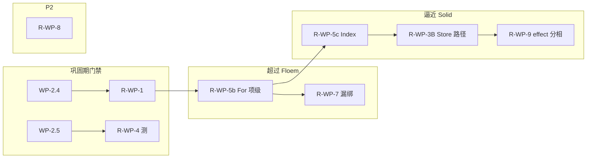

# RUI 细粒度响应式完善计划（R-WP）

> **冻结展开（2026-08-12）**：勾选、排期以 [`AUTHORITY.md`](AUTHORITY.md) **WP-2.4 / 2.5 / 2.7 / WP-R.*** 为**唯一执行源**。本文仅保留 R-WP 验收矩阵与加深细则；旧编号对照见 AUTHORITY §9。**禁止**在此改勾选充进度。  
> **原地位**：把 [`REACTIVITY.md`](REACTIVITY.md) 的开放缺口落成 R-WP。行为状态机下沉归组件域，不把开合塞进反应性包。  
> **前提**：ADR-1 已锁；主路径 API 已齐；**禁止为对齐 Leptos/Floem/Dioxus 扩 API 表面**。战略：[`REACTIVITY.md`](REACTIVITY.md) **§0.1 超过 Floem、逼近 Solid 机制**（§5.9 记分牌），不是 JSX/SSR。  
> **日期**：2026-08-12；**机制对照修订 2026-08-13**；**战略升格 2026-08-13**  

交叉：[`AUTHORITY.md`](AUTHORITY.md) · [`REACTIVITY.md`](REACTIVITY.md) · [`reactivity_and_hot_reload.md`](reactivity_and_hot_reload.md) · [`element_identity.md`](element_identity.md)

---

## 0. 目标与原则

**总目标**：卫生与契约可写入 SemVer；细粒度机制 **超过 Floem、逼近 SolidJS**（[`REACTIVITY.md`](REACTIVITY.md) §0.1 / §5.9）。顺序：I-7 For 项级 → I-11 Index → I-8 Store 路径 → I-12 effect 分相。不换核、不抄 VDOM/SSR。

| 原则 | 含义 |
|------|------|
| **硬化 > 扩面** | 卫生已齐；加深按 §0.1 序，不先做 DevTools / mergeProps |
| **不挡工程化** | 与 W1/W2/W4 **并行**；不以 Solid API / SSR 为 Beta 前置；**宣称超过 Floem** 须 WP-R.5b；0.1 Win-first 仍可不挡 |
| **一门禁一勾选** | WP-2.4 / 2.5 关闭条件仍记在总计划；R-WP-1/4 提供审计清单与加深，不另开第二套勾选互掐 |
| **原生优先对照** | **标尺 Solid**（要逼近机制）；**近邻 Floem**（要超过纯度）；图协议可借鉴 Leptos；**反例** Dioxus；禁止抄 SSR / 换核 |

**硬退出（反应性专项 DoD）**：

- [x] WP-2.4 ☑（总计划）：Anchors/Bindings 随 Owner dispose；scoped id 辅助 API；无表膨胀测  
- [x] WP-2.5 ☑（总计划）：produce 文档+测；Resource Err→EB e2e；SemVer 面草稿  
- [x] R-WP-2：根裸 `get()` 可观测或 debug 断言；文档红线可测  
- [x] [`REACTIVITY.md`](REACTIVITY.md) §6 表 G1–G3 / G5 关闭；G4 **升 P1**（逼近 Solid → WP-R.3B） 
- [ ] [`reactivity_and_hot_reload.md`](reactivity_and_hot_reload.md) 与 identity §7 与实现同步  

---

## 1. 与现有 WP 的映射（禁止重复）

| 总计划 WP | 本计划 | 分工 |
|-----------|--------|------|
| **WP-2.4** Anchors/Bindings→Owner + scoped ID | **R-WP-1** | 2.4 = 任务与 ☐ 勾选；R-WP-1 = 审计清单、测矩阵、`COMPONENT_*` 覆盖 |
| **WP-2.5** Store/Resource 契约 | **R-WP-3**（Store 加深，2.5 之后）· **R-WP-4**（异步契约，承接 2.5 测） | 2.5 只做 produce 契约 + EB e2e + 实验面标注；proxy / 自动桥为可选加深 |
| （无对应） | **R-WP-2** 双路径 / 根订阅 | 纯反应性卫生 |
| **WP-R.5** | **R-WP-5** 5a/b/c 列表 | 超 Floem + 逼近 Solid |
| **WP-R.3** | **R-WP-3B** Store 路径 | 逼近 Solid I-8 |
| **WP-R.9** | **R-WP-9** effect 分相 | 逼近 Solid I-12 |
| （无对应） | **R-WP-6** 热重载×反应槽 | 手册 + 回归 |
| **WP-R.7** | **R-WP-7** 宏降级 | 否则 5b 只写在纸上 |
| （无对应） | **R-WP-8** 可观测 | P2 |

组件侧：**C-WP-V.5 / 2.6** 管身份分类与空串；R-WP-1 提供 Owner 前缀能力后由组件计划消费。

---

## 2. 波次建议



| 阶段 | 包 | 说明 |
|------|----|------|
| **Gate（与 W2 并行）** | WP-2.4 + R-WP-1；WP-2.5 + R-WP-4 | 可预测更新门槛（已关） |
| **超过 Floem** | R-WP-5a/b + R-WP-7 | I-7 测绿才许宣称纯度超过 Floem |
| **逼近 Solid** | R-WP-5c + R-WP-3B + R-WP-9 | I-11 / I-8 / I-12 |
| **Later** | R-WP-8 | 可观测；非 DevTools UI |

---

## 3. 工作包明细

### R-WP-1 Registry Owner 收口验收

| | |
|--|--|
| **对齐** | 总计划 **WP-2.4**（勾选仍在总计划） |
| **路径** | `app/reactive.rs`（`REGISTERED_*`、`COMPONENT_PROPS`/`CHILDREN`）、`core/reactivity.rs` |
| **任务** | ① 审计：Anchor / Binding / COMPONENT_* 是否均在 owner dispose 或等价路径移除；② Binding 补 `on_cleanup`（若仅 unmount 不足）；③ 长会话挂载/卸载测：registry 键数不单调膨胀；④ 与 C-WP-2.6 对照全局 `"{id}__…"` 清单 |
| **验收** | 测矩阵写入本包附录或 `crate_tests/reactive/`；dispose 后无残留键；更新 [REACTIVITY.md](REACTIVITY.md) G1 |
| **状态** | ☑ 2026-08-13（勾选源 AUTHORITY WP-2.4） |

### R-WP-2 双路径收敛 / 根订阅可观测

| | |
|--|--|
| **路径** | `app/lifecycle`（根 effect）、`app/reactive.rs`、可选 debug feature |
| **任务** | ① 文档红线可测：根 `app_builder` 裸 `get()` 检测（debug assert 或计数钩子）；② 统计或测试锁定「优先 bind / Show，避免整树 diff」；③ 缩小必须走全树属性 diff 的场景说明 |
| **验收** | 至少一测证明误用可被发现或文档示例全部走三档；更新手册红线节 |
| **状态** | ☑ 2026-08-13（勾选源 AUTHORITY WP-2.7；`root_bare_get` 测 + `ui_root_effect_dep_count`） |
| **对照** | Floem：UpdaterEffect 推 `update_state`，非重建 View；Leptos：RenderEffect 绑叶子 |

### R-WP-3 Store 路径订阅（逼近 Solid · 选 B）

| | |
|--|--|
| **依赖** | WP-2.5 ☑；建议在 R-WP-5b 之后 |
| **路径** | `core/store.rs` |
| **任务** | **选 B**：路径触发器（思想对齐 Solid proxy / Leptos `reactive_stores`，实现自研）。兄字段 `set` **不**重跑弟 select/compute。`store_select`+`produce` 作过渡 SemVer 实验面可留 |
| **验收** | 字段级更新测：改 `age` 时 `name` select 的 compute 计数不变；CHANGELOG 标明路径 API |
| **状态** | ☐ **P1**（AUTHORITY WP-R.3；不再默认冻结 A） |

### R-WP-4 Async 边界完整契约

| | |
|--|--|
| **对齐** | 总计划 **WP-2.5** 任务② |
| **路径** | `app/resource.rs`、`app/error_boundary.rs`、`core/resource.rs` |
| **任务** | ① Resource Err→EB **端到端测**（2.5 门禁）；② 首载 / refetch / generation 取消策略表写入 REACTIVITY 或手册；③ 自动桥 vs 显式 `throw_error` 二选一文档化（巩固期允许显式） |
| **验收** | 2.5 勾选 + 策略表；无 SSR 语义 |
| **状态** | ①③ 随 WP-2.5 ☑（显式 `throw_resource_error`）；② 策略摘要见 [`REACTIVITY.md`](REACTIVITY.md) §4.1；自动桥加深仍可选 |

### R-WP-5 列表：超过 Floem（5b）→ 逼近 Solid Index（5c）

> 对照：Solid `mapArray` / `indexArray`；Floem `dyn_stack`（子 View diff，**弱于** Solid For）；**不要**学 Dioxus keyed 组件重跑。见 [`REACTIVITY.md`](REACTIVITY.md) §5.5 / §5.9。

| | |
|--|--|
| **路径** | `app/reactive.rs`、`app/state.rs` `reconcile_keyed_children` |
| **5a 硬化** | keyed 插/删/**换位**库测；文档标明现状 ≠ Solid For/Index |
| **5b 超 Floem（I-7）** | 每 key 一个 child `Owner`；列表 signal 只 insert/remove/reorder；未动 key **不**重跑项 `render`（Solid `mapArray`） |
| **5c 逼近 Solid（I-11）** | 真 `<Index>`：下标固定，项为 Accessor/`Signal`；同下标改值不重建节点 |
| **验收** | **5a** 插删换位绿；**5b** 无关项 / 换位时未变 key 的 render 计数不变 + Owner 无泄漏；**5c** 改 `items[i]` 只触发订了该项的 `bind_*` |
| **状态** | ☐ |
| **宣称门** | 5b 绿 → 可说「细粒度纯度超过 Floem」；5b+5c → 列表机制逼近 Solid |

### R-WP-6 热重载 × 反应槽不变量

| | |
|--|--|
| **路径** | `app/hot_reload.rs`、`reactivity_and_hot_reload.md` |
| **任务** | ① 结构岛稳定 `template_id` 指南（gallery 抽 2 例）；② 空 templates 退化整树策略写明；③ 与 `reconcile` 精确匹配回归（禁止 fuzzy） |
| **验收** | 手册 § 更新；至少一回归测或清单项 |
| **状态** | ☐ |

### R-WP-7 宏降级完备性

| | |
|--|--|
| **路径** | `rui_macros`、`#[component(reactive)]`、gallery 试点 |
| **任务** | ① `isolate_reads` 下漏绑回归；② Switch/Match 糖评估（可延后）；③ gallery 扩 `ReactiveStatusBadge` 模式 |
| **验收** | 漏绑有测或已知限制表 |
| **状态** | ☐ **P1**（否则超 Floem 只写在纸上） |

### R-WP-8 信号图可观测（P2 / Backlog）

| | |
|--|--|
| **任务** | effect/owner/订阅计数或泄漏诊断钩子；**非**完整 DevTools UI |
| **验收** | feature 门或 debug API 文档；进纲领 P2 |
| **状态** | ☐ |

### R-WP-9 Effect 分相（逼近 Solid · I-12）

| | |
|--|--|
| **对齐** | 总计划 **WP-R.9** |
| **路径** | `core/reactivity.rs` `flush_pending`；`bind_*` 标记为渲染绑 |
| **任务** | ① flush 序：dirty memo / Computed → `bind_*`（渲染）→ 用户 `create_effect`；② 可选 `create_computed`（同步写其它 Signal，对齐 Solid `createComputed`，**不必**改名 RenderEffect）；③ 测：一次 `set` 下 bind 先于用户 effect 观察到新值 |
| **验收** | 分相测绿；REACTIVITY §5.9 I-12 行更新；无 SSR tick 假设（可同帧，但顺序固定） |
| **状态** | ☐ P1 |

---

## 4. WP-2.4 / WP-2.5 验收清单（镜像，勾选以总计划为准）

### WP-2.4（镜像）

- [x] Anchors：owner dispose → 键消失（已有部分 `on_cleanup`，审计全覆盖）  
- [x] Bindings：同等保证  
- [x] scoped `template_id` / `focus_id` 辅助 API  
- [x] 长会话无膨胀测（`crate_tests/reactive/registry_owner.rs`）  
- [x] 文档：`reactivity_and_hot_reload.md` + `element_identity.md` §7  

勾选源仍以 [`AUTHORITY.md`](AUTHORITY.md) WP-2.4 为准（☑ 2026-08-13）。

### WP-2.5（镜像）

- [x] `produce` 语义与文档示例  
- [x] Resource Err → ErrorBoundary e2e  
- [x] 实验 API 列入 CHANGELOG 草案  

勾选源仍以 [`AUTHORITY.md`](AUTHORITY.md) WP-2.5 为准（☑ 2026-08-13）。

---

## 5. 明确不做

- 为追 Leptos 而引入 SSR / hydrate / `Resource` 编解码  
- 把 `core/reactivity` 替换为依赖 `reactive_graph` / `floem_reactive`（对照学习可以，换核需独立 ADR）  
- 巩固期实现 **JS Proxy 式** Store 运行时（WP-R.3B 是自研路径触发器，不是把 Proxy 搬进 Element）  
- 用反应性专项阻塞 Win-first 0.1 发布（门禁仅 WP-2.4 泄漏测建议进 Beta；0.1 Alpha 可注明已知限制）  

---

## 6. 工作约定

1. **一 R-WP 一 PR**（或与对应 WP-2.x 同 PR，描述写清双勾选）。  
2. 关闭 G 项时同步改 [`REACTIVITY.md`](REACTIVITY.md) §6。  
3. 测试基线同总计划 §10；反应性改动优先 `crate_tests/reactive/` + 模块内测。  
4. 对照代码只读 `Reference/SolidJS`、`Reference/leptos-main`、`Reference/floem-main`、`Reference/dioxus`，禁止无 ADR 复制粘贴进 `crates/rui`。  

---

## 7. 文档拓扑

```text
AUTHORITY.md                        ← ★执行源（WP-2.4 / 2.5 / 2.7 / WP-R.*）
ENGINEERING_GRADE_FRAMEWORK.md
REACTIVITY.md                       ← 领域规范（§5 四框架机制 + §5.7 完整 FG）
REACTIVITY_PLAN.md                  ← 本文件（R-WP 冻结展开；R-WP-5 = 5a/5b）
reactivity_and_hot_reload.md        ← 手册
element_identity.md
```

---

*冻结：勾选改 [`AUTHORITY.md`](AUTHORITY.md)；本文仅保留 R-WP 细则。*
