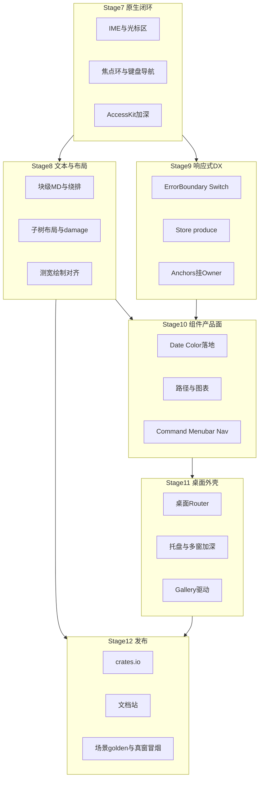

# RUI 工程级后续发展路线图（阶段七～十二）

> **历史排期（非巩固期执行源）**。阶段七～十二 **MVP 勾选已完成**；深化与 Beta DoD 请跟 [AUTHORITY.md](AUTHORITY.md)。门槛见 [ENGINEERING_GRADE_FRAMEWORK.md](ENGINEERING_GRADE_FRAMEWORK.md)。

依据 [gap_analysis.md](gap_analysis.md)、[PROJECT.md](PROJECT.md)。**底座不变**：Solid 式响应式 + `winit/wgpu/taffy/glyphon`；差距在原生层、产品面与发布工程。

> 命名约定：只用「阶段七」…「阶段十二」，**不分** + / ++ / +++。

当前已并入主线（阶段一～六）：AccessKit 桥、细粒度 `reactive!` / memo、热重载契约、多窗口、FontSystem 共享、`createResource`/`Suspense`、markdown inline 等（见 [gap_analysis.md](gap_analysis.md) §7）。

---

## 现状锚点（阶段六后 · 历史；2026-08-09 勘误）

- 阶段清单 P0/P1/P2 已关；开放面转为巩固期：**真窗冒烟签署、组件 golden≥5、crates.io、文档站、稳定面 CV**。
- Solid：`ErrorBoundary` / `switch_reactive` / `on_mount` **已落地**（旧「缺」作废）；部分 reconcile / Index；`mergeProps` 等可长期空缺。
- 组件：约 **45** 公开模块（见 [COMPONENT_LIBRARY.md](COMPONENT_LIBRARY.md) §5）；相对 EUI 仍缺块级 markdown 等。 VirtualMasonry **WP-3.10 ☑**（experimental）。
- MVP 已有、工程未闭环：IME 代码路径、焦点环、focus_trap、Router/次窗、块级 md MVP、2 个 offscreen golden、Gallery 八分区。

原则（历史）：**先堵原生与文本坑，再铺产品组件，最后发布**。现执行节奏见巩固期计划。

---

## 阶段七 · 原生输入与焦点闭环（桌面可用性）

**目标**：输入框 / 文本域 / 组合框在 Win·macOS·Linux 上「像系统控件一样可用」。

| 工作包 | 内容 | 关键路径 |
|--------|------|----------|
| IME 深度 | preedit 稳定、合成窗定位、`set_ime_cursor_area` 与滚动/缩放同步；中日韩回归用例 | `input_controller.rs`、`window_events.rs`、Input/Textarea |
| 全局焦点环 | 主题 `ring` token 统一；可聚焦控件默认 `focus-visible` 环 | `style/theme.rs`、`style/focus_ring.rs` |
| 键盘导航层 | 应用级 Tab 序；列表/菜单 **roving tabindex**；Escape 关闭浮层契约 | `utils/focus_trap.rs`、Combobox/ContextMenu |
| AccessKit 加深 | 更多 Role（text field、menu、listbox）；键盘 Action 与焦点同步 | `a11y/bridge` |
| 真窗口冒烟 | 三平台「打开示例 → 输入中文 → Tab 移焦」清单 | [desktop_smoke.md](desktop_smoke.md) |

**验收**：IME 合成不丢字、光标区不漂移；Tab 可走完主路径表单；读屏能读到 Input 名称与值变化。

---

## 阶段八 · 文本管线与布局/渲染打磨

**目标**：块级内容与虚拟列表可信；测宽与绘制一致；脏区更细。

| 工作包 | 内容 | 关键路径 |
|--------|------|----------|
| 块级 Markdown | 标题/段落/列表/代码块/引用 → Element 树 | `text/markdown.rs` |
| 逐行变宽绕排 | Pretext 式行可用宽可变 MVP | `text/measure.rs` |
| glyphon ↔ layout_lines | soft-wrap / chip 与绘制分行一致 | `prepare_text.rs` |
| 字体策略 | UI 字体打包与字重回退 | `font_loader.rs` |
| 子树布局加深 | 尺寸上溢时升父/根（☑ WP-2.3） | `layout_tree.rs` · [layout_subtree.md](layout_subtree.md) |
| 细粒度 damage | 结构未变时按元素 rect union | `damage.rs` |
| 组件级 golden | 场景进 CI | `offscreen.rs` |
| Scrollbar overlay | 不占布局宽的 overlay 条 | `scrollbar.rs` |

**验收**：块级 markdown 可渲染 README 级文档；至少 2 个组件 golden 在 CI 绿（含纯 CPU `stage8_pattern` + 既有 offscreen clear）。

阶段八 MVP 落点：

- [`text/markdown.rs`](../crates/rui/src/text/markdown.rs) · [`layout_lines_variable_width`](../crates/rui/src/text/wrap_variable.rs)
- [`damage::rects_union`](../crates/rui/src/app/damage.rs) · Scrollbar `overlay(true)`
- [`docs/font_strategy.md`](font_strategy.md) · golden `stage8_pattern`

---

## 阶段九 · 响应式与 DX 硬化

**目标**：异步错误可捕；分支原语齐；Store/ID 更可维护。

| 工作包 | 内容 | 关键路径 |
|--------|------|----------|
| `ErrorBoundary` | 捕获资源 Err；fallback UI | `app/resource.rs` / reactivity |
| `<Switch>` / `<Match>` | `switch_reactive` API | `app/reactive.rs` |
| `onMount` | Owner 首次挂载回调 | `core/reactivity.rs` |
| Store 加深 | `produce` 式原地更新 | `core/store.rs` |
| Anchors 挂 Owner | REGISTERED_* 随 owner 回收 | `app/reactive.rs` |
| ID 策略 | scoped `template_id` / `focus_id` 辅助 | gap §3.2 |
| Headless 布局测试 | 无窗口 `build_and_layout` + bounds | `src/crate_tests/layout/` |
| DX 文档 | reactivity / headless 更新 | docs |

**验收**：Resource 失败可被 ErrorBoundary 接住；Switch 有测；headless 布局测进 CI。

---

## 阶段十 · 组件产品面

**目标**：填占位与高优先级缺失控件；图表先补绘制原语。

- **A. 占位落地**：DatePicker / TimePicker / ColorPicker
- **B. 导航与命令**：Sheet、Menubar、Command、Navbar/Sidebar（确认框并入 Dialog，已无独立 AlertDialog）
- **C. 反馈与流程**：Progress、Stepper、Segmented、Carousel
- **D. 绘制 → 图表**：路径原语 → Bar/Line/Pie
- **E. VirtualMasonry**（依赖阶段八行高）→ **WP-3.10 ☑** experimental
- **F. Gallery**：每组件一页 examples

**验收**：占位三者可交互；Command + Menubar 可演示；至少 1 种图表；gallery 可本地跑。

---

## 阶段十一 · 桌面外壳与应用骨架

| 工作包 | 内容 |
|--------|------|
| 桌面 Router | 路由表 + 历史后退/前进；与 Navigator（转场栈）协作 |
| 多窗口加深 | 次窗事件/焦点/菜单协作 |
| 系统托盘 | 托盘图标 + 菜单 |
| 剪贴板/拖放加深 | 跨控件文本 / 自定义 MIME |
| 平台抽象 | `PlatformWindow` 扩展点；移动/鸿蒙不阻塞桌面 |

**验收**：示例 App：侧栏路由 + 两页历史 + 托盘退出。

---

## 阶段十二 · 发布与生态

| 工作包 | 内容 |
|--------|------|
| crates.io | 版本策略、feature 门、SemVer 承诺面 |
| 文档站 | 中英双语；Getting Started；组件 API；示例索引 |
| CI 加深 | 组件 golden 矩阵；可选真窗口 job |
| Bench 看板 | layout / reconcile / text measure 基线 |
| 体积/内存 | [size_and_memory.md](size_and_memory.md) + 发布 checklist |
| 同步 gap | 每阶段结束更新 [gap_analysis.md](gap_analysis.md) §7 |

**验收**：`cargo add rui` 可编译最小窗口；文档站有示例索引；CI 含场景 golden。

---

## 建议执行节奏（历史；已移交）

阶段七～十二 MVP 已落地。后续节奏以巩固期 **Wave 1–4** 为准，勿再按本节日历开新阶段编号。

**明确不做**：换 VDOM/EUI DSL；弃 wgpu 追体积；完整 Solid DOM/SSR；移动端一等公民（仅留抽象）——与纲领禁区一致。

---

## 历史占位（已并入上表）

原四条长期项对照：

1. Headless 测试 → 阶段九 / 十二
2. 桌面 Router → 阶段十一
3. 文档站 → 阶段十二
4. 跨平台冒烟 → 阶段七冒烟表 + 阶段十二 CI
