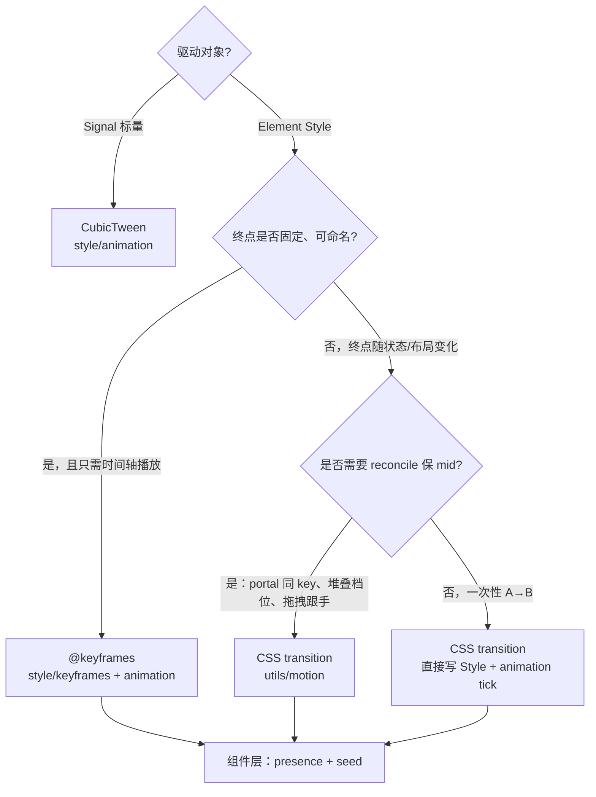

# CSS 动画与 Motion

> **文档地位**：RUI 动画**唯一手册**。**第一部分** — 分层选型与模块边界（`keyframes` / `animation` / `motion` / 组件编排）。**第二部分** — CSS Animations Level 1 + CSS Transitions **已承诺子集**。**第三部分** — 源码入口。  
> **冻结状态**：**已冻结**（2026-09-06；`anim_freeze` 20 项绿；Gallery「ANIM 对齐」+ Accordion/Dialog/Toast 路径与 §8 一致）。纠错（行号、测试名、实例表增行）可改；**策略变更须改本文并跑 `cargo test -p rui --lib anim_freeze`**，禁止静默扩面。  
> **冻结含义**：第一部分 = 模块边界 / 选型 ADR（不把 `motion` 迁入 `style/`；presence 用 `animation_run_active`）。第二部分 = CSS 子集 + `PropertyId` 单轨（64 槽已满）。新增组件动效只增 §8 行，不改引擎契约。  
> **读者**：写 Accordion / Dialog / Toast 等组件的作者；改 `style/animation` 引擎的实现者。  
> **执行源**：ANIM-0～6 已退出排期；§16 勾选仅为落地史。  
> **实现锚点**：`style/animatable.rs` · `style/timing.rs` · `style/animation.rs` · `style/waapi.rs` · `style/keyframes.rs` · `style/easing.rs` · `style/specified.rs` · `style/used_layout.rs` · `utils/motion.rs` · `utils/presence.rs` · `crate_tests/style/anim_freeze.rs`  
> **相关**：[`custom_components.md`](../components/custom_components.md) · [`headless.md`](../components/headless.md) · [`COMPONENT_LIBRARY.md`](../COMPONENT_LIBRARY.md) §2.1 · [`box_model.md`](box_model.md) · [`layout_subtree.md`](layout_subtree.md) · [`damage.md`](damage.md) · EUI 动画产品模型（非冻结面）见 [`EUI_NEO_VISUAL.md`](../comparison/EUI_NEO_VISUAL.md) **§8**；GPUI / gpui-component 动画轴见同文 **§9** 与本文 **§21**

---

# 第一部分 · 分层选型与模块边界

## 1. 总览：四条线

RUI 把 Web 上的 `transition` / `@keyframes` / `animation` 拆成 **样式引擎** 与 **组件编排** 两层，中间用 **Motion 原语** 桥接 transition 路径：

```text
style/keyframes.rs     ── WHAT   可命名的 @keyframes 曲线（KeyframeStop 注册表 + 采样）
style/animation.rs     ── HOW    CSS transition / @keyframes 运行时（tick、snapshot、lock）
utils/motion.rs        ── RECIPE transition 路径的 Element 侧配方（只写目标、保 mid）
utils/presence.rs      ── WHEN   何时挂载/卸载（ExitGate；与曲线无关）
components/*           ── WIRE   产品语义、presence、DOM 结构、seed 时机
components/internal/   ── SHARE  多组件共享的 presence + 动效编排（如 modal_motion）
```

**不要混淆**：

| 模块 | CSS 对应 | 驱动方式 |
|------|----------|----------|
| `keyframes` + `animation`（keyframes 分支） | `@keyframes` + `animation-*` | 按 **时间轴** 采样关键帧；`AnimationSnapshot` |
| `animation`（transition 分支） | `transition-*` | 属性 **A→B** 插值；`TransitionSnapshot` |
| `motion` | 无独立 CSS 名；封装 `transition-*` 用法 | **只写目标**，mid 由 transition 引擎推进 |
| `animation::CubicTween` | 类似 `transition`，但走 **Signal** | 少数非 Element 路径（如 Slider）；与 `motion` 正交 |

另有 [`style/timeline.rs`](../../crates/rui/src/style/timeline.rs)（通用时间线 / B17 文字特效），与本文 CSS 动效栈并列，**不**替代 `keyframes` / `transition` MVP。

三层模型（详见 **§11.5**）：**引擎**（`Timing::resolve` + 插值 + 中断）必做；**声明式**（`transition` / `animation` / `@keyframes`，含 `spring()`）是前端承诺；**编程式**是 id 句柄 + `play`/`pause`/`reverse`/`seek`/`set_rate`，不是 WAAPI 规范对象。Spring 是与 duration easing 并列的驱动源。

---

## 2. 选型决策（先答「用哪条引擎」）



### 2.1 用 `@keyframes`（`keyframes` + `animation`）

适合：

- 曲线 **固定**、可注册为全局名（`fade-in-0`、`zoom-in-90`、`accordion-down`）
- 播放一次或循环，由 **duration / iteration** 控制
- 缺省端点可来自元素 **cascaded base**（如 `accordion-down` 的 `max-height: 0 → content-height`）

典型：**Accordion** 面板高度、**Dialog** overlay/panel 淡入缩放。

#### 2.1.1 `max-height` keyframes 与 `min-height`

Taffy 下 `min-height: auto` = min-content。若 **padding 打在外层 clip 壳** 上，即使 `max-height → 0` 也会被 min-content 顶住（Accordion 收起漏字根因）。

- **引擎**：`tick_element_animations` 在 keyframe 拥有 `max-height` 时把 `min-height` 钉为 `0`，`style.animations` 清空后从 `AnimationBaseline` 恢复。
- **结构**：外层 clip 壳只负责 `overflow-hidden` + `min-h(0)`；`px`/`pb` 放 inner（见 [`box_model.md`](box_model.md) §2.5.1）。

#### 2.1.2 Presence 退场：`animation_run_active` vs `css_animation_needs_frame`

| API | 语义 |
|-----|------|
| [`animation_run_active`](../../crates/rui/src/style/animation.rs) | 仍有 **未 finished** 的 finite run → presence 可结束退场 |
| [`css_animation_needs_frame`](../../crates/rui/src/style/animation.rs) | `style.animations` 非空 **或** run active → **帧泵**是否继续 |

`fill-mode: forwards` 结束后 run 已 `finished`，列表仍非空；用 `css_animation_needs_frame` 判断退场会 **永不 finish**（整页每帧 `LayoutChanged`）。Accordion / Dialog 等 presence 组件应使用 `animation_run_active`。

### 2.2 用 CSS `transition` + `utils/motion`

适合：

- **目标每帧/每状态变化**（堆叠 rank、拖拽偏移、Sheet 贴边滑入）
- **reconcile / portal hoist** 后须保留 mid（Toast `toast-card-{id}`）
- 需要 `MotionStyle` 记住「上一帧目标」（style 可能是 mid，不能 style≈target 判等）
- 跟手拖拽时要 `clear_motion`

典型：**Toast** 入退场/堆叠、**Sheet/Drawer** 滑入、Carousel 档位。

### 2.3 用裸 `transition`（不经 `motion`）

适合：

- 单次、简单、无 reconcile 需求（如 Accordion chevron 的 `rotate` transition）
- 已在 Builder 上写 `transition(...)` 且不需要 `prepare_motion_sync` 配方

### 2.4 用 `CubicTween`

适合：**Element 树之外**、或绑定 **Signal** 的标量过渡（Slider 等）。不要与 Toast/Modal 的 Element CSS 路径混用。

---

## 3. `style/keyframes.rs` — 写什么

**职责**：`@keyframes` **规则本体** — 注册、查找、按 CSS 语义采样。

### 应当放在这里

| 内容 | 示例 |
|------|------|
| `KeyframeStop` 定义与 builder | `.at(0.0).opacity(0.0)` |
| 内置 shadcn/Tailwind 同名规则 | `fade-in-0`、`zoom-in-90`、`accordion-down/up`、`slide-in-from-*-2` |
| `register_keyframes` / `lookup_keyframes` / `keyframes_exist` | 应用可注册自定义名 |
| 采样逻辑 | `sample_keyframes_eased`（分段 easing、implicit 0%/100%） |
| `KeyframeBase` | cascaded value，供单端点 keyframes 补全 |

### 不应放在这里

- `AnimationEntry` 的 duration / timing / fill-mode **预设**（见 §4，可放 `animation.rs`）
- presence、何时 seed（intrinsic 高度走引擎 `used_layout`）
- 组件 DOM 结构（Dialog 的 overlay + zoom 双层）
- `Element` / `reactive_sync` / damage 相关逻辑

### 判断口诀

> **若删掉所有组件，这条曲线仍应在 CSS 里有意义** → 放 `keyframes`。

---

## 4. `style/animation.rs` — 写什么

**职责**：CSS **运行时引擎** — 推进 transition 与 `@keyframes`，管理 snapshot 与属性 lock。

### 应当放在这里

| 内容 | 示例 |
|------|------|
| `tick_element_transitions` / `TransitionSnapshot` | transition A→B |
| `tick_element_animations` / `AnimationSnapshot` / `AnimationLock` | keyframes 时间轴 |
| `animation_run_active` | presence 退场：run 是否仍在播放 |
| `css_transition_needs_frame` / `css_animation_needs_frame` | 是否要下一帧（帧泵） |
| `snap_element_transitions_to_current` | 基线 snap |
| `TimingFunction` 求值、`cubic_bezier_y_at_x` | easing 数学 |
| `CubicTween` / `use_ui_transition_cubic` | Signal 标量 tween |
| 通用 `AnimationEntry` 工厂 | [`keyframes_anim_entry`](../../crates/rui/src/style/animation.rs)（`name`, `duration_ms`, `timing`, `fill_mode`） |
| **可选**：shadcn **bundle** 预设 | `shadcn_dialog_enter_anims()` → `[fade-in-0, zoom-in-90]` |

### 不应放在这里

- `MotionStyle` / `prepare_motion_sync`（属于组件 authoring 配方，见 §5）
- `ExitGate` / mounted / portal 卸载延迟
- Toast 堆叠 rank、Modal 嵌套 scale 等产品计算
- 依赖 `Element.template_id` 的子树查找

### 与 `keyframes` 的分界

| | `keyframes` | `animation` |
|---|-------------|-------------|
| 问题 | **画什么曲线** | **怎么随时间播放** |
| 输入 | 名称 → stops | `Style.animations` + snapshot |
| 输出 | `KeyframeSample` | 写回 `Style` 各属性 |

---

## 5. `utils/motion.rs` — 写什么

**职责**：在 **CSS transition 路径**上，为 `reactive_sync` / 浮层作者提供 **可复用配方** — 「只写目标，mid 由引擎推」。

**WP-PRIM.2**；与 [`presence`](../components/custom_components.md)（WP-PRIM.1）、[`keyed_overlay`](../components/custom_components.md)（WP-PRIM.3）同级，属于 **行为工具**，不是样式子系统的底层一块。

### 应当放在这里

| 内容 | 示例 |
|------|------|
| `MotionTransform` / `MotionStyle` | 跨帧记住**目标**姿态 |
| `ensure_motion_transitions` | 幂等写入 `TransitionEntry` |
| `prepare_motion_sync` + `MotionBootstrap` | EnsureAfterSnap / SnapAfterEnsure 首帧 seed（都是 **ensure → snap**；`transition` 为空时 snap 不建档） |
| `clear_motion` / `snap_motion_baseline` | 拖拽清场、退场 seed |
| `motion_is_animating` / `motion_sync_status` | 按卡要帧 + frame damage |
| 与 transition 引擎无关的 **通用容差** | `MotionEpsilon` |

### 不应放在这里

- `@keyframes` 注册或采样
- `AnimationEntry` / `animation_snapshot` 编排（Dialog/Accordion 的 keyframes 路径）
- 产品语义（Toast 的 `behind_fade`、Sonner limit、Modal 的 slide 轴长）
- presence 状态机本身（应用 `presence`，不要塞进 `motion`）

### 判断口诀

> **帮助作者在 Element 上正确消费 `tick_element_transitions`** → 放 `motion`。  
> **帮助引擎计算下一帧 Style** → 放 `animation`。

---

## 6. 组件 / `internal` — 写什么

组件层（含 `components/internal/modal_motion.rs`）保留 **编排与产品语义**：

| 保留在组件 | 原因 |
|------------|------|
| `ExitGate` / `needs_enter` / `needs_exit_anim` | 生命周期与卸载时机 |
| `seed_*_enter_anim` / `seed_*_exit_anim` | 挂 named `@keyframes`；specified 保持 `auto` |
| 引擎 `used_layout` | Accordion / Collapsible / Expand 读 intrinsic，禁止组件测高 |
| DOM 结构 | Dialog overlay + zoom 内层 |
| 引擎选型 | Dialog 用 keyframes，Sheet 用 motion |
| 产品参数 | Toast 堆叠、拖拽、tone shadow |

**反模式**：在 `accordion.rs` 里重新定义 `fade-in-0` 的 stops — 应已在 `keyframes`；在 `toast/motion.rs` 里实现 transition tick — 应调用 `animation`。

---

## 7. 是否将 `motion` 迁入 `style/`？

### 结论：**不建议迁移**

`motion` 与 `animation` / `keyframes` **语义相关但层级不同**，当前 `utils/motion` 的位置符合 [`COMPONENT_LIBRARY.md`](../COMPONENT_LIBRARY.md) §2.1 行为工具分层。

### 理由

| 维度 | `style/animation` · `style/keyframes` | `utils/motion` |
|------|----------------------------------------|----------------|
| **抽象** | 纯样式引擎（主要操作 `Style` + snapshot） | Element 树 authoring 原语 |
| **依赖** | 布局 px 换算、采样数学 | `Element`、`app::damage`、reconcile 约定 |
| **消费者** | 引擎、utility class、tick 全局调度 | 组件作者、Toast/Carousel/Modal(Sheet) |
| **与 WP 对齐** | 样式子系统 | **WP-PRIM.2**，与 presence/keyed_overlay 并列 |
| **文档入口** | `style/mod.rs` | `custom_components.md` / `headless.md` |

把 `motion` 挪进 `style/` 会模糊「样式引擎 vs 组件工具」边界，且对 keyframes 路径 **无收益**。

### 何时才考虑 `style/motion.rs`

仅当 `motion` **完全**去掉对 `Element` / damage 的依赖、退化为纯 `Style` 上的 transition 辅助时；以当前 API（`prepare_motion_sync(el: &mut Element, …)`）**不成立**。

---

## 8. 仓库内实例对照

| 组件 | 引擎 | 曲线 / 配置位置 | 编排位置 |
|------|------|-----------------|----------|
| Accordion 面板 | `@keyframes`（默认）或 `transition`（flag） | `keyframes`: `accordion-down/up`；备选 **通用** `grid-template-rows` `0fr→1fr`（`RUI_ACCORDION_GRID_FR=1`） | `accordion.rs` 只是消费者 |
| Accordion chevron | `transition` | 组件内 `TransitionEntry` | 简单 rotate，无需 `MotionStyle` |
| Dialog | `@keyframes` | `keyframes`: `fade-in-0`, `zoom-in-90`, … | `internal/modal_motion.rs` |
| Sheet / Drawer | `transition` + `motion` | `modal_motion`: slide entries | `MotionStyle` + presence |
| Floating Fade | `@keyframes` | `fade-in-0` / `fade-out-0` | `internal/floating_motion.rs` |
| Floating Expand | `@keyframes` | `accordion-down/up` | `internal/floating_motion.rs` |
| Toast | `transition` + `motion` | `toast/motion.rs`: phase → entries | 堆叠/drag/队列语义 |

---

## 9. 新增动效检查清单

1. **选型**：按 §2 流程图确定 keyframes / transition+motion / CubicTween。
2. **曲线下沉**：可复用的 stops → `register_keyframes`（或 `ensure_builtins`）。
3. **Entry 工厂**：duration/timing/fill 重复 → `style/animation` 预设。
4. **Transition 配方**：Element + reconcile + 目标 dedupe → `utils/motion` 或复用现有 API。
5. **Presence**：挂载/卸载 → `utils/presence`；keyframes 退场未完成时 **禁止** ExitGate 提前卸载。
6. **产品逻辑**：留在 `components/` 或 `components/internal/`，勿污染引擎层。
7. **扩面**：新 animatable 属性 → **§13 / §11.4** + `PropertyId` 注册表 + `anim_freeze`；禁止扩展 `KeyframeStop` 手工字段。`PropertyId` 64 槽已满，扩槽须先改本文冻结面。

---

# 第二部分 · CSS 动画冻结子集（对齐 Web）

> **规范参照**：[MDN CSS Animations](https://developer.mozilla.org/en-US/docs/Web/CSS/Guides/Animations) · [Animatable properties](https://developer.mozilla.org/en-US/docs/Web/CSS/Guides/Animations/Animatable_properties) · CSS Animations L1 · CSS Transitions  
> **CI**：`cargo test -p rui --lib anim_freeze`

## 10. 一句话

RUI 用 **一条 `PropertyId` 插值轨** 驱动 CSS `transition` 与 `@keyframes`：作者只写 class / `animation()` / `@keyframes` 文本；**禁止** 再给 `KeyframeStop` 手工加字段。组件不做布局测高。本冻结面承诺 §11.1 + §13 + **三层动画模型（§11.5）**；§11.4 是**明确不做 / 扩面须改本文**的清单，不是欠账。扩面仍须改本表再写代码。

---

## 11. 目标与对齐边界

### 11.1 冻结目标（已达成）

与 Web 对齐的动画基底（`PropertyId` 单轨 + Specified/Used 值模型 + 布局动画 + 文本继承属性）已落地：组件创作 **只写 CSS 语义**（class / `animation()` / `@keyframes` 文本），**禁止** 再为单个组件向 `KeyframeStop` 手工加字段。

### 11.2 三问直接回答

| # | 问题 | 结论 |
|---|------|------|
| **1** | CSS **cascaded value** 能否在 RUI 实现、且**组件不做布局测量**？ | **能，但要分层。** 非布局属性可完全由引擎维护 **Specified ↔ Used** 双轨。**尺寸类** used 值在 layout pass 后写入 `Element.used_layout`；Accordion 等改读引擎缓存，**零组件侧测量**。 |
| **2** | Layout 动画是否要做、如何优化？ | **要做。** 子树增量 layout、compositor 与 layout 分 tick、`will-change`、帧内合并 layout 请求。 |
| **3** | Text `color` 等如何补齐？ | **扩展动画目标到 Present 视图**（`Style` + 继承 `TextStyle`）；tick 从「只写 `Style`」改为写 Present + 文本继承链。 |

### 11.3 纳入「最大对齐 v1」

| 域 | 内容 |
|----|------|
| **@keyframes** | 多 stop、分段 `timing-function`、implicit 0%/100%、Rust 注册 + **CSS 文本解析** |
| **animation-*** | L1 全部 longhands；`steps()`/`jump-*` |
| **transition-*** | property/duration/delay/timing；与 keyframes **共用**插值表 |
| **Animatable 属性** | 见 §13 矩阵：A 合成 + B 绘制 + C 布局 + D 文本 |
| **Reduced motion** | `RUI_REDUCED_MOTION=1` / `set_prefers_reduced_motion`：tick 把 `dt` 拉到区间末（snap 终值），不是删掉 `animation` 列表 |
| **Utility** | Tailwind `animate-*` / `transition-*` 与属性表 1:1 |

### 11.4 未纳入本冻结面（扩面须改本文）

`PropertyId` **64 槽已满**（`Opacity = 0` … `TranslatePct = 63`；`PropertyId::ALL.len() == 64`，`anim_freeze::property_id_table_is_full_u8_bitmap`）。新属性 **不能**再挤 `repr(u8)` 位图；须先改冻结面并换存储策略（例如 `u128` / 第二位图）。

| 项 | 为何未进 v1 | 再做的代价 |
|----|-------------|------------|
| **`background-size` 动画** | 无空槽 | 扩 `PropertyId` 位图 + 改 §13 |
| **`transition-behavior: allow-discrete`** | 不占槽，未承诺 | 现成 discrete 路径加开关 + 改本文 |
| **`view-timeline-inset` 全集** | 不占槽，未承诺 | 扩 `view_timeline` 解析 + 改本文 |

**硬边界（仍不做）：**

| 项 | 理由 |
|----|------|
| 浏览器 **DOM** `animation*` 事件 / `Promise` / `DocumentTimeline` | 无 DOM；完成通知是 callback / `Signal` |
| **编程面 `composite: add/accumulate`** | 声明式 `animation-composition` 已保留 |
| **vertex instance loc 2–15 再加字段** | 已满；新几何走 storage buffer |
| **vertex interpolator loc >14** | 设备上限；禁止 `@location(15)` 输出 |

负 `animation-delay`：`after_delay = elapsed - delay_ms`（CSS）。`anim_freeze` 锁定。

### 11.5 三层动画模型（引擎 / 声明式 / 句柄）

| 层 | 承诺 | 落地 |
|----|------|------|
| **1 引擎** | timing + keyframes + easing + 中断/重定向 | `Timing::resolve` · `PropertyId` 插值 · transition retarget（spring 保留 `vel`）· `LayoutImpact` · `needs_frame` |
| **2 声明式** | `transition:` / `animation:` / `@keyframes` | §11.3；`transition: … spring()` |
| **3 编程式** | Rust 句柄子集 | `style/waapi.rs`：`Animation` = id + 注册表。`play` / `pause` / `reverse` / `seek` / `set_rate` / `finish` / `cancel`。**不**照搬 DocumentTimeline、Promise |

已收进冻结面的延伸（spring、`linear()` 分段 easing、`clip-path`、`offset-path`、`transform-origin`、`extra_shadows`、`calc-size()`、具名 scroll/view-timeline、独立 `scale`/`rotate` transition 等）见 git 历史 ANIM-6；实现锚点见 **第三部分**。

---

## 12. Cascaded Value 模型

### 12.1 Web 语义映射

```text
Author style (Builder / class / reactive_sync)
        ↓
Specified values     ← Element.specified_style (+ specified_text_style)
        ↓  cascade + inherit
Computed/Cascaded
        ↓  layout（Taffy + intrinsic measure）
Used values          ← Element.used_layout + used_present
        ↓  animation/transition tick
Animated used values ← 单帧绘制值
```

**Tick 规则：**

1. keyframes 采样前，从 **Specified + UsedLayout** 重建 `KeyframeBase`。
2. Transition 目标变化：比较 **Specified** 目标，不是 mid。
3. 动画结束：`fill-mode: none` 恢复 Specified；`forwards` 保持最后一帧。

### 12.2 Accordion 与 intrinsic（已落地）

```text
1. 作者：max-height: auto；keyframes: accordion-down 仅 0% { max-height: 0 }
2. Layout pass → used_layout.content_height
3. tick 读 KeyframeBase.max_height = used_layout.content_height
4. mid 写 max_size.height，不反写 specified
```

组件只保留 **presence**。

### 12.3 能否完全不做 layout？

| 属性类 | 无 layout 可否 used？ |
|--------|----------------------|
| opacity, transform, filter, color, shadow 分量 | ✅ |
| width/height/max-/min-*, padding, margin, gap | ❌ 依赖 Taffy |
| max-height: auto → content height | ❌ 须 layout 定 intrinsic |

---

## 13. Animatable 属性矩阵（已冻结）

图例：**✅** keyframes + transition 共用 `animatable::interpolate` · **—** 不进 `PropertyId`（§11.4）

真源：[`PropertyId::ALL`](../../crates/rui/src/style/animatable.rs)（**64** 项，`LayoutImpact` 与下表分层一致）。`transition: all` 展开 `ALL_PROPS`（**shorthand 不含 longhand**，避免 padding 双写）。`all` **含 packed `transform`**（会带动 translate/scale/rotate 分量）；独立 longhand `transition-property: scale | rotate` **不**再单独列入 `ALL_PROPS`，避免与 packed transform 双写。

### 13.1 A 层 — 合成 / `LayoutImpact::None`（10）

| CSS property | `PropertyId` | RUI 字段 | kf | trans |
|--------------|--------------|----------|----|-------|
| `opacity` | `Opacity` | `Style.opacity` | ✅ | ✅ |
| `transform` | `Transform` | packed 5 元组 + `TransformList` | ✅ | ✅ |
| `translate` | `Translate` | `Style.translate` | ✅ | ✅ |
| `scale` | `Scale` | `Style.scale` | ✅ | ✅ |
| `rotate` | `Rotate` | `Style.rotate_deg` | ✅ | ✅ |
| `filter` | `Filter` | `Style.filter` | ✅ | ✅ |
| `backdrop-filter` | `BackdropFilter` | `Style.backdrop_blur` | ✅ | ✅ |
| `offset-distance` | `OffsetDistance` | 沿 `offset_path` 0–1 | ✅ | ✅ |
| `offset-rotate` | `OffsetRotate` | 切线角（度） | ✅ | ✅ |
| `translate` `%` | `TranslatePct` | 相对 border box 分数 | ✅ | ✅ |

### 13.2 B 层 — 绘制 / `LayoutImpact::Paint`（16）

| CSS property | `PropertyId` | RUI 字段 | kf | trans | 备注 |
|--------------|--------------|----------|----|-------|------|
| `background-color` | `BackgroundColor` | `bg_color` | ✅ | ✅ | `lerp_text_rgba` |
| `border-color` | `BorderColor` | border_* | ✅ | ✅ | |
| `outline-color/width/offset` | `Outline*` | outline_* | ✅ | ✅ | 3 槽 |
| `box-shadow` | `BoxShadow` | 主 `shadow_*` + `extra_shadows` | ✅ | ✅ | 等长列表 lerp；inset 不对齐则 discrete |
| `border-radius` | `BorderRadius` | `radii` | ✅ | ✅ | |
| `border-*-radius` | 四角各 1 槽 | `radii[i]` | ✅ | ✅ | 4 槽 |
| `background-position` | `BackgroundPosition` | `bg_position` | ✅ | ✅ | |
| `clip-path` | `ClipPath` | `clip_path` | ✅ | ✅ | `ClipPathTween` |
| `transform-origin` | `TransformOrigin` | 分数 0–1 | ✅ | ✅ | |
| `color` | `Color` | `TextStyle.color` | ✅ | ✅ | 继承；产品分层见 §13.4 |
| `text-decoration-color` | `TextDecorationColor` | decoration_color | ✅ | ✅ | 同上 |
| `-webkit-text-fill-color` | （映射 `Color`） | `TextStyle.color` | ✅ | ✅ | 不占独立槽 |

### 13.3 C 层 — 布局 / `LayoutImpact::Layout`（38）

| CSS property | `PropertyId` | 备注 |
|--------------|--------------|------|
| `width` / `height` | `Width` / `Height` | `calc-size()` / `used_layout` |
| `min-width/height` · `max-width/height` | `Min*` / `Max*` | `auto` → `used_layout` |
| `padding` + `padding-*` | 5 槽 | shorthand 不进 `all` 的 longhand 展开 |
| `margin` + `margin-*` | 5 槽 | |
| `inset` · `top/right/bottom/left` | 5 槽 | |
| `gap` · `row-gap` · `column-gap` | 3 槽 | |
| `border-width` + `border-*-width` | 5 槽 | |
| `flex-grow/shrink/basis` | 3 槽 | |
| `grid-template-rows/columns` | 2 槽 | 等长 `fr` lerp；不等长 discrete |
| `font-size` / `line-height` / `letter-spacing` | 3 槽 | TextStyle；触 layout |
| `zoom` | `Zoom` | 缩放布局尺寸 |

### 13.4 D 层 — 文本 / 继承（文档分组）

`color` / `text-decoration-color` 的 **实现分层是 B（Paint）**，产品上按继承文本处理。tick **只改 animated layer**，不破坏 specified（`specified_max_height_stays_auto_during_accordion_down`）。

| CSS property | 状态 |
|--------------|------|
| `caret-color` | **—** 不进 `PropertyId`（Input chrome） |

计数：A 10 + B 16 + C 38 = **64** = `PropertyId::ALL.len()`。

---

## 14. Layout 动画优化

### 14.1 分级策略

```text
Compositor tick（无 layout）  → opacity, transform, filter
Paint tick（无 layout）       → colors, shadow, radii
Layout tick（C 层变化）       → size/padding/margin/gap → layout_subtree
```

### 14.2 优化项

| 优化 | 做法 |
|------|------|
| Layout coalescing | 帧末单次 `compute_layout` |
| Subtree layout | `layout_subtree_root` |
| UsedLayout 缓存 | keyframes 读 `content_height` |
| `will-change` | compositor 快路径 |
| Reduced motion | 全引擎 snap 终值（`set_prefers_reduced_motion` / `RUI_REDUCED_MOTION`） |

### 14.3 性能预算（DoD）

- compositor 动画：**0** layout/frame  
- Accordion 展开：**≤ 2** layout  
- 10 并行 layout 动画：**1** coalesced layout/frame  

---

## 15. 目标架构（单轨）

```text
style/animatable.rs       PropertyId::ALL（64）、TargetSlot、InterpolateFn、LayoutImpact
style/specified.rs        SpecifiedPresent
style/used_layout.rs      UsedLayout 缓存
style/keyframes.rs        KeyframeStop → BTreeMap<PropertyId, Value>
style/animation.rs        统一 tick
style/easing.rs           cubic-bezier + steps/jump-*
utils/motion.rs           Element transition 配方（第一部分 §5）
```

**冻结规则：** 禁止新增 `KeyframeStop` 字段；新属性必须进 `PropertyId` **并改 §13 / §11.4**。当前 **64/64 已满**；扩槽须先改本文。

---

## 16. 落地史（ANIM-0～6，已全部完成）

> 历史记录，**不再排期**。新工作以 §11.4 / §13 为准。

- [x] **ANIM-0** 治理：AUTHORITY 路由、禁止 `KeyframeStop` 扩字段、Gallery 占位  
- [x] **ANIM-1** Specified/Used、`PropertyId` 单轨、`used_layout`、`steps()`  
- [x] **ANIM-2** A+B 层全覆盖、表驱动 `apply_keyframe_sample`  
- [x] **ANIM-3** C 层布局动画、coalesced layout、Accordion 去测高、`grid-template-rows` 备选  
- [x] **ANIM-4** 文本 color、`@keyframes` CSS 解析、reduced-motion  
- [x] **ANIM-5** Dialog/Toast 迁移、废弃旧 API、矩阵审计  
- [x] **ANIM-6** scroll/view timeline、`animation-composition`、`calc-size()`、clip-path 几何、具名 timeline  

---

## 17. 冻结验收（DoD）

| # | 承诺 | 门禁 |
|---|------|------|
| 1 | 零组件测量：Accordion / Collapsible 无 `measure_*_height` | 代码审；`specified_max_height_stays_auto_during_accordion_down` |
| 2 | §13 与 `PropertyId::ALL` 1:1（64） | `property_id_table_is_full_u8_bitmap` |
| 3 | 双引擎共用插值 | `dual_engine_*`、clip-path、scale/rotate |
| 4 | Specified 不漂移；fill-mode | `specified_max_height_*`、`fill_mode_none_*`、`fill_mode_forwards_*` |
| 5 | Text `color` | `dual_engine_text_color_mid` |
| 6 | 负 delay | `negative_animation_delay_seeks_into_cycle` |
| 7 | Reduced motion snap 终值 | `reduced_motion_snaps_keyframes_to_end` |
| 8 | 编程式句柄走 CSS tick | `waapi_keyframe_objects_share_css_tick` |
| 9 | Presence：forwards 不挡退场 | `fill_mode_forwards_holds_end_opacity`（`animation_run_active` vs `css_animation_needs_frame`） |

命令：`cargo test -p rui --lib anim_freeze`（CI 已接入）。

---

## 18. 风险与对策

| 风险 | 对策 |
|------|------|
| `Element` 增槽破坏布局 | 侧车 `AnimationPresent` 先落地 |
| Layout 动画掉帧 | coalescing + subtree；超预算 snap |
| Text 继承冲突 | specified 与 present 分离 |
| reactive 写 Style 冲突 | reactive 只写 specified；tick 只写 present |
| 范围膨胀 | §11.4 硬边界 |

---

## 19. 变更记录

| 日期 | 说明 |
|------|------|
| 2026-08-29 | `css_animation_max_alignment` 初版：三问 + ANIM-0~6 |
| 2026-09-05 | ANIM 全波落地 + **冻结** §13；三层模型 §11.5 |
| 2026-09-06 | 与 `animation_and_motion` **合并**；原独立冻结手册已删除 |
| 2026-09-06 | **全文冻结**：第一部分边界 + 第二部分 CSS 子集；`PropertyId` 64 槽满；`anim_freeze` 20 项 |
| 2026-09-06 | 附录 **§20**：EUI-NEO 动画对照指针（**不改**冻结面） |
| 2026-09-06 | 附录 **§21**：GPUI / gpui-component 动画对照指针（**不改**冻结面） |

---

# 第三部分 · 源码入口

| 路径 | 说明 |
|------|------|
| [`style/keyframes.rs`](../../crates/rui/src/style/keyframes.rs) | `@keyframes` 注册与采样 |
| [`style/timing.rs`](../../crates/rui/src/style/timing.rs) | `Timing::resolve` + `spring_step` |
| [`style/animation.rs`](../../crates/rui/src/style/animation.rs) | transition / animation tick |
| [`style/waapi.rs`](../../crates/rui/src/style/waapi.rs) | 编程式句柄 |
| [`style/animatable.rs`](../../crates/rui/src/style/animatable.rs) | `PropertyId` 单轨 |
| [`utils/motion.rs`](../../crates/rui/src/utils/motion.rs) | MotionStyle 配方 |
| [`utils/presence.rs`](../../crates/rui/src/utils/presence.rs) | ExitGate |
| [`components/internal/modal_motion.rs`](../../crates/rui/src/components/internal/modal_motion.rs) | Dialog/Sheet |
| [`components/internal/floating_motion.rs`](../../crates/rui/src/components/internal/floating_motion.rs) | 锚定浮层 |
| [`components/toast/motion.rs`](../../crates/rui/src/components/toast/motion.rs) | Toast 产品层 |
| [`crate_tests/style/anim_freeze.rs`](../../crates/rui/src/crate_tests/style/anim_freeze.rs) | 冻结契约测 |

---

## 20. 对照 EUI-NEO 动画（非规范 · 不改冻结面）

EUI 动画**引擎更窄**（无 `@keyframes` / 句柄 / repeat / 完成回调），**产品模型更满**：compose 只写目标，`AnimatedValue` 从当前值改道；hover/press 走 `SmoothedValue`，不重新 compose。

RUI 已覆盖同一目标声明（`utils/motion` + transition retarget），且时间轴 / presence / `spring()` / `prefers-reduced-motion` **领先**。可参考、且**不扩** `PropertyId` 的项：

| 学 | 不学 |
|----|------|
| Gallery 同一 actor 同时 morph 多属性（Color+Radius+Shadow+Transform） | 拆掉 keyframes 去「更像 EUI」 |
| 阴影关掉时 **保 RGB、只把 alpha→0** | 为阴影新开槽（64 已满） |
| 跨节点共享 press（外壳 scale 跟命中层） | hover 每帧 `set` 整棵树 |
| Gallery 连续时长缩放（与 reduce=跳终态分开） | 用速度条冒充 `prefers-reduced-motion` |
| 抽屉手感参照 `OutExpo` ≈0.92s | 把 EUI `Frame`(x/y/w/h) 当 taffy 默认 tween |

深对照与禁区：[EUI_NEO_VISUAL.md](../comparison/EUI_NEO_VISUAL.md) **§8**。本附录不新增承诺属性、不改 §11 / §13。

---

## 21. 对照 GPUI / gpui-component 动画（非规范 · 不改冻结面）

GPUI 核是 **时间轴闭包**（`with_animation(id, Animation, |el, delta| …)`），没有 CSS `@keyframes` / 属性表。gpui-base 另有 **目标值** `transition(id, target)`（从采样点改道，位置连续、速度不连续）与 `spring`（改道保速度；`with_travel(false)` 拖拽跟手）。`App::reduce_motion` 绑帧泵：oneshot→终态，repeat→始态。

RUI 时间轴 / presence / `spring()` **已领先**。可参考、且**不扩** `PropertyId` 的项：

| 学 | 不学 |
|----|------|
| `repeat_synced`：同 duration 锁相（后插入也合拍）。波浪 = 闭包 offset 或不用 synced | 用 Entity `render()` 换 Signal；把闭包动画当主作者面；以为共享相位就不能错落 |
| gpui-base 改道纪律写进注释（duration ≠ 保速度） | 把 `EffectTransition`（fade/slide）当唯一动效模型 |
| `Spring::with_travel(false)`：拖拽不得滞后指针 | 用 2D SVG rotate 冒充 2.5D |
| reduce-motion 停帧泵 | 为对齐 GPUI 拆掉 `@keyframes` |

深对照：[EUI_NEO_VISUAL.md](../comparison/EUI_NEO_VISUAL.md) **§9** · [GPUI_ECOSYSTEM_COMPARISON.md](../comparison/GPUI_ECOSYSTEM_COMPARISON.md) **§6.5**。本附录不新增承诺属性、不改 §11 / §13。

