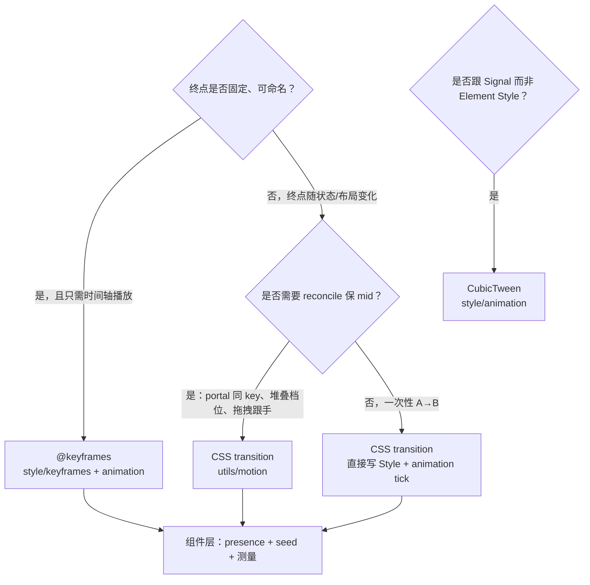

# CSS 动画与 Motion 分层决策

> **文档地位**：操作手册 — 说明 `style/keyframes`、`style/animation`、`utils/motion` 各写什么，以及组件层应保留什么。  
> **对齐执行源**：一次性落地范围、Specified/Used 模型、ANIM To-Do → [`css_animation_max_alignment.md`](css_animation_max_alignment.md)  
> **读者**：写/改 Accordion、Dialog、Toast 等带进退场的组件，或自定义浮层/通知的作者。  
> **相关**：[`custom_components.md`](../components/custom_components.md) · [`headless.md`](../components/headless.md) · [`COMPONENT_LIBRARY.md`](../COMPONENT_LIBRARY.md) §2.1

---

## 1. 总览：四条线

RUI 把 Web 上的 `transition` / `@keyframes` / `animation` 拆成 **样式引擎** 与 **组件编排** 两层，中间用 **Motion 原语** 桥接 transition 路径：

```text
style/keyframes.rs     ── WHAT   可命名的 @keyframes 曲线（KeyframeStop 注册表 + 采样）
style/animation.rs     ── HOW    CSS transition / @keyframes 运行时（tick、snapshot、lock）
utils/motion.rs        ── RECIPE transition 路径的 Element 侧配方（只写目标、保 mid）
utils/presence.rs      ── WHEN   何时挂载/卸载（ExitGate；与曲线无关）
components/*           ── WIRE   产品语义、布局测量、DOM 结构、seed 时机
components/internal/   ── SHARE  多组件共享的 presence + 动效编排（如 modal_motion）
```

**不要混淆**：

| 模块 | CSS 对应 | 驱动方式 |
|------|----------|----------|
| `keyframes` + `animation`（keyframes 分支） | `@keyframes` + `animation-*` | 按 **时间轴** 采样关键帧；`AnimationSnapshot` |
| `animation`（transition 分支） | `transition-*` | 属性 **A→B** 插值；`TransitionSnapshot` |
| `motion` | 无独立 CSS 名；封装 `transition-*` 用法 | **只写目标**，mid 由 transition 引擎推进 |
| `animation::CubicTween` | 类似 `transition`，但走 **Signal** | 少数非 Element 路径（如 Slider）；与 `motion` 正交 |

另有 [`style/timeline.rs`](../../crates/rui/src/style/timeline.rs)（通用时间线 / B17 文字特效），与本文 CSS 动效栈并列，**不**替代 `keyframes` / `transition` MVP。

---

## 2. 选型决策（先答「用哪条引擎」）



### 2.1 用 `@keyframes`（`keyframes` + `animation`）

适合：

- 曲线 **固定**、可注册为全局名（`fade-in-0`、`zoom-in-90`、`accordion-down`）
- 播放一次或循环，由 **duration / iteration** 控制
- 缺省端点可来自元素 **cascaded base**（如 `accordion-down` 的 `max-height: 0 → content-height`）

典型：**Accordion** 面板高度、**Dialog** overlay/panel 淡入缩放。

#### 2.1.1 `max-height` keyframes 与 `min-height`

Taffy 下 `min-height: auto` = min-content。若 **padding 打在外层 clip 壳** 上，即使 `max-height → 0` 也会被 min-content 顶住（Accordion 收起漏字根因）。

- **引擎**：`tick_element_animations` 在 keyframe 拥有 `max-height` 时把 `min-height` 钉为 `0`，`style.animations` 清空后从 `AnimationBaseline` 恢复。
- **结构**：外层 clip 壳只负责 `overflow-hidden` + `min-h(0)`；`px`/`pb` 放 inner（见 [`box_model.md`](box_model.md) §2.5.1）。

#### 2.1.2 Presence 退场：`animation_run_active` vs `css_animation_needs_frame`

| API | 语义 |
|-----|------|
| [`animation_run_active`](../../crates/rui/src/style/animation.rs) | 仍有 **未 finished** 的 finite run → presence 可结束退场 |
| [`css_animation_needs_frame`](../../crates/rui/src/style/animation.rs) | `style.animations` 非空 **或** run active → **帧泵**是否继续 |

`fill-mode: forwards` 结束后 run 已 `finished`，列表仍非空；用 `css_animation_needs_frame` 判断退场会 **永不 finish**（整页每帧 `LayoutChanged`）。Accordion / Dialog 等 presence 组件应使用 `animation_run_active`。

### 2.2 用 CSS `transition` + `utils/motion`

适合：

- **目标每帧/每状态变化**（堆叠 rank、拖拽偏移、Sheet 贴边滑入）
- **reconcile / portal hoist** 后须保留 mid（Toast `toast-card-{id}`）
- 需要 `MotionStyle` 记住「上一帧目标」（style 可能是 mid，不能 style≈target 判等）
- 跟手拖拽时要 `clear_motion`

典型：**Toast** 入退场/堆叠、**Sheet/Drawer** 滑入、Carousel 档位。

### 2.3 用裸 `transition`（不经 `motion`）

适合：

- 单次、简单、无 reconcile 需求（如 Accordion chevron 的 `rotate` transition）
- 已在 Builder 上写 `transition(...)` 且不需要 `prepare_motion_sync` 配方

### 2.4 用 `CubicTween`

适合：**Element 树之外**、或绑定 **Signal** 的标量过渡（Slider 等）。不要与 Toast/Modal 的 Element CSS 路径混用。

---

## 3. `style/keyframes.rs` — 写什么

**职责**：`@keyframes` **规则本体** — 注册、查找、按 CSS 语义采样。

### 应当放在这里

| 内容 | 示例 |
|------|------|
| `KeyframeStop` 定义与 builder | `.at(0.0).opacity(0.0)` |
| 内置 shadcn/Tailwind 同名规则 | `fade-in-0`、`zoom-in-90`、`accordion-down/up`、`slide-in-from-*-2` |
| `register_keyframes` / `lookup_keyframes` / `keyframes_exist` | 应用可注册自定义名 |
| 采样逻辑 | `sample_keyframes_eased`（分段 easing、implicit 0%/100%） |
| `KeyframeBase` | cascaded value，供单端点 keyframes 补全 |

### 不应放在这里

- `AnimationEntry` 的 duration / timing / fill-mode **预设**（见 §4，可放 `animation.rs`）
- presence、何时 seed、布局测量
- 组件 DOM 结构（Dialog 的 overlay + zoom 双层）
- `Element` / `reactive_sync` / damage 相关逻辑

### 判断口诀

> **若删掉所有组件，这条曲线仍应在 CSS 里有意义** → 放 `keyframes`。

---

## 4. `style/animation.rs` — 写什么

**职责**：CSS **运行时引擎** — 推进 transition 与 `@keyframes`，管理 snapshot 与属性 lock。

### 应当放在这里

| 内容 | 示例 |
|------|------|
| `tick_element_transitions` / `TransitionSnapshot` | transition A→B |
| `tick_element_animations` / `AnimationSnapshot` / `AnimationLock` | keyframes 时间轴 |
| `animation_run_active` | presence 退场：run 是否仍在播放 |
| `css_transition_needs_frame` / `css_animation_needs_frame` | 是否要下一帧（帧泵） |
| `snap_element_transitions_to_current` | 基线 snap |
| `TimingFunction` 求值、`cubic_bezier_y_at_x` | easing 数学 |
| `CubicTween` / `use_ui_transition_cubic` | Signal 标量 tween |
| 通用 `AnimationEntry` 工厂 | [`keyframes_anim_entry`](../../../crates/rui/src/style/animation.rs)（`name`, `duration_ms`, `timing`, `fill_mode`） |
| **可选**：shadcn **bundle** 预设 | `shadcn_dialog_enter_anims()` → `[fade-in-0, zoom-in-90]` |

### 不应放在这里

- `MotionStyle` / `prepare_motion_sync`（属于组件 authoring 配方，见 §5）
- `ExitGate` / mounted / portal 卸载延迟
- Toast 堆叠 rank、Modal 嵌套 scale 等产品计算
- 依赖 `Element.template_id` 的子树查找

### 与 `keyframes` 的分界

| | `keyframes` | `animation` |
|---|-------------|-------------|
| 问题 | **画什么曲线** | **怎么随时间播放** |
| 输入 | 名称 → stops | `Style.animations` + snapshot |
| 输出 | `KeyframeSample` | 写回 `Style` 各属性 |

---

## 5. `utils/motion.rs` — 写什么

**职责**：在 **CSS transition 路径**上，为 `reactive_sync` / 浮层作者提供 **可复用配方** — 「只写目标，mid 由引擎推」。

**WP-PRIM.2**；与 [`presence`](../components/custom_components.md)（WP-PRIM.1）、[`keyed_overlay`](../components/custom_components.md)（WP-PRIM.3）同级，属于 **行为工具**，不是样式子系统的底层一块。

### 应当放在这里

| 内容 | 示例 |
|------|------|
| `MotionTransform` / `MotionStyle` | 跨帧记住**目标**姿态 |
| `ensure_motion_transitions` | 幂等写入 `TransitionEntry` |
| `prepare_motion_sync` + `MotionBootstrap` | EnsureAfterSnap / SnapAfterEnsure 首帧 seed |
| `clear_motion` / `snap_motion_baseline` | 拖拽清场、退场 seed |
| `motion_is_animating` / `motion_sync_status` | 按卡要帧 + frame damage |
| 与 transition 引擎无关的 **通用容差** | `MotionEpsilon` |

### 不应放在这里

- `@keyframes` 注册或采样
- `AnimationEntry` / `animation_snapshot` 编排（Dialog/Accordion 的 keyframes 路径）
- 产品语义（Toast 的 `behind_fade`、Sonner limit、Modal 的 slide 轴长）
- presence 状态机本身（应用 `presence`，不要塞进 `motion`）

### 判断口诀

> **帮助作者在 Element 上正确消费 `tick_element_transitions`** → 放 `motion`。  
> **帮助引擎计算下一帧 Style** → 放 `animation`。

---

## 6. 组件 / `internal` — 写什么

组件层（含 `components/internal/modal_motion.rs`）保留 **编排与产品语义**：

| 保留在组件 | 原因 |
|------------|------|
| `ExitGate` / `needs_enter` / `needs_exit_anim` | 生命周期与卸载时机 |
| `seed_*_enter_anim` / `seed_*_exit_anim` | 依赖布局的初态（opacity=0、measured height） |
| 布局测量 | Accordion `measure_panel_natural_height` |
| DOM 结构 | Dialog overlay + zoom 内层 |
| 引擎选型 | Dialog 用 keyframes，Sheet 用 motion |
| 产品参数 | Toast 堆叠、拖拽、tone shadow |

**反模式**：在 `accordion.rs` 里重新定义 `fade-in-0` 的 stops — 应已在 `keyframes`；在 `toast/motion.rs` 里实现 transition tick — 应调用 `animation`。

---

## 7. 是否将 `motion` 迁入 `style/`？

### 结论：**不建议迁移**

`motion` 与 `animation` / `keyframes` **语义相关但层级不同**，当前 `utils/motion` 的位置符合 [`COMPONENT_LIBRARY.md`](../COMPONENT_LIBRARY.md) §2.1 行为工具分层。

### 理由

| 维度 | `style/animation` · `style/keyframes` | `utils/motion` |
|------|----------------------------------------|----------------|
| **抽象** | 纯样式引擎（主要操作 `Style` + snapshot） | Element 树 authoring 原语 |
| **依赖** | 布局 px 换算、采样数学 | `Element`、`app::damage`、reconcile 约定 |
| **消费者** | 引擎、utility class、tick 全局调度 | 组件作者、Toast/Carousel/Modal(Sheet) |
| **与 WP 对齐** | 样式子系统 | **WP-PRIM.2**，与 presence/keyed_overlay 并列 |
| **文档入口** | `style/mod.rs` | `custom_components.md` / `headless.md` |

把 `motion` 挪进 `style/` 会：

1. 让 `style/` 依赖 `Element` 与 damage，模糊「样式引擎 vs 组件工具」边界；
2. 破坏已文档化的 **utils 行为工具** 清单，Authors 会从 `style/` 找 transition 引擎、从 `utils/` 找配方 — 混放增加误用；
3. 对 keyframes 路径 **无收益**（Accordion/Dialog 根本不经过 `motion`）。

### 可选改进（非必须）

- 在 [`style/mod.rs`](../../crates/rui/src/style/mod.rs) 模块文档加一句：「组件 transition 配方见 [`utils/motion`](../../crates/rui/src/utils/motion.rs)」。✓ 已完成
- ~~将重复的 `accordion_css_anim` / `dialog_css_anim` 下沉到 `keyframes_anim_entry`~~ ✓ 已完成
- shadcn bundle 预设（`shadcn_dialog_enter_anims()` 等）可按需追加

### 何时才考虑 `style/motion.rs`

仅当 `motion` **完全**去掉对 `Element` / damage 的依赖、退化为纯 `Style` 上的 transition 辅助时，才值得与 `animation.rs` 同目录；以当前 API（`prepare_motion_sync(el: &mut Element, …)`）**不成立**。

---

## 8. 仓库内实例对照

| 组件 | 引擎 | 曲线 / 配置位置 | 编排位置 |
|------|------|-----------------|----------|
| Accordion 面板 | `@keyframes` | `keyframes`: `accordion-down/up` | `accordion.rs`: presence + 测高 + seed |
| Accordion chevron | `transition` | 组件内 `TransitionEntry` | 简单 rotate，无需 `MotionStyle` |
| Dialog | `@keyframes` | `keyframes`: `fade-in-0`, `zoom-in-90`, … | `internal/modal_motion.rs` |
| Sheet / Drawer | `transition` + `motion` | `modal_motion`: slide entries | `MotionStyle` + presence |
| Floating Fade | `@keyframes` | `fade-in-0` / `fade-out-0`（无 zoom） | `internal/floating_motion.rs`：popover / tooltip / hover_card / context / command |
| Floating Expand | `@keyframes` | `accordion-down/up` | `internal/floating_motion.rs`：dropdown / select / combobox / menubar / navigation_menu |
| Toast | `transition` + `motion` | `toast/motion.rs`: phase → entries | 堆叠/drag/队列语义 |

---

## 9. 新增动效检查清单

1. **选型**：按 §2 流程图确定 keyframes / transition+motion / CubicTween。
2. **曲线下沉**：可复用的 stops → `register_keyframes`（或 `ensure_builtins`）。
3. **Entry 工厂**：duration/timing/fill 重复 → `style/animation` 预设。
4. **Transition 配方**：Element + reconcile + 目标 dedupe → `utils/motion` 或复用现有 API。
5. **Presence**：挂载/卸载 → `utils/presence`，keyframes 退场未完成时 **禁止** ExitGate 提前卸载。
6. **产品逻辑**：留在 `components/` 或 `components/internal/`，勿污染引擎层。

**ANIM 冻结（2026-08-29 起）：** 新 animatable 属性只通过 [`css_animation_max_alignment.md`](css_animation_max_alignment.md) ANIM-1+ 注册表落地；禁止扩展 `KeyframeStop` 手工字段。

---

## 10. 相关源码入口

| 路径 | 说明 |
|------|------|
| [`crates/rui/src/style/keyframes.rs`](../../crates/rui/src/style/keyframes.rs) | `@keyframes` 注册与采样 |
| [`crates/rui/src/style/animation.rs`](../../crates/rui/src/style/animation.rs) | transition / animation tick |
| [`crates/rui/src/utils/motion.rs`](../../crates/rui/src/utils/motion.rs) | MotionStyle 配方 |
| [`crates/rui/src/utils/presence.rs`](../../crates/rui/src/utils/presence.rs) | ExitGate |
| [`crates/rui/src/components/internal/modal_motion.rs`](../../crates/rui/src/components/internal/modal_motion.rs) | Dialog/Sheet 共享编排 |
| [`crates/rui/src/components/internal/floating_motion.rs`](../../crates/rui/src/components/internal/floating_motion.rs) | 锚定浮层 Fade / Expand 共享编排 |
| [`crates/rui/src/components/toast/motion.rs`](../../crates/rui/src/components/toast/motion.rs) | Toast 产品层 motion |
