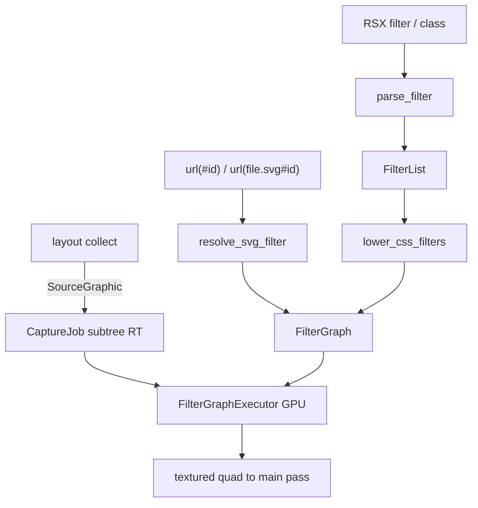

# CSS `filter` 100% 完整交付（含 SVG `url()`）

## 目标

对照 [MDN `filter`](https://developer.mozilla.org/en-US/docs/Web/CSS/Reference/Properties/filter) 与 [Filter Effects Module Level 1](https://www.w3.org/TR/filter-effects-1/)：

- 全部 CSS `<filter-function>` + `none` + 多函数串联：**解析、宏、Tailwind、动画插值、GPU 绘制**
- `url()`：**解析并实际求值** SVG `<filter>` 滤镜图（内联 `#id` + 外链 `file.svg#id`）
- 无「只解析不画」捷径；色矩阵 / blur / drop-shadow 均对**子树捕获纹理**按序作用（符合「filter 作用于整棵绘制结果」）

## 统一架构：CSS 函数编译为 SVG FilterGraph

CSS 滤镜函数在规范上等价于一组 SVG 滤镜原语。本项目用**同一执行器**跑两种来源：



- `filter: blur(5px) grayscale(0.4)` → 自动 lower 为 `feGaussianBlur` + `feColorMatrix` 链
- `filter: url(#foo)` → 从注册表 / 已解析 SVG 取 `FilterGraph` 执行
- 混合：`url(#a) brightness(1.2)` → 先跑 SVG 图，再跑 CSS lower 的后继节点

## 交付分波

### Wave A — 类型 / 解析 / 宏 / Style（可独立合入）

**新建** [`crates/rui/src/style/filter.rs`](crates/rui/src/style/filter.rs)（对标 [`transform.rs`](crates/rui/src/style/transform.rs)）：

```rust
pub enum FilterFunction { /* Blur, Brightness, Contrast, DropShadow, Grayscale,
  HueRotate, Invert, Opacity, Saturate, Sepia, Url(String) */ }
pub type FilterList = Vec<FilterFunction>;
pub fn parse_filter(s: &str) -> Option<FilterList>; // none/empty → None；非法 → None
```

- `%` ↔ number；`drop-shadow`：`<color>? && <length>{2,3}`（无 inset/spread）
- `url("...")` / `url('...')` / `url(...)` 保留原始引用串
- 单测覆盖 MDN 示例与非法参数

**Style / API**

- [`element_style.rs`](crates/rui/src/style/element_style.rs)：`filter: Option<FilterList>`
- [`tree.rs`](crates/rui/src/core/tree.rs)：`Element::filter`；Box/Base builder 转发
- `TransitionProperty::Filter` + MDN 插值（同序无 Url 则按默认值补齐插值，否则离散）
- [`style/mod.rs`](crates/rui/src/style/mod.rs) 导出

**宏** [`rui_macros/src/lib.rs`](crates/rui_macros/src/lib.rs)

- 白名单 `filter` → `#element.filter(#value)`

**Tailwind** [`rui_style_tokens/src/catalog.rs`](crates/rui_style_tokens/src/catalog.rs) + [`utility.rs`](crates/rui/src/style/utility.rs)

- `blur-*` / `brightness-*` / `contrast-*` / `grayscale*` / `sepia*` / `invert*` / `saturate-*` / `hue-rotate-*` / `drop-shadow-*`
- 写入/替换 `style.filter`（同族 token 覆盖）

### Wave B — SVG Filter 模型与注册

**新建** `crates/rui/src/style/svg_filter/`（或 `renderer/svg_filter/`）：

| 模块 | 职责 |
|------|------|
| `graph.rs` | `FilterGraph { region, primitives }`、`FilterPrimitive` 枚举、`in`/`result` 命名 |
| `parse.rs` | 解析 `<filter>` XML/子树（字符串 + 后续 Element 树） |
| `registry.rs` | `register_svg_filter(id, graph)` / `lookup` / 外链缓存 |
| `lower_css.rs` | CSS `FilterList` → `FilterGraph`（规范等价展开） |

**Filter Effects L1 原语（全部实现）**

- `feBlend`, `feColorMatrix`, `feComponentTransfer`（含 R/G/B/A 子元素）, `feComposite`, `feConvolveMatrix`, `feDiffuseLighting`（+ `feDistantLight`/`fePointLight`/`feSpotLight`）, `feDisplacementMap`, `feFlood`, `feGaussianBlur`, `feImage`, `feMerge`（+ `feMergeNode`）, `feMorphology`, `feOffset`, `feSpecularLighting`, `feTile`, `feTurbulence`

输入关键字：`SourceGraphic`, `SourceAlpha`, `BackgroundImage`/`BackgroundAlpha`（Background*：无 backdrop 时按规范透明黑/空）、`FillPaint`/`StrokePaint`（非 SVG 宿主时按 SourceGraphic 退化）、`result` 名引用。

**区域**：`filter` 的 `x/y/width/height` 默认 `-10%/120%`；`filterUnits` / `primitiveUnits`；各原语 `x/y/width/height`。

**API 面**

```rust
pub fn register_svg_filter(id: impl Into<String>, svg_filter_markup: &str) -> Result<(), FilterParseError>;
// url("#id") / url("asset.svg#id") 由 resolve 路径调用 registry + 资源加载
```

外链：经现有资源/文件加载路径读入 SVG 文本 → 解析出带 `id` 的 `<filter>` → 缓存。宿主 app 也可只 `register_svg_filter` 内联图。

**RSX/SVG**：扩展 [`svg.rs`](crates/rui/src/primitives/svg.rs) 识别 `filter` / `fe*` 节点进 `SvgNode`（defs 内不绘制，只登记 graph）；SVG 元素上的 `filter="url(#…)"` 与 CSS 共用 resolve。

### Wave C — GPU FilterGraph 执行器

**新建** `crates/rui/src/renderer/css_filter/`：

1. **捕获**：有 `style.filter`（或 SVG 属性 filter）时，收集子树 `instances`+`textured_draws` 进 `CaptureJob`（复用 B16 [`effect.rs`](crates/rui/src/renderer/effect.rs) 捕获，**独立** `FilterJob` 队列，不与 `rui_fx` 创意特效混 mode）
2. **执行**：按拓扑序为每个 primitive 分配 ping-pong RT；输入纹理 + uniform → WGSL pass
3. **合成**：最终结果 textured quad 画回主通道；命中测试仍用未过滤几何

**Shader 能力映射**

| 原语 | GPU 策略 |
|------|----------|
| feColorMatrix / ComponentTransfer | 片段色变换 |
| feGaussianBlur | 可分高斯（复用/扩展 [`backdrop_blur`](crates/rui/src/renderer/backdrop_blur.rs)） |
| feOffset | 采样 UV 偏移 |
| feFlood | 清色 |
| feBlend / feComposite | 双输入混合 |
| feMerge | 多层 alpha 叠 |
| feMorphology | 邻域 min/max |
| feConvolveMatrix | 卷积核 |
| feDisplacementMap | 位移采样 |
| feTurbulence | 噪声生成 |
| feImage | 绑定已加载纹理 |
| feTile | 重复采样 |
| Lighting 族 | N 图 + 光照公式 |

CSS `drop-shadow()` lower 为：`SourceAlpha` → offset → blur → flood/composite 着色 → merge 与 SourceGraphic（规范等价链）。

**仅 `opacity()`**：仍可走捕获后矩阵，或折叠进 opacity 链；为保持「整棵子树一致」默认仍捕获（与浏览器一致）。

### Wave D — 布局接线 / DevTools / Gallery / 测试

- [`layout_tree.rs`](crates/rui/src/layout/layout_tree.rs)：collect 结束时若 `filter.is_some()` → enqueue FilterJob
- DevTools [`snapshot.rs`](crates/rui/src/app/devtools/snapshot.rs)：序列化 `filter: ...`
- Gallery：CSS 函数矩阵墙 + `url(#registered)` 自定义滤镜演示
- 测试：
  - `parse_filter` / SVG filter XML 解析
  - CSS→graph lower 快照
  - utility tokens
  - GPU 冒烟（库测或 `gpu_probe`）：blur / color-matrix / drop-shadow / 简单 `feMerge` url

## 关键文件

| 路径 | 变更 |
|------|------|
| `crates/rui/src/style/filter.rs` | 新建 CSS 解析 |
| `crates/rui/src/style/svg_filter/*` | 新建 graph/parse/registry/lower |
| `crates/rui/src/style/element_style.rs` / `mod.rs` | Style 字段与导出 |
| `crates/rui/src/core/tree.rs` | `Element::filter` |
| `crates/rui/src/primitives/box.rs` / `components/base.rs` | 转发 |
| `crates/rui_macros/src/lib.rs` | RSX `filter` |
| `crates/rui_style_tokens/src/catalog.rs` | Tailwind |
| `crates/rui/src/style/utility.rs` | 应用 token |
| `crates/rui/src/style/animation.rs` | Filter 插值 |
| `crates/rui/src/renderer/css_filter/*` | GPU 执行 |
| `crates/rui/src/renderer/effect.rs` / `mod.rs` / `state.rs` | 捕获队列与 flush |
| `crates/rui/src/layout/layout_tree.rs` | 接线 |
| `crates/rui/src/primitives/svg.rs` | fe* / defs 登记 |
| `examples/gallery/src/main.rs` | 演示 |

## 明确不做（本交付边界）

- 通用 CSS `backdrop-filter` 全属性（继续 `backdrop_blur`；BackgroundImage 输入在无 backdrop 管线时按规范空输入）
- AUTHORITY **B3** 滚动层 dirty-region 离屏缓存产品化（本功能自有 per-filter RT，不阻塞）
- 把 `rui_fx` 创意特效目录并入 CSS filter（保持独立）

## 验收清单

- [x] `filter: none` 与缺省等价
- [x] 十个 CSS 函数均可单独与组合绘制，顺序正确（后函数作用于含阴影的中间结果）
- [x] `drop-shadow` 跟随 alpha 轮廓，非 box-shadow 矩形近似
- [x] RSX `filter="..."` / `filter={…}` 与 Tailwind 类生效
- [x] `transition: filter` 可插值（无 Url）
- [x] `register_svg_filter` + `filter: url(#id)` 可见自定义图
- [x] 外链 `url("….svg#id")` 可加载求值
- [x] Filter Effects L1 上列原语均有实现与至少一处测试或 Gallery 覆盖
- [x] 非法参数使整段 filter 失效为 none
- [x] Gallery「布局」分区：`FilterShowcase`（函数墙 + Tailwind + url(#galleryBlurSepia)）
