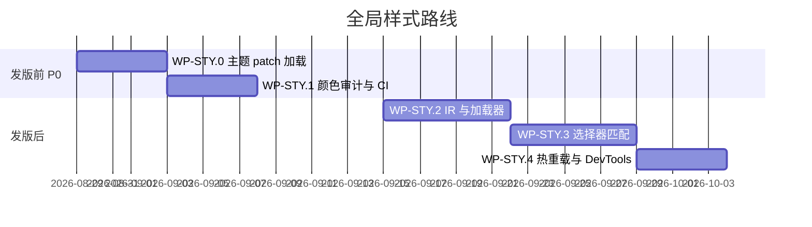

# 全局样式表加载器与主题令牌治理

> **文档地位**：样式承诺面（[`component_inventory.md`](../components/component_inventory.md) §1.8）的**发版前 P0** + **发版后深化**计划。  
> **约束**：[`AUTHORITY.md`](../AUTHORITY.md) 巩固期明确**不实现完整 CSSOM**（选择器级联 / 浏览器样式表）；本计划是**受控子集**，不是 CSS 引擎。  
> **关联**：[`color.md`](../engine/color.md) · [`COMPONENT_LIBRARY.md`](../COMPONENT_LIBRARY.md) §5.2.2 · [`devtools.md`](../ops/devtools.md)  
> **日期**：2026-08-29

---

## 0. 目标与非目标

### 目标

| 阶段 | 时机 | 交付 |
|------|------|------|
| **Phase 0** | **发版前（挡 WP-4.7）** | 全局主题令牌可覆盖；库内颜色走令牌，无裸 hex/RGB 产品色 |
| **Phase 1–3** | **发版后** | 多格式全局样式表加载器；有限选择器 → `apply_class_list` |

### 非目标（全阶段）

- 浏览器级 CSSOM（任意后代选择器、特异性级联、`@media` 全量、`@layer`）
- 把 RUI 变成「运行时解析任意 `.css`」的 Web 引擎
- 单独引入 `.rui` 作为**唯一**扩展名（见 §3 格式策略）

### 用户故事

1. **发版前**：应用启动时读 `theme.toml`，覆盖 `destructive` / `primary`，全应用组件自动换色，无需改组件源码。
2. **发版后**：`styles.css` 或 `styles.json` 写 `[data-slot=bubble-content] { @apply rounded-2xl px-3; }`，聊天页所有气泡统一外观，RSX 不再重复内联。

---

## 1. 现状基线（2026-08-29）

### 已有

| 能力 | 位置 | 说明 |
|------|------|------|
| 运行时主题 | `style/theme.rs` | `Theme` / `DesignTokens` / `set_theme` / `set_theme_mode` |
| 语义色解析 | `style/color.rs` + `tokens/colors.rs` | `parse_color("primary")`、`destructive/10` 等 |
| Utility 应用 | `style/utility.rs` | `apply_class_list` / `with_class_list` / `bind_class` |
| Variant 前缀 | `rui_style_tokens/variant.rs` | `hover:`、`dark:`、`data-[state=open]:` |
| 组件 hook 属性 | 各 `components/*` | `data-slot`、`data-variant`（Bubble 等） |

### 缺口

| 缺口 | 影响 |
|------|------|
| **无文件加载 API** | 用户只能 Rust 代码里 `set_theme` 手改 `DesignTokens` 字段 |
| **无部分覆盖 / merge** | `set_theme_mode` 会整表替换 light/dark，无法「只改 3 个色」 |
| **无全局样式表** | 无法按 `data-slot` 统一规则，只能 RSX 逐节点 `class` |
| **库内仍有硬编码色** | 浮层 shadow、导航 scrim 等用裸 `[0,0,0,α]`（见 §2.3 审计） |

---

## 2. Phase 0 — 发版前必达（WP-STY.0 / WP-STY.1）

> **门禁**：未完成 **不得** 勾选 WP-4.7（对外 Beta）。可与 WP-4.1–4.6 并行，但须在 `cargo publish` 前合入。

### 2.1 WP-STY.0 — 全局主题令牌覆盖

#### 2.1.1 API 面（`crates/rui/src/style/theme.rs` + 新模块 `theme_load.rs`）

```rust
/// 仅列出要覆盖的字段；未出现的令牌保持当前 Theme 默认。
#[derive(Clone, Debug, Default, Deserialize)]
#[serde(deny_unknown_fields)]
pub struct ThemeColorPatch {
    pub background: Option<ColorInput>,
    pub foreground: Option<ColorInput>,
    pub primary: Option<ColorInput>,
    // … DesignTokens 全部语义色 + radius + focus_ring_style
}

#[derive(Clone, Debug)]
pub enum ColorInput {
    /// `oklch(0.577 0.245 27.325)` / `#ff0000` / `primary`
    Str(String),
}

/// 合并 patch → 当前 `Theme`（保留未覆盖字段与 `FocusRingStyle`）。
pub fn apply_theme_patch(patch: &ThemeColorPatch, mode: ThemeMode) -> Theme;

/// 从路径推断格式并加载（见 §3.1）。
pub fn load_theme_patch(path: impl AsRef<Path>) -> Result<ThemeColorPatch, ThemeLoadError>;

/// 应用并 `set_theme`；可选 `on_theme_changed` 回调供重绘。
pub fn install_theme_patch(patch: ThemeColorPatch, mode: ThemeMode);
```

**应用入口**（文档与 Gallery 示例）：

```rust
// main.rs — 启动最早阶段
if let Ok(patch) = load_theme_patch("theme.toml") {
    install_theme_patch(patch, ThemeMode::Light);
}
```

#### 2.1.2 颜色输入解析（与 `parse_color` 同源）

`ColorInput` 解析顺序（与 Web/shadcn 对齐）：

1. 语义令牌名：`primary`、`destructive-foreground`
2. `oklch(L C H)` / `oklch(L C H / A)`
3. `#rgb` / `#rrggbb` / `#rrggbbaa`
4. `rgb()` / `rgba()`（可选，Phase 0 可仅 hex + oklch）

解析实现复用 `color_space::oklch_to_display_srgba` 与 `parse_hex_color_rgba`，**禁止**在 loader 里另起一套色值逻辑。

#### 2.1.3 Light / Dark 双表

配置文件支持两种结构（TOML 示例，JSON 同构）：

```toml
# theme.toml — 推荐发版前格式（IDE 高亮友好）

[light]
primary = "oklch(0.205 0 0)"
destructive = "oklch(0.577 0.245 27.325)"
radius = 0.625

[dark]
primary = "oklch(0.922 0 0)"
destructive = "oklch(0.704 0.191 22.216)"
```

或 **shadcn 兼容** 的 CSS 变量子集（见 §3.2）— Phase 0 至少支持 `:root` / `.dark` 块内 `--primary` 等 **已映射到 `DesignTokens` 的变量名**。

#### 2.1.4 `set_theme_mode` 行为修正

今日 `set_theme_mode` 会丢弃自定义 patch。Phase 0 需：

- 引入 `ThemeBase` 线程局部：`default_light` / `default_dark` + `user_patch`
- `set_theme_mode(m)` → `merge(base(m), user_patch)` → `set_theme`
- `install_theme_patch` 更新 `user_patch` 并刷新当前 mode

#### 2.1.5 测试与验收

| 用例 | 断言 |
|------|------|
| 空 patch | 与 `Theme::light()` 像素级一致（已有 `light_tokens_match_globals_css` 扩展） |
| 只改 `destructive` | Bubble/Button destructive variant 随 patch 变，其它令牌不变 |
| TOML + JSON 同内容 | 解析结果 `PartialEq` |
| `set_theme_mode` 往返 | patch 在 light/dark 切换后仍生效 |
| 非法键 / 未知色 | `ThemeLoadError` 含路径与字段名 |

#### 2.1.6 文档

- [`color.md`](../engine/color.md) 增 §「应用级主题覆盖」
- Gallery 增 **Theme** 分区子页：`theme.toml` 热加载演示（可选 `jadix_hot_reload` 监听）

---

### 2.2 WP-STY.1 — 库内颜色令牌化审计

#### 2.2.1 规则（产品代码 `crates/rui/src/**`，不含 `#[cfg(test)]`）

| 分类 | 允许 | 禁止 | 处理 |
|------|------|------|------|
| **语义色** | `parse_color("token")`、`tokens::primary()`、`bg("muted")` | 裸 `#hex`、`[r,g,b,a]` 表达品牌/前景/背景/边框/ destructive | 改为令牌 |
| **全透明** | `TRANSPARENT` 常量 `[0,0,0,0]` | — | 集中到 `style/color.rs` 导出 `pub const TRANSPARENT` |
| **阴影** | `shadow("md")` 或 `tokens::elevation_shadow(Elevation::Md)` | `shadow([0,0,0,0.14], 12)` 散落 | 新增 elevation 令牌（见下） |
| **遮罩 scrim** | `parse_color("foreground/35")` 或 `tokens::overlay_scrim(0.35)` | `bg([0,0,0,0.35])` | 改令牌 |
| **用户色板** | ColorPicker 内部 HSV/hex | — | 豁免 |
| **DevTools** | 调试假数据 | 产品路径硬编码 | `#[cfg(feature = "devtools")]` 隔离 |
| **color_space 矩阵常数** | OKLab 数学常数 | — | 豁免 |

#### 2.2.2 Phase 0 新增令牌（`DesignTokens` 或 `tokens/` 辅助）

```rust
// tokens/elevation.rs — 阴影色仍用 foreground 混合，alpha 随主题
pub enum Elevation { Sm, Md, Lg, Xl }

pub fn shadow_rgba(e: Elevation) -> [f32; 4];  // 或返回 utility 类名 "shadow-md"
pub fn overlay_scrim(alpha: f32) -> [f32; 4];   // foreground 基色 × alpha
```

**待迁移文件（shadow 裸 RGBA，17 处 / 16 文件）**：

- `card.rs`, `dialog.rs`, `drawer.rs`, `sheet.rs`, `popover.rs`, `tooltip.rs`
- `dropdown_menu.rs`, `context_menu.rs`, `navigation_menu.rs`, `select.rs`, `combobox.rs`
- `command.rs`, `date_picker.rs`, `switch.rs`, `toggle_group.rs`
- `color_picker/view.rs`, `internal/text_edit/build.rs`

**待迁移（scrim）**：

- `app/navigator/host.rs` — `bg([0,0,0,0.35*…])` → `overlay_scrim`

#### 2.2.3 CI 门禁

新增 `scripts/check-token-colors.ps1`（或 `cargo xtask check-colors`）：

```text
扫描 crates/rui/src （排除 */tests/*、*test*、devtools、color_picker、color_space）
禁止模式：
  .bg([0-9.]+,\s*[0-9.]+,\s*[0-9.]+,\s*[0-9.]+)  # 除白名单 TRANSPARENT
  parse_color("#")
  shadow([0.0,\s*0.0,\s*0.0
允许列表文件：scripts/color-audit-allowlist.txt（须注释理由，定期缩减）
```

挂入 CI：与 `cargo test` 同级，**挡 main / publish**。

#### 2.2.4 验收清单

- [ ] `ThemeColorPatch` + `load_theme_patch` + `install_theme_patch` 合入
- [ ] `set_theme_mode` 保留用户 patch
- [ ] shadow / scrim 迁移完成，无新增裸 RGBA（CI 绿）
- [ ] `color.md` + `COMPONENT_LIBRARY.md` §5.2.2 更新
- [ ] Gallery Theme 示例可演示覆盖 `destructive`
- [ ] `component_inventory.md` §1.8 增 `load_theme_patch` 行

---

## 3. 格式策略（发版后样式表 · Phase 1+）

**原则**：不强制 `.rui` 单扩展名；**多格式同 IR**，按扩展名或 `format:` 字段分发，保留 IDE 语法高亮。

| 扩展名 | 角色 | 高亮 | Phase |
|--------|------|------|-------|
| **`.toml`** | 主题 + 规则（推荐） | ✅ | 0（主题）/ 1（规则） |
| **`.json`** | 机器生成 / 工具链 | ✅ | 0 / 1 |
| **`.css`** | shadcn `globals.css` 子集 | ✅ | 0（仅变量）/ 1（规则） |
| **`.rs`** | `mod styles;` + `pub const` / `include_str!` | ✅ | 0 起（模式文档） |
| `.rui` | 可选别名 | ❌ 默认 | 不推广；`load_stylesheet` 可识别但不写入文档首荐 |

### 3.1 统一加载入口（Phase 1）

```rust
pub enum StylesheetFormat { Toml, Json, Css, Auto }

pub fn load_stylesheet(path: impl AsRef<Path>) -> Result<Stylesheet, StylesheetError>;
pub fn register_stylesheet(sheet: Stylesheet);  // 全局 registry，可多次合并
pub fn clear_stylesheets();
```

### 3.2 CSS 子集 — `globals.css` 变量（Phase 0 即可用）

解析 **仅**：

```css
:root {
  --background: oklch(1 0 0);
  --primary: oklch(0.205 0 0);
  --radius: 0.625rem;
}
.dark {
  --background: oklch(0.145 0 0);
}
```

映射表：`--{kebab-case}` → `DesignTokens::{snake_case}`（与 shadcn `@theme inline` 对齐，见 [`theme.rs`](../../crates/rui/src/style/theme.rs) 注释）。

**不解析**：`@import`、`@layer`、任意选择器规则（Phase 1 才开规则）。

### 3.3 TOML / JSON 样式表（Phase 1）

```toml
# styles.toml
[[rule]]
selectors = ["[data-slot=bubble-content]"]
classes = "rounded-2xl px-3 py-2 text-sm"

[[rule]]
selectors = ["[data-variant=destructive][data-slot=bubble-content]"]
classes = "bg-destructive/10 text-destructive dark:bg-destructive/20"

[theme.light]
primary = "oklch(0.205 0 0)"
```

JSON 同构；`theme` 段与 Phase 0 `ThemeColorPatch` **共用解析器**。

### 3.4 Rust 模块模式（无加载器亦可）

```rust
// app/styles/chat.rs
pub const BUBBLE_CONTENT: &str = "rounded-2xl px-3 py-2 text-sm";

// app/styles/mod.rs
pub mod chat;
```

发版前即推荐；与 Phase 1 加载器**不冲突**（加载器只是把字符串规则挪到外部文件）。

---

## 4. Phase 1 — 样式表 IR 与加载（发版后 Wave A）

### 4.1 模块布局

```text
crates/rui/src/style/stylesheet/
  mod.rs          # 公开 API
  ir.rs           # Stylesheet, StyleRule, Selector
  load_toml.rs
  load_json.rs
  load_css.rs     # 变量块 + 有限规则
  registry.rs     # 全局 Vec<Stylesheet> + 优先级
```

### 4.2 中间表示（IR）

```rust
pub struct Stylesheet {
    pub theme: Option<ThemeColorPatch>,  // 可选，安装时走 WP-STY.0
    pub rules: Vec<StyleRule>,
    pub source: Option<PathBuf>,         // 调试 / devtools
}

pub struct StyleRule {
    pub selectors: Vec<Selector>,
    pub classes: String,   // 空格分隔 utility，交给 parse_class_list
    pub priority: u16,     // 默认 0；后注册覆盖先注册
}

pub enum Selector {
    DataSlot(String),           // [data-slot=bubble-content]
    DataEq { key: String, value: String },  // [data-variant=destructive]
    Class(String),              // .chat-panel（匹配 element.attrs["class"] 包含）
    Id(String),                 // #root
    And(Vec<Selector>),         // 串联 = AND
}
```

### 4.3 明确不支持（文档写死）

- 后代 / 子代 / 相邻：` `、`>`、`+`、`~`
- `:nth-child`、`:not()`、属性通配
- `@media`（viewport 已有 `sm:` utility；真媒体查询延后）
- `!important`、继承、`initial`

### 4.4 交付物

- [ ] `load_stylesheet` + TOML/JSON 规则解析
- [ ] `register_stylesheet` / `clear_stylesheets`
- [ ] 单元测试：解析 + IR 序列化 roundtrip
- [ ] 文档 `docs/stylesheet.md`（用户向）

---

## 5. Phase 2 — 选择器匹配（发版后 Wave B）

### 5.1 匹配时机

在 **元素构建完成后、用户 RSX `class` 合并前** 注入：


实现挂点：`BaseComponentBuilder::build` 末尾，或 `Element` 打包前统一 `apply_stylesheet_rules(el)`。

### 5.2 匹配算法

对每个 `Element`：

1. 读 `attrs`：`data-slot`、`data-variant`、`class`、`id`
2. 对 registry 中每条 `StyleRule`，任一 `selector` 匹配 → 收集 `classes`
3. 按 `priority` + 注册顺序合并 class 字符串
4. 调用既有 `with_class_list(el, merged)`

复杂度：O(元素数 × 规则数)；规则数 < 500 时可接受；后续可加 `data-slot` 索引。

### 5.3 `data-*` 规范

- 组件库统一 `data-slot` / `data-variant`（Bubble 已具备）
- 新组件规范写入 [`COMPONENT_LIBRARY.md`](../COMPONENT_LIBRARY.md) §4.3
- `rui_bubble_variant` 等非标准 attr → Phase 2 前改为 `data-bubble-variant` 或在匹配器支持别名表

### 5.4 测试

- Bubble：`styles.toml` 只写 `[data-slot=bubble-content]`，Gallery 无 RSX class 即生效
- 优先级：后注册规则覆盖先注册
- 性能冒烟：1000 节点 × 50 规则 < 1ms（库测）

---

## 6. Phase 3 — 运行时与工具链（发版后 Wave C）

| 项 | 说明 |
|----|------|
| **热重载** | `jadix_hot_reload` 监听 `styles.toml` / `.css`，变更 → `clear_stylesheets` + reload + `request_redraw` |
| **DevTools** | Styles 面板列出命中规则与来源文件（`source` 字段） |
| **CSS 规则子集** | 仅 `@apply` 或裸声明 → utility 降级（如 `padding: 0.75rem` → `p-3`） |
| **VS Code** | 可选 `tailwindcss` 高亮复用到 `styles.toml` 的 `classes` 字符串（非阻塞） |

---

## 7. WP 编号与排期

| ID | 阶段 | 挡发版 | 概要 |
|----|------|--------|------|
| **WP-STY.0** | Phase 0 | **是** | 主题令牌文件加载 + patch merge |
| **WP-STY.1** | Phase 0 | **是** | 库内颜色审计 + elevation/scrim 令牌 + CI |
| **WP-STY.2** | Phase 1 | 否 | Stylesheet IR + TOML/JSON/CSS 变量加载 |
| **WP-STY.3** | Phase 2 | 否 | 选择器匹配 + `apply_stylesheet_rules` |
| **WP-STY.4** | Phase 3 | 否 | 热重载 + DevTools + CSS 声明降级 |

建议写入 [`AUTHORITY.md`](../AUTHORITY.md) §5 末尾「发版后 backlog」；**WP-STY.0/1** 链入 [`W4_PRELAUNCH_CHECKLIST.md`](../ops/W4_PRELAUNCH_CHECKLIST.md) 新小节 **A3. 主题与颜色治理**。

---

## 8. 风险与决策记录

| 风险 | 缓解 |
|------|------|
| 用户以为支持完整 CSS | 文档 + 解析器对不支持语法 **硬错误**（带行号） |
| `set_theme_mode` 与 patch 竞态 | 单线程 `ThemeBase`；文档说明调用顺序 |
| 样式表与组件默认冲突 | 优先级文档：RSX `class` > stylesheet > 组件默认 |
| shadow 令牌与 shadcn 视觉漂移 | golden 抽 1–2 浮层（Popover/Dialog）对比 |
| serde 依赖体积 | `theme_load` 用 `optional feature = "theme-file"`，默认 **开启**（发版承诺面） |

**ADR 建议**（合入 Phase 0 时写 `docs/adr/ADR-10-theme-and-stylesheet.md`）：

- 不实现 CSSOM；stylesheet = **utility 分发器**
- 主题真源仍是 `DesignTokens`；文件只是输入
- 扩展名优先 `.toml` / `.css`，`.rui` 不首推

---

## 9. 实施顺序（执行摘要）



**发版前最小可交付**：

1. `theme.toml` / `theme.json` / `globals.css`（`:root` 变量）覆盖语义色  
2. 库内产品色全部走 `parse_color` / `tokens::` / elevation  
3. CI 阻止回退  

**发版后**：在同一 `load_stylesheet` 入口上叠加 `[[rule]]` 与匹配器，用户文件格式无需迁移。

---

## 10. 交叉引用更新清单（合入时勾选）

- [ ] [`AUTHORITY.md`](../AUTHORITY.md) — WP-STY.0–4 + 发版前挡板
- [ ] [`W4_PRELAUNCH_CHECKLIST.md`](../ops/W4_PRELAUNCH_CHECKLIST.md) — §A3
- [ ] [`component_inventory.md`](../components/component_inventory.md) — §1.8 增样式表行（Phase 1 后）
- [ ] [`color.md`](../engine/color.md) — 应用主题覆盖 §
- [ ] [`CHANGELOG.md`](../CHANGELOG.md) — Phase 0 条目
