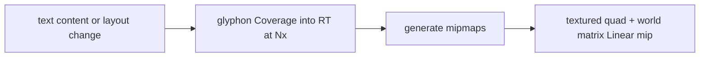
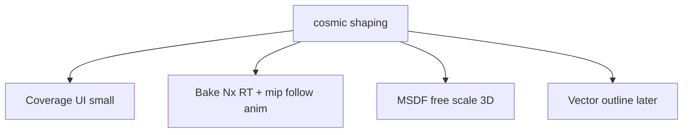

# 变换文字：Bake 跟随动画 + MSDF 自由缩放/3D

## 已锁定决策

- **简单文本跟随动画（本问）**：采用 **一次性（按内容失效）超采样离屏层 + Linear（+mip）+ 矩阵变换**。节点一旦「可变换」（含 `transition-transform` / `hover:rotate` 在 0°），**始终**走该路径，避免悬停锐度跳变。
- **自由缩放 / 3D（原 1B）**：Bake 在大倍率缩放或透视下会糊/闪，仍用 **MSDF**（后于 Bake 落地）。
- **策略 2A**：轴对齐、无 transform/transition 的 UI 小字 = 现有 **Coverage + Nearest**，不动。
- **Vello / 自研整帧矢量**：不接入；窄矢量字形仅后置 spike。

## 超采样离屏 + Linear(+mip) + 矩阵 —— 是否适合「简单跟随」？

**适合。** 这正是「把排好版的字烤成一张章，再转章」——对 gallery §3b 的 rotate / hover:rotate / spin 一类动画，比立刻上 MSDF 更贴问题、工期更短。



| 项 | 结论 |
|--|--|
| 锐度 | 轴对齐烤进 RT（可 snap），旋转只滤贴图；N=2～3 + mip 通常够「跟随动画」 |
| 一致性 | sticky：0° 与 45° 都采样同一张 bake，无路径切换 |
| 代价 | 每块变换文字一张 RT；内容/字号/换行变才重烤 |
| 上限 | 持续 `scale` 到很大、透视 3D、可编辑光标叠在变换文字上 → 转 MSDF/矢量 |

### 先前 offscreen 失败点 → 本方案硬约束

曾用 `RUI_TEXT_XFORM=offscreen` 踩过坑，本路径必须写死：

1. **独立** `capture_text_renderer`（或等价），禁止与主帧 `text_renderer.prepare` 抢同一 atlas/vertex 缓冲。
2. **空壳不 bake**：无 paintable 字形则只画 SDF 壳；禁止对空 RT 做矩阵（曾出现细线「丢旋转」）。
3. **壳与字同 `world_linear`**：字走贴图矩阵，壳仍用现有 rounded_rect 变换，pivot 一致。
4. **Cache key 稳定**：`shape_hash + font + color + box_px + oversample`；勿把每帧角度编进 key。
5. **不作全站默认**：仅 sticky 变换节点；全站小字永不进 bake。

实现落点（复用已有基建，收紧语义）：

- 布局标志：[`TextLayoutInfo`](crates/rui/src/layout/layout_tree.rs) → `GlyphRasterMode::Bake`
- 捕获：现有 effect/filter 用的 capture 文本路径 / [`text_texture`](crates/rui/src/utils/text_texture.rs) 思路，改为「只烤字、超采样、生成 mip」
- 绘制：textured quad + 与壳相同的 2×2（日后可 mat4）
- 文档：[`text_xform.rs`](crates/rui/src/renderer/text_xform.rs) 写明三种模式，不再「永远 Pipeline-only」一句话打发

## 三模式路由

```rust
pub enum GlyphRasterMode {
    Coverage, // 默认 UI 小字
    Bake,     // 跟随动画 / sticky transform
    Msdf,     // 自由缩放、3D（Bake 不够时）
}
```

选 `Bake`：存在 transform 相关 transition / `rotate_deg` / 非空 transform list / `animate-spin`，且缩放在合理带内（例如 0.5～2）、非 3D。

选 `Msdf`：`scale` 越界、显式 3D 文字、或后续产品开关。

选 `Coverage`：其余。

## MSDF / 矢量 / Vello（仍保留，顺位靠后）

- **MSDF**：Bake 验收后做；专治连续缩放与 3D `mat4`。
- **窄矢量字形**：outline→`PathCommand`→`RUI_GPU_2D`，spike + ADR。
- **Vello**：仅 `reference/vello-main` 对照，服务 Canvas/SVG 层，不替换 glyphon。



## 验收

- §3b 跟随动画：中文无严重锯齿；hover 前后锐度一致；空壳 tile 旋转正常。
- 无 transform 的小字与改前一致。
- 主帧文本与 bake 捕获无互相 clobber（快速滚动 + 悬停旋转同屏压力测）。

## 明确不做

- 用 Vello 替换 glyphon / 整帧 UI。
- 全体文字强制 Bake 或 MSDF。
- 全局 FS multi-tap / 全局 Linear。
- Bake 与主 `text_renderer` 共用 prepare。
- 把每帧旋转角写入 bake cache key。
