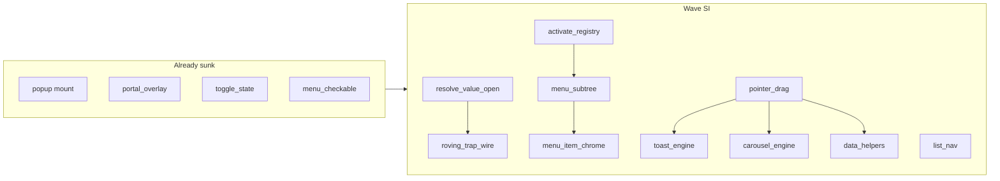

# 已有组件能力与交互深化下沉

## 目标与边界

**目标**：把「已被 ≥2 个已导出组件证明重复」或「单组件交互引擎过厚、无法单测策略」的能力沉到 `utils/` 或 `components/internal/`，让产品层变薄、后续改造只消费公共面。

**默认范围（锁定）**：全部当前已 `pub use` 的组件；**不含** planned P1（Badge/Avatar/…）；**不含** 外观 chrome、HSV/日历算术、Carousel **视觉变体壳**、Toast/Carousel **CSS 动效**（策略/轨道引擎要下沉，见 WP-SI.9 / SI.10）。

**已完成、本计划不再重做**：[`utils/popup.rs`](crates/rui/src/utils/popup.rs) 挂载、[`portal_overlay`](crates/rui/src/app/portal_overlay.rs) Esc/互斥（含 Toast host 的 `Pinned`）、[`toggle_state`](crates/rui/src/utils/toggle_state.rs)、[`menu_checkable`](crates/rui/src/components/internal/menu_checkable.rs)、[`roving`](crates/rui/src/utils/roving.rs)、[`drag_reorder`](crates/rui/src/utils/drag_reorder.rs)。

**硬禁区**（来自现网注释/测）：

- Menubar peer 切换不得统一 `disarm_underlay_close`
- `{parent}__subN` 不得被当成 peer Menu 关掉父层
- 键盘开子菜单必须 `refresh_hover=false`
- CheckboxItem 激活不关菜单；普通 Item 关
- 不发明「万能 compound_scope 宏」
- Toast：暂停计时勿写回 queue（避免 hover 闪断）；`displace` 退场勿 snap 正在播的非挤出退场；`TOAST_PAUSE_FLOOR` / `TOAST_EXIT_GAP` 语义不得丢掉
- Carousel：seamless 环复位与 `LoopAnim` 不得在拖拽中途撕轨道；autoplay 与指针按住互斥语义保持

**与发版关系**：本波 **不挡** W4（jadix 重命名 / publish）。在 [`AUTHORITY.md`](docs/AUTHORITY.md) 增 **Wave SI（Sink Deepen）** 小节，编号 `WP-SI.1`…`WP-SI.10`，明确「不挡 Beta」。

---

## 改造后高完整度组件 · 计划覆盖审计

口径：近期复合/能力翻新（`feat(ui)` / compound / carousel / toast / command / WP-3.3 选器等），**完整度高**才列入；未改造薄壳不要求对位 SI.9 级内聚包。

| 组件                  | 完整度信号                            | 厚引擎（仍在文件内）                  | 计划覆盖               | 是否偏薄         |
| --------------------- | ------------------------------------- | ------------------------------------- | ---------------------- | ---------------- |
| DropdownMenu          | 复合 + 子菜单 + checkable + Gallery   | submenu / activate / keys / chrome    | SI.1 / SI.3 / SI.5     | 否               |
| ContextMenu           | 复合 + 子菜单 + Gallery               | 与 Dropdown 近拷贝                    | SI.3 主消费者          | 否               |
| Menubar               | 复合；委托 Dropdown；peer ←→          | `open_neighbor_menu`（禁泛化）        | 引擎走 SI.3；peer 留壳 | 否（故意）       |
| Toast                 | **verified**；stack/list/overflow     | timer / queue / swipe / CSS           | SI.9 + SI.7 壳         | 已补 SI.9        |
| **Carousel**          | 复合 variants；拖拽/键盘/dots；库测密 | **snap / seamless / autoplay / 轨道** | 原仅 SI.7「换壳」      | **是 → SI.10**   |
| Table                 | 复合 + data_table sort/filter/page    | `cycle_sort` / row order              | SI.8 + SI.2            | 否（中厚已点名） |
| Command               | 复合 Overlay/Dialog；↑↓ 过滤          | activate + list 键                    | SI.1 + SI.4            | 否               |
| ColorPicker           | WP-3.3；HSV + 浮层                    | 拖拽会话；HSV 领域                    | SI.7 + SI.2；HSV 留    | 否               |
| DatePicker / Calendar | WP-3.3；键盘日/周/月                  | open 信号；日历算术                   | SI.2；算术留           | 否               |
| Select / Combobox     | **verified**；浮层已 sunk             | 列表键（Combo 更重）                  | SI.4；portal 已有      | 否               |
| Dialog                | **verified**；复合                    | 薄壳；trap 未接线                     | SI.6                   | 否               |
| Tabs                  | **verified**；roving 已挂             | String 受控槽                         | SI.2                   | 否               |
| Button / Switch       | CSS transition 替 Spring              | chrome only；`toggle_state` 已 sunk   | 无需新包               | 否               |

**结论**：在「仅改造后完整度高」集合里，除已补的 Toast 外，**唯一仍偏薄的是 Carousel**；其余要么已被 SI.1–8 点名，要么是故意留本地的产品壳/领域算术。

---

## 工作包（按序；每包可独立合入）

### WP-SI.1 — Activate 注册表（低风险快赢）

- **抽**：[`utils/activate_registry.rs`](crates/rui/src/utils/activate_registry.rs)（或 `components/internal/`）
- **迁出**：`dropdown_menu` 的 `DD_ACTIVATES` / `push_activate`、`context_menu` 的 `CTX_ACTIVATES`、`command` 的 `COMMAND_ACTIVATES`
- **API 形态**：`push(id, Rc<dyn Fn()>)` / `take(id)` / `activate_at(id, ix)`，namespace 由调用方前缀区分
- **验收**：三组件行为测绿；Enter 激活高亮项不变；库测覆盖 push→activate→clear

### WP-SI.2 — 受控 Signal 泛化（扩 WP-3.7）

- **扩** [`utils/toggle_state.rs`](crates/rui/src/utils/toggle_state.rs)（或新建 `utils/controlled.rs`）：
  - `resolve_string_signal` / `resolve_f32_signal` / `resolve_open_signal(bool)`
  - 规则同布尔：受控原样返回；非受控 → `use_scoped_signal`，禁止新全局 `{id}__*`
- **首批消费者**：Tabs、RadioGroup、Slider、DatePicker/`open`、ColorPicker/`open`+value（Carousel index 可随 SI.10）
- **验收**：Owner 隔离测（对位现有 `toggle_state` 测）；迁入组件非受控多实例不串键；文档 [`headless.md`](docs/headless.md) / [`COMPONENT_LIBRARY.md`](docs/COMPONENT_LIBRARY.md) §2.1 补一行

### WP-SI.3 — 菜单子树生命周期 + 键盘（最高杠杆）

- **抽**：`components/internal/menu_subtree.rs`（优先 internal，避免过早公开 API）
- **以 Dropdown 为源、Context 为消费者**对齐后抽取：
  - `close_open_subs` / `close_open_subs_except`
  - `open_or_remount_sub_ex(..., refresh_hover)`
  - `attach_*_menu_trigger_keys`（↑↓/Home/End/Enter/Space + ←→ 子菜单）
  - 可配置 active 键前缀（`__dd_active` / `__ctx_active`）
- **先对齐差异**：Dropdown 有 `try_hoist_portals_now()`、Context 暂无——统一前选定一侧行为并加测
- **Menubar**：继续委托 Dropdown，不单独复制；`open_neighbor_menu` **留在 menubar.rs**
- **验收**：现有 menubar/context/dropdown 相关测全绿；新增测锁定：nested `__sub` 不关父、键盘开 sub 不因 hover refresh 被杀、CheckboxItem Enter 不关菜单

### WP-SI.4 — 打开列表键盘 `list_nav`

- **抽**：[`utils/list_nav.rs`](crates/rui/src/utils/list_nav.rs)
- **覆盖**：↑↓/Home/End/Enter/Esc + open 时 `disarm_underlay_close`（**不含** submenu ←→）
- **消费者**：Combobox、Command（Select 按需挂）；尊重 `command_filter_consumes_key` 一类过滤框例外回调
- **验收**：Combobox/Command 键盘测绿；与 SI.3 菜单键不互相吞键

### WP-SI.5 — 菜单行 chrome + highlight paint

- **抽**：`components/internal/menu_item_chrome.rs`
- **迁出**：`item_row_chrome` / `style_item_text` / `sync_*_item_paint_subtree`（dd ↔ ctx 重复）
- **可配置**：`rui_dd_*` vs `rui_ctx_*` attr 前缀；Menubar 继续吃 Dropdown slot 名
- **验收**：勾选/破坏性/快捷键槽视觉与现网一致；Gallery 菜单区抽查

### WP-SI.6 — Roving / focus_trap 产品接线

- **RadioGroup**（必要时 ToggleGroup）挂 [`attach_focus_roving`](crates/rui/src/utils/roving.rs) + Enter/Space
- **Dialog / Sheet**：开时 `sync_focus_trap` / 关时 deactivate（今日 components 侧 **零接线**，仅 mod 文档提及）
- **文档**：更新 [`keyboard_nav.md`](docs/keyboard_nav.md)；关闭 C-WP-1.3「有库无接线」缺口叙述
- **验收**：库测 + Gallery：Radio 方向键移焦；Dialog 打开 Tab 环不逃出；关 Dialog 恢复

### WP-SI.7 — 指针拖拽会话统一

- **抽**：[`utils/pointer_drag.rs`](crates/rui/src/utils/pointer_drag.rs)
- **对标**：[`drag_reorder`](crates/rui/src/utils/drag_reorder.rs) 的 app 路由模式（capture + move + release 单入口）
- **迁入顺序（禁止一次改四家）**：Slider → ColorPicker → **Toast 滑动会话** → **Carousel 拖拽会话壳**
- **接线**：[`window_events`](crates/rui/src/app/window_events.rs) / [`pointer_events`](crates/rui/src/app/pointer_events.rs) 收敛多路 TLS tick
- **本包边界**：
  - Toast：只换拖拽壳；阈值/方向策略 → SI.9
  - Carousel：只换拖拽壳；`ideal_offset` / snap / seamless / autoplay → **SI.10**
- **验收**：四组件拖拽手感不回归；Resizable「真拖」可列为 follow-up

### WP-SI.9 — Toast 交互引擎内聚（verified）

> 对标「单组件过厚 → internal 可测引擎」。不是公开第二套通知 API。

**现状锚点**（[`toast.rs`](crates/rui/src/components/toast.rs) + app 接线）：

| 能力面        | 关键符号 / 行为                                                                                    | 下沉目标                      |
| ------------- | -------------------------------------------------------------------------------------------------- | ----------------------------- |
| 可暂停计时    | `ToastTimer`、`arm/pause/resume/defer_toast_timer`、`TOAST_PAUSE_FLOOR`                            | `internal/toast_timer.rs`     |
| 堆叠/列表冻结 | `apply_stack_timer_pause`、stack 冻全部 / list 冻单条 / 拖拽强制暂停                               | 同上                          |
| 队列与溢出    | `ToastOverflow`、`limit`、pending、`ensure_exit_budget`、`TOAST_EXIT_GAP`                          | `internal/toast_queue.rs`     |
| 生命周期 tick | `tick_toast_lifecycle*`、`toast_next_wake_at`（[`lifecycle.rs`](crates/rui/src/app/lifecycle.rs)） | queue+timer；wake 契约保持    |
| 滑动关闭      | `clamp_swipe_offset`、`begin_toast_exit(..., from_drag)`                                           | `toast_swipe.rs`；会话吃 SI.7 |
| Pinned host   | `OverlayMode::Pinned`                                                                              | **已 sunk**；不重做           |
| CSS 动效      | `ToastCssPhase`、stack lift/scale                                                                  | **留**产品层                  |

**子项**：9.1 Timer → 9.2 Queue → 9.3 Swipe（依赖 SI.7）→ 9.4 薄壳 → 9.5 文档。

**验收**：stack/list、displace/wait、hover 暂停、滑动关闭、挤出归队不回归；新测 `toast_timer_*` / `toast_queue_*`；wake 契约保持。

**不做**：公开 `notification_queue`；CSS 进 utils；改 Pinned z。

### WP-SI.10 — Carousel 轨道引擎内聚（改造后完整度高 · 补缺）

> 与 Toast 同病：[`carousel.rs`](crates/rui/src/components/carousel.rs)（~3.5k LOC）在 SI 里曾只写成「拖拽换壳」，漏掉 snap / seamless / autoplay。**单消费者 internal cohesion**，不公开 Embla 式通用库。

**现状锚点**：

| 能力面       | 关键符号 / 行为（示意）                                   | 下沉目标                           |
| ------------ | --------------------------------------------------------- | ---------------------------------- |
| 轨道偏移模型 | `ideal_offset` / 拖拽累计 / clamp                         | `internal/carousel_track.rs`       |
| Snap         | `snap_offset_to` / pageSnap / free-drag 松手吸附          | `internal/carousel_snap.rs`        |
| Seamless 环  | 克隆轨、`LoopAnim`、越过端点复位                          | track 或 `carousel_loop.rs`        |
| Autoplay     | `tick_carousel_autoplay`、与 pointer 按住/悬停互斥        | `internal/carousel_autoplay.rs`    |
| 拖拽会话     | TLS 拖拽 + `window_events` tick                           | **吃 SI.7**；策略回调回 track/snap |
| 受控 index   | `{id}__idx` 等                                            | 吃 SI.2 `resolve_*`                |
| 视觉变体壳   | single/multi/stack 布局、轨道 CSS transition、dots chrome | **留** `carousel.rs`               |

**子项**：

1. **10.1 Track + snap**：纯函数/状态机可测（给定宽度、index、offset → snap 目标）；库测锁定 page/free 松手
2. **10.2 Seamless loop**：端点复位不闪；拖拽中途不撕环（对位现有测）
3. **10.3 Autoplay**：tick + pause-on-interact；与 lifecycle/wake 或现有帧 tick 接线文档化
4. **10.4 接 SI.7**：拖拽 delta 写入 track；松手走 snap
5. **10.5 薄壳**：variants / CSS / dots / Gallery API 留组件；模块头写清引擎边界

**验收**：现有 carousel 库测 + Gallery（autoplay、free drag、page snap、seamless）不回归；新测不依赖整棵 Element 树即可断言 snap/loop。

**不做**：公开通用 carousel utils 给第二组件；把 stack/multi **视觉**抽进 utils；一次 PR 改拖拽+snap+autoplay+CSS。

### WP-SI.8 — 数据态小助手（低优先级收尾）

- Table（改造后中厚，已点名）：`cycle_sort` / `sorted_row_order` / `filtered_row_order` → `utils/table_sort.rs`（或 internal）；sort/select 信号改吃 SI.2；**分页 chrome 留组件**
- Tree：`flatten` + expand-set toggle → `utils/tree_model.rs`（可选；完整度低于上表核心波）
- **浅层**：`take_packed` → `utils/element_pack.rs`（可与 SI.1 同 PR）
- **验收**：Table 排序/筛选/选中测绿

---

## 明确不做

| 项                                                                           | 原因                                 |
| ---------------------------------------------------------------------------- | ------------------------------------ |
| 第二套 portal / placement                                                    | WP-3.4 已收口                        |
| Menubar `open_neighbor_menu` 泛化                                            | 与 `had_peer_menu` 耦合              |
| NavMenu `expanded` 进 overlay                                                | 产品层互斥 ≠ 栈互斥                  |
| Toast/Carousel **CSS** 动效；Carousel **视觉变体壳**；Color HSV UI；日历算术 | 视觉/领域留组件；策略见 SI.9 / SI.10 |
| 公开 notification_queue / 公开 Embla 式 carousel                             | 仅一家消费者；先 internal            |
| compound_scope 宏                                                            | 手册约定足够                         |
| 为下沉而升 experimental → verified                                           | 分桶仍走 CV                          |

---

## 文档与勾选

每包合入时同步：

1. [`AUTHORITY.md`](docs/AUTHORITY.md) Wave SI 勾选 +「不挡 Beta」
2. [`COMPONENT_LIBRARY.md`](docs/COMPONENT_LIBRARY.md) §2 行为层表增加新 utils / internal
3. [`headless.md`](docs/headless.md) / [`keyboard_nav.md`](docs/keyboard_nav.md)；Toast / Carousel 引擎各补一行行为契约
4. 禁止在 [`COMPONENT_LIBRARY_PLAN.md`](docs/COMPONENT_LIBRARY_PLAN.md) 改勾充进度

---

## 建议节奏（单人全职量级）

| 周  | 包                                                           |
| --- | ------------------------------------------------------------ |
| 1   | SI.1 + SI.2 +（可选）`take_packed`                           |
| 2   | SI.3                                                         |
| 3   | SI.4 + SI.5                                                  |
| 4   | SI.6 + SI.7 前半（Slider/Color）+ SI.9.1–9.2                 |
| 5   | SI.7 后半（Toast/Carousel 拖拽壳）+ SI.9.3–9.5 + SI.8        |
| 6   | **SI.10**（Carousel track/snap/loop/autoplay；接已迁拖拽壳） |

W4 重命名/publish 可与周 1–2 **并行**，互不阻塞。
