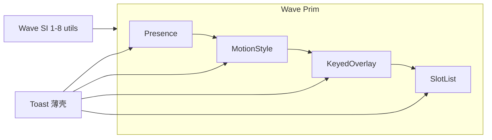

# 组件能力下沉（纠偏后）

## 目标与边界

**真正目标**（见 [`docs/custom_components_suggestions.md`](../custom_components_suggestions.md)）：

> 组件库 = 薄产品壳；**厚逻辑沉成框架原语**。验收：新做一个中等浮层组件能在数百行内完成，且不复制 Toast 的 TLS / hoist / transition 仪式。

**不是目标**：把单一产品组件的私有引擎挪到 `components/internal/` 并称作「下沉」。那只是文件搬家，对自定义组件零杠杆。

| 层 | 放什么 | 例子 |
|----|--------|------|
| `utils/` / 框架面 | ≥2 消费者或文档化原语 | `activate_registry`、`pointer_drag`、**`presence`**、未来 Motion / Overlay |
| `components/internal/` | **多组件**共享 chrome | `text_edit`；`menu/{subtree,item_chrome,checkable}` |
| `components/{toast,carousel}/` | **单组件**策略/算术 | `toast/timer`、`carousel/snap`（产品拆分，非原语） |

**已折回（反假下沉）**：原 WP-SI.9 / SI.10 的 `internal/toast_*`、`internal/carousel_*` → `components/toast/`、`components/carousel/`。

**仍保留的 SI 价值**（多消费者）：SI.1–8。

**硬禁区**（行为契约不变）：Menubar peer、`__subN`、Toast 暂停勿写回 queue、Carousel seamless 拖拽中途不撕环，等。

---

## Wave SI 收口（SI.1–8 ☑；SI.9/10 折回）

见 [`AUTHORITY.md`](../AUTHORITY.md) §5.6b。不再新增「单组件引擎进 internal」包。

---

## Wave Prim — 框架原语（对齐 suggestions）

顺序 = 杠杆从大到小：

### WP-PRIM.1 — Presence / ExitGate ☑（本步）

- **API**：[`utils/presence.rs`](../../crates/rui/src/utils/presence.rs)
  - `PresencePhase` / `ExitGate` / `exit_elapsed` / `exit_elapsed_at`
- **首迁**：Toast `finalize_exits` 用 `exit_elapsed` 判定墙钟
- **不做（本包）**：完整 `presence(show, children)` Element 包装（待 reconcile / portal 同 key 契约对齐）
- **验收**：presence 库测绿；Toast 退场测不回归

### WP-PRIM.2 — MotionStyle ☑（本步）

- **API**：[`utils/motion.rs`](../../crates/rui/src/utils/motion.rs)
  - `MotionTransform` / `MotionStyle` / `ensure_motion_transitions` / `prepare_motion_sync` / `motion_sync_status`
- **首迁**：Toast 卡 `reactive_sync`；Carousel 轨道 offset sync
- **验收**：motion 库测绿；Toast/Carousel 相关测不回归

### WP-PRIM.3 — KeyedOverlay ☑（本步）

- **API**：[`utils/keyed_overlay.rs`](../../crates/rui/src/utils/keyed_overlay.rs)
  - `item_template_id` / `viewport_portal_stage` / `mount_reactive_anchor`
  - `adopt_keyed_overlay`（hoist）/ `preserve_keyed_motion_on_reconcile`（reconcile）
- **首迁**：hoist/reconcile 从 `layout_tree` / `state` 抽出；Toast 宿主 + 卡 `template_id`
- **验收**：keyed_overlay 库测绿；toast hoist/reconcile 测不回归

### WP-PRIM.4 — LayoutGroup / slot_list ☑（本步）

- **API**：[`utils/layout_group.rs`](../../crates/rui/src/utils/layout_group.rs)
  - `SlotListConfig` / `slot_list_pose` / `slot_visual_offset` / `linear_slot_offset` / `LayoutGroup`
- **首迁**：Toast `stack_pose_for_rank` / `stack_lift_visual` / list `base_lift`
- **验收**：layout_group 库测绿；Toast stack/list 测不回归

---

## 明确不做

| 项 | 原因 |
|----|------|
| 再把 toast/carousel 策略抽回 `internal/` | 假下沉；无第二消费者 |
| 公开 notification_queue / Embla carousel | 产品 API，非原语 |
| 第二套 portal | WP-3.4 已收口；PRIM.3 是在其上做一等 API |
| compound_scope 宏 | 手册约定足够 |

---

## 文档勾选

每包合入时同步：

1. [`AUTHORITY.md`](../AUTHORITY.md) Wave Prim 勾选
2. [`headless.md`](../headless.md) / [`custom_components.md`](../custom_components.md) 补原语一行
3. 禁止在 `COMPONENT_LIBRARY_PLAN.md` 改勾充进度
